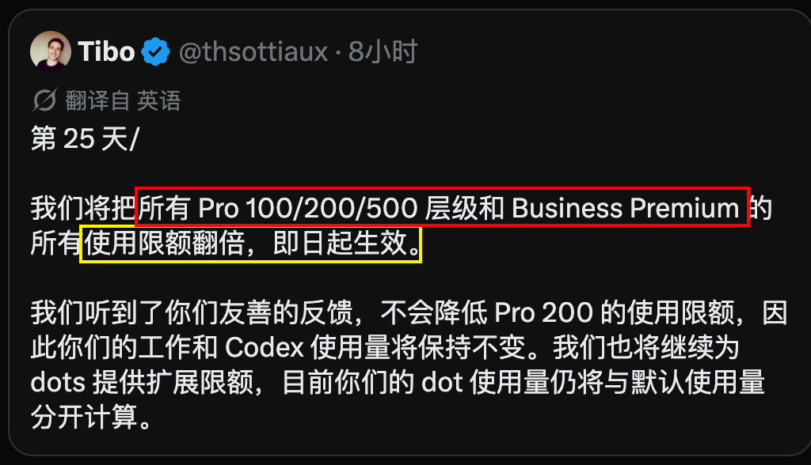
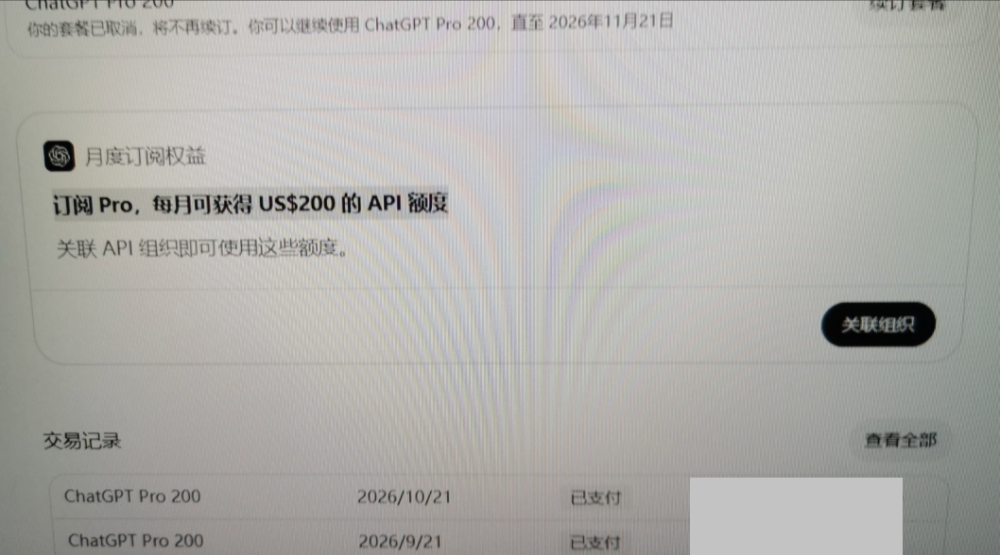

# 11 Pro 额度翻倍+免费API领取说明

2026年10月28日，Codex 在 X 上发了一条。

**Pro $100、$200、$500，以及 Business Premium，Work 和 Codex 额度翻倍，即刻生效。**

原定的降额，取消。

{#screenshot}

按照之前的倍数关系，Pro 各档相对 Plus 的额度大概是：

Plus 1x，Pro 100 是 5x，Pro 200 是 10x，Pro 500 是 25x。

但 OpenAI 之前一直在搞阶段性优惠，Pro 100 实际能到 10x 左右，Pro 200 能到 20x。

9 月底说优惠要结束，Pro 200 老用户从 20x 掉回 10x。

现在呢？

不降了，还翻倍。

调整之后，Pro 100 从 5x 变成 10x，Pro 200 从 10x 变成 20x，Pro 500 从 25x 变成 50x。

老用户本来就在 20x 的，保留。新用户本来要掉到 10x 的，直接拉到 20x。

价格没变，资源翻倍。

## 三档 Pro 怎么比较

原文以 Plus 额度为基准，整理如下：

| 套餐 | 月费（美元） | Codex 额度 | Ultrafast |
| --- | --- | --- | --- |
| Pro 100 | 100 | 10x Plus | 不含 |
| Pro 200 | 200 |   20x Plus  | 不含 |
| Pro 500 | 500 | 50x Plus | 包含 |

倍数按原文整理，实际额度以账号后台显示为准。

套餐功能可查看 [ChatGPT 官方定价页](https://chatgpt.com/pricing/)。

## Fast 和 Ultrafast 怎么消耗额度

相对同一模型的 Standard 模式：

- **Fast**：按 2.5 倍速率消耗套餐额度。
- **Ultrafast**：按 8 倍速率消耗套餐额度。

这里说的是额度消耗，不能理解成对应倍数的运行速度。

Ultrafast 消耗更快，选模式时要留意剩余额度。

::: info 说明
资格窗口和保留政策以 OpenAI 官方帮助中心为依据，额度倍数按原文整理。具体用量以账号后台实际显示为准。
:::

## 领取步骤（官方推荐路径）

1. 确认你的 ChatGPT Pro 付费订阅已生效满 **7 天**，并用订阅账号登录 [ChatGPT](https://chatgpt.com/)。ChatGPT 和 API 平台必须使用同一个邮箱。
2. 打开 [设置 → 账单](https://chatgpt.com/settings/billing)。
3. 找到「API 额度权益」或「月度订阅权益」卡片。图中 Pro 200 显示每月可获得 US$200 的 API 额度。
4. 点击「关联组织」或页面上的领取按钮。

   {#screenshot}

5. 选择你拥有的 API 组织（Organization），核对组织和领取金额后确认。如果刚开始用 API，可以关联自己的个人 API 组织。
6. 打开 [API 平台的账单概览](https://platform.openai.com/settings/organization/billing/overview)，切换到刚关联的组织，查看到账金额和到期时间。
7. 请勿转移、出售或赠送这笔额度。额度只能用于已关联的组织，违规可能导致额度被撤销或账号被暂停、终止。 [OpenAI 服务额度条款](https://openai.com/policies/service-credit-terms/)

首次领取按当前账期剩余时间折算，未用完的额度在账期结束时失效。此权益不适用于通过 API 密钥调用 Codex，也不增加已登录 Codex 的使用额度。 [OpenAI API 额度官方说明](https://developers.openai.com/api/docs/guides/chatgpt-api-credits)
