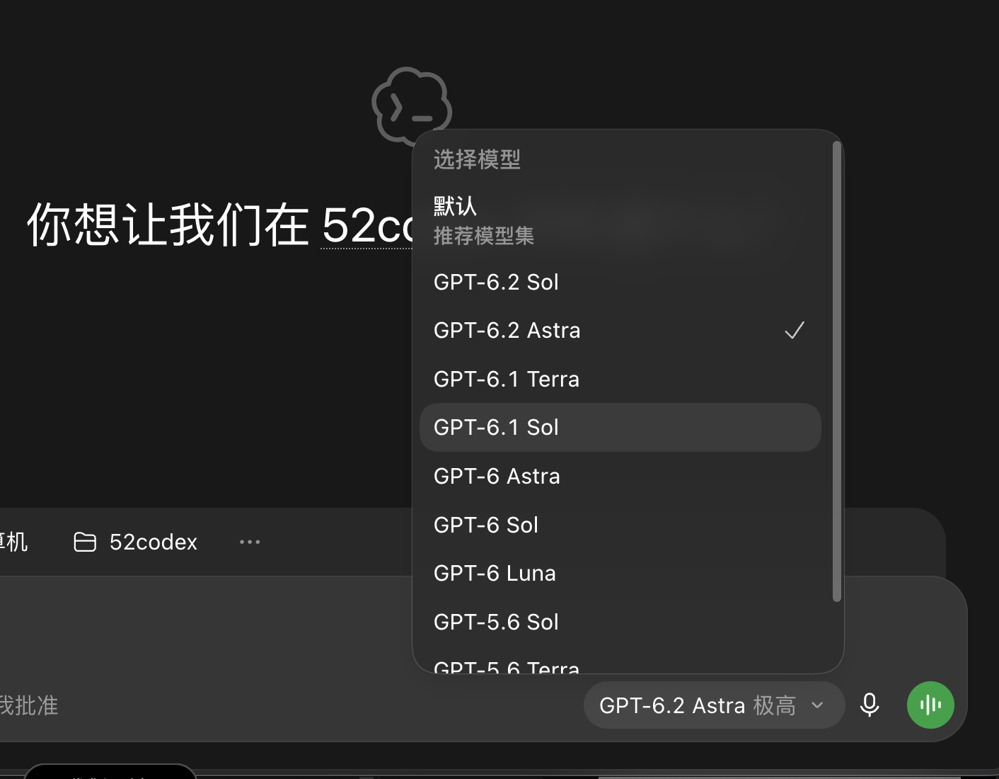
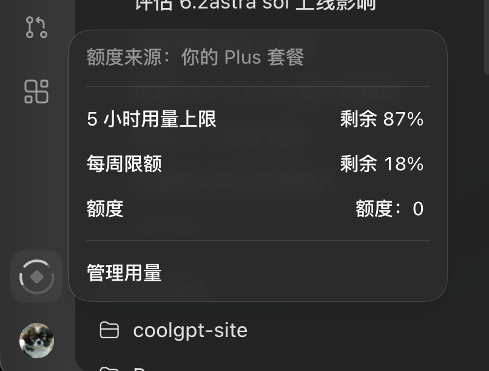
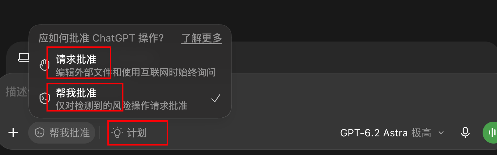
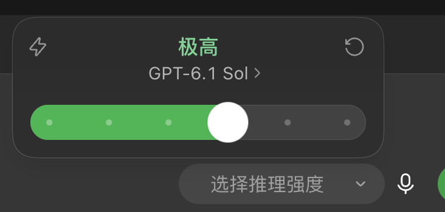
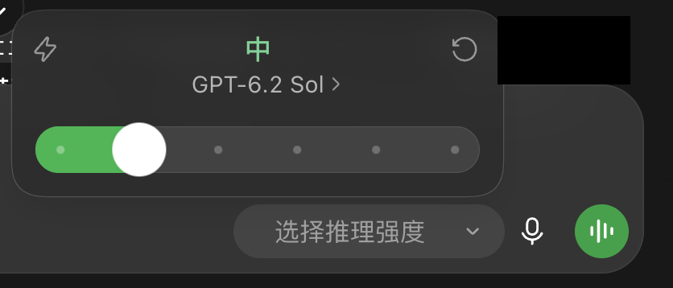

# ChatGPT绿皮书

**CHATGPT · GREEN BOOK**

写给非程序员的 ChatGPT Work、Codex 与 AI 实战使用手册

**作者：清风**

**版本：v1.0 · 2026-11-25**

---

## 使用说明

本书整理自 52codex.site 的读者内容，面向不会编程、刚接触 Codex，以及想把业务经验和想法做成工具的普通用户。

本书为非官方指南，不代表 OpenAI 官方文档或产品承诺。产品更新较快，功能、模型、额度和界面请以实际版本与官方说明为准。

本版收录站内上手指南、实用技巧、精选案例、插件与技能、资源与答疑及附录。

导入飞书后，可将可选封面图插入文档最前方，再按需要设置分页并导出 PDF。

## 前言

这本书不要求你先学会编程。你只需要从一个具体问题或想法开始，学会把需求说清楚，让 Codex 帮你写、改、测，再用项目规则和工作流逐步提高稳定性。

## 首页导读

**从编程神器到全能助手**

### 借助 Codex，构建你想要的一切

技术小白的 Codex 实践站。不用写代码，把脑子里的想法变成能用的工具。

本站内容分为精选案例、上手指南、实用技巧、插件与技能、常见问题和资源答疑。本书按相同路线整理为可连续阅读的章节。

## 目录

- [第一篇｜上手指南](#第一篇上手指南)
  - [新手指南 — 学习路线图](#新手指南-学习路线图)
  - [02 AI编程是什么？](#02-ai编程是什么)
  - [03 Codex 是什么？](#03-codex-是什么)
  - [04 GPT注册与订阅](#04-gpt注册与订阅)
  - [05 Codex 下载安装](#05-codex-下载安装)
  - [06 Codex 界面全览](#06-codex-界面全览)
  - [07 Codex 插件与技能](#07-codex-插件与技能)
  - [08 Codex 项目与对话](#08-codex-项目与对话)
  - [09 Codex 怎么连接手机？](#09-codex-怎么连接手机)
  - [11 Pro 额度翻倍+免费API领取说明](#11-pro-额度翻倍免费api领取说明)
  - [10 项目做完怎么快速发布到公网？](#10-项目做完怎么快速发布到公网)
- [第二篇｜实用技巧](#第二篇实用技巧)
  - [01 技巧总览](#01-技巧总览)
  - [02 如何让 Codex 越用越顺手](#02-如何让-codex-越用越顺手)
  - [03 Codex 如何接入第三方 API](#03-codex-如何接入第三方-api)
  - [04 AGENTS 怎么写？](#04-agents-怎么写)
  - [05 Codex“目标”功能怎么用？](#05-codex目标功能怎么用)
  - [06 Codex 额度怎么省？](#06-codex-额度怎么省)
  - [07 Codex 手机二次验证怎么破？](#07-codex-手机二次验证怎么破)
  - [08 Codex 弹出手机短信验证怎么办？](#08-codex-弹出手机短信验证怎么办)
  - [09 如何让 Codex 不断进化？](#09-如何让-codex-不断进化)
  - [10 如何提升 Codex 的设计美感？](#10-如何提升-codex-的设计美感)
  - [11 Giffgaff 境外卡激活教程](#11-giffgaff-境外卡激活教程)
  - [12 怎么用Codex养龙虾(OpenClaw)？](#12-怎么用codex养龙虾openclaw)
  - [13 怎么在Codex里运行Claude Code](#13-怎么在codex里运行claude-code)
  - [14 Codex 怎么操控电脑](#14-codex-怎么操控电脑)
  - [15 GPT-6.2 提示词怎么写](#15-gpt-62-提示词怎么写)
  - [16 Codex 报错找不到模型怎么办](#16-codex-报错找不到模型怎么办)
  - [17 无需 KYC，手把手教你本地调用 Claude 大模型](#17-无需-kyc手把手教你本地调用-claude-大模型)
- [第三篇｜精选案例](#第三篇精选案例)
  - [精选案例](#精选案例)
  - [01 用 Codex 做武侠网页游戏](#01-用-codex-做武侠网页游戏)
  - [02 写一个武侠版贪吃蛇](#02-写一个武侠版贪吃蛇)
  - [05 用 Codex + HyperFrames 做视频](#05-用-codex-hyperframes-做视频)
  - [03 用 Codex 完善老项目](#03-用-codex-完善老项目)
  - [04 调用 Skill 写 PPT](#04-调用-skill-写-ppt)
  - [即将上线](#即将上线)
  - [06 自动搜集公众号热帖](#06-自动搜集公众号热帖)
  - [07 GPT Codex能够控制电脑了！](#07-gpt-codex能够控制电脑了)
  - [08 调用自动化插件搜索小红书](#08-调用自动化插件搜索小红书)
  - [目标/Goal 模式开发软件项目](#目标goal-模式开发软件项目)
  - [10 编写一个周计划管理系统](#10-编写一个周计划管理系统)
- [第四篇｜插件与技能](#第四篇插件与技能)
  - [插件与技能](#插件与技能)
  - [01 十个Codex项目规范Skills](#01-十个codex项目规范skills)
  - [02 十个内容创作者必用Skill](#02-十个内容创作者必用skill)
  - [03 八个办公生产力Skill](#03-八个办公生产力skill)
  - [04 十一个让效率起飞的官方插件](#04-十一个让效率起飞的官方插件)
  - [视频剪辑插件 HyperFrames（正文见精选案例）](#05-用-codex-hyperframes-做视频)
- [第五篇｜资源与答疑](#第五篇资源与答疑)
  - [资源集锦](#资源集锦)
  - [01 Codex 报错查询](#01-codex-报错查询)
  - [关注与交流](#关注与交流)
  - [常见问题](#常见问题)
- [附录](#附录)
  - [Codex 重置监控](#codex-重置监控)
  - [即将上线](#即将上线-1)

---

# 第一篇｜上手指南

## 新手指南 — 学习路线图

<!-- source: guide/index.md -->

> 摘要：为什么做这个网站，以及从 0 开始学习 Codex 的路线图。

#### 为什么做这个网站？

清风我当过一段时间的 IT 经理，同部门有一位编程高手。

我们一起合作过很多系统——自己开发的、外面买来实施的——各种网站、ITSM、计划管理、合同管理、成本管理、人力资源管理……  自己开发的往往是最好用的，生命周期最长的，当然也是最省钱的。

每次开发新系统，都是我来收集需求、做分析、写功能规划，程序员同事负责数据结构和编码，一起测试，最后我再来做培训，出教材，在公司内部推动上线使用。

后来到了新单位，在各种业务部门横跳，场景更多了，有想法，但没有程序员搭档，很多念头就搁在那了。

直到遇到 Codex。一用之下，惊为天人。

> **真的太好用了。**

> **"Codex 让我的那个程序员搭子又回来了。"**

- 如果你是业务熟手，对自己领域很了解，但不会写代码

- 如果你有一个具体的想法想落地，但过去必须依赖程序员才能实现

- 如果你有某个效率很低的场景，想用信息化或 AI 来改善

**这个网站就是为你做的**。这里记录的，是普通人用 Codex 把脑子里的东西做出来的真实过程。

#### 学习路线图

```
Phase 0  理解概念        什么是AI编程？Codex 是什么角色？
   ↓
Phase 1  环境搭建        注册账号 → 下载安装 → 熟悉界面
   ↓
Phase 2  上手实战        第一次对话 → 做一个网页 → 学会批注
   ↓
Phase 3  工具扩展        插件 → Skill → 自动化 → 定时任务
   ↓
Phase 4  工程化落地      AGENTS.md → DESIGN.md → Goals → 快速发布 → 完整系统
```

#### 按顺序学习

- [02 AI编程是什么？](#02-ai编程是什么)
- [03 Codex 是什么？](#03-codex-是什么)
- [04 GPT注册与订阅](#04-gpt注册与订阅)
- [05 Codex 下载安装](#05-codex-下载安装)
- [06 Codex 界面全览](#06-codex-界面全览)
- [07 Codex 插件与技能](#07-codex-插件与技能)
- [08 Codex 项目与对话](#08-codex-项目与对话)
- [09 Codex 怎么连接手机？](#09-codex-怎么连接手机)
- [11 Pro 额度翻倍+免费API领取说明](#11-pro-额度翻倍免费api领取说明)
- [10 项目做完怎么快速发布到公网？](#10-项目做完怎么快速发布到公网)

> **不用从头看**

> 如果你已经装好了 Codex，直接跳到你需要的章节。每篇都是独立的。

#### 学完之后去哪里

- 想看别人怎么用 → [精选案例](https://www.52codex.site/cases/)
- 想提升效率 → [实用技巧](https://www.52codex.site/tips/01-index)
- 想扩展能力 → [插件与技能](https://www.52codex.site/plugins/)

---

## 02 AI编程是什么？

<!-- source: guide/02-what-is-vibe-coding.md -->

> 摘要：什么是 AI 编程、它和传统编程有什么不同，新手如何快速上手？

### AI编程是什么？不会写代码也能编程？

  Phase 0
  概念
  阅读约 5 分钟

#### 适合谁

如果你完全没有技术背景，可以从这篇开始。

#### 一句话解释

AI 编程，又称之为 Vibe Coding（氛围编程）。主要指人类协调、指挥 AI ，完成程序开发。人类负责定目标、拟规划、提要求，AI 负责代码编写代码。

你甚至能让一个AI做前端界面设计，一个AI写后端程序，再来一个 AI 审代码。

它的核心不是“学会一门编程语言”，而是“学会把需求说清楚”。

你只需要动动嘴，AI会搞定一切

比如，你不需要知道 HTML、CSS、JavaScript 怎么写，只需要能说清楚：

> 我想做一个公司官网，有首页、服务介绍、案例展示、联系方式，整体风格要简洁专业，手机上也能看。

AI 就可以根据你的描述，帮你生成代码、修改页面、运行项目，一步步构建这个网站。

越来越多的软件公司开始使用 codex 开发大型型目。

连大名鼎鼎的 龙虾 openclow，70% 的代码也是 Codex 写的。

不懂编程的技术小白，不写一行代码，就可以开发各种让人眼花缭乱的网站、各种程序工具。

下面这个本地运行 gpt-image2 和 seedance2 的网站（[www.91banana.site](https://www.91banana.site)），就是我用 Codex 半天搞定的。结合第三方APi，4分一张的gpt images，比官网便宜的Seedance2.0 真人版，完全实现了做图、做视频自由。


#### 你能做出什么

对非程序员来说，AI 编程最适合从小项目开始：

- 做一个个人主页或公司介绍网站
- 做一个表格整理工具
- 做一个批量生成图片或 PPT 的流程
- 做一个自动搜集资料、整理日报的助手
- 做一个内部使用的小系统，比如招聘管理、客户管理、库存记录

重点是：你不需要一开始就懂代码，但你需要知道自己想解决什么问题。

#### 一个类比

可以把 AI编程 想象成装修房子。

| 方式 | 你要做什么 | 结果 |
|------|------------|------|
| 传统编程 | 自己学水电、木工、瓦工 | 全部亲手做 |
| 找程序员 | 你写需求，别人开发 | 等别人交付 |
| AI编程 | 你说清楚想要什么，AI 帮你实现 | 边沟通边完成，你负责指挥、检验 |

你需要的不是“怎么砌墙”，而是“知道自己想住什么样的房子”。

这也是很多非程序员能开始用 AI 做项目的原因：门槛从“会不会写代码”，变成了“能不能描述清楚目标”。

你是爱狗人士，你可以对AI说：

> “用HTML+CSS+JS做一个网站，主题‘西高地白梗犬找家’，包含：①萌图轮播 ②狗狗档案（名字/年龄/疫苗）③领养按钮（跳转到表单）④主人微信二维码⑤SEO关键词‘西高地领养成都’

过10分钟，你得到一个网站：


你是投资负责人，投了很多项目，但项目资料太多太杂，你想做一个信息系统，把项目的投融管退资料都管起来，要求比Excle方便，比专业系统轻。于是你对AI说：

> 我想做一个基于web的投资管理系统，用户是投资集团及其总部和下属公司投资部人员。实现对集团下属所有投资项目的投、融、管、退的信息管理。投资项目包括股权投资、直接经营、债权投资。

发出提示的同时，你可以传一份完整的投资制度给AI，再加上一点点设计提示，你就得到这个系统：


看，只要你能说清楚你的需求，AI就可以帮你实现你的想法和目的。说不清楚也没关系，你可以告诉AI，让它一步一步帮你分析。

一句话，你有需求和想法，告诉AI，它都能帮你搞定！这就是AI编程

---

## 03 Codex 是什么？

<!-- source: guide/03-what-is-codex.md -->

> 摘要：面向新手介绍 OpenAI Codex 的定位、和 Claude Code 的区别，以及基本用途。

### Codex 是什么？新手能用它做什么

今天我们来聊聊 AI 编程工具 GPT-Codex，以下简称 Codex。

这篇适合作为 AI 编程的入门手册。如果你刚开始接触 Codex，可以先从这篇了解它到底是什么、能做什么，以及它和 Claude Code 这类工具有什么区别。

#### 适合谁

这篇适合三类人：

- 听过 Codex，但还不知道它和 ChatGPT、Claude Code 有什么区别
- 不会编程，但想用 AI 做网站、工具、自动化流程
- 已经开始用 Codex，想快速理解它除了写代码还能做什么

#### Codex 是什么

Codex 是 OpenAI 于 2025 年 10 月上线的一款 AI 助手。早期它主要定位为 AI 编程工具，现在正在往 AI 全能助手转型。


新版 Codex 正在脱离“代码生成器”的单一定位。目前，Codex 已经上线了本地电脑控制、定时任务等功能。

它的发展方向可以理解为：

- 从辅助写代码，到独立完成项目
- 从解决编程问题，到帮你处理电脑软件问题
- 从等待你下命令，到逐步具备主动探索和执行任务的能力

**Codex 恐怖的用户增长量（截止2026年10月7日）**


官方资源：

- Codex 官网：[https://openai.com/zh-Hans-CN/codex/](https://openai.com/zh-Hans-CN/codex/)
- OpenAI 对 Codex 的介绍：[《人们在工作中如何利用 Codex 协作？》](https://openai.com/codex/for-work/)

#### GPT、Chat、Work 和 Codex 有什么区别

GPT 是 AI 大模型；Chat、Work 和 Codex 都在 ChatGPT 体系中。

- Chat：问答、解释和短文改写。
- Work：整理资料、生成文件和执行多步骤任务。
- Codex：更侧重编程、项目开发和代码维护。

Work 和 Codex 都可使用授权的文件、插件和工具，并且共用额度。

来源：[ChatGPT Work 入门](https://learn.chatgpt.com/docs/get-started-with-work)、[额度说明](https://learn.chatgpt.com/docs/pricing)。

Codex 也支持使用第三方开源AI，小白知道就行了。

#### Codex 和 Claude Code 有什么区别

Codex 和 Claude Code 都是非常优秀的 AI 编程和智能体工具。

下面这张图是一个简单对比，来自aihot：


原因不只是模型能力，也和使用体验有关。原文里提到，OpenAI 对中国用户更友好：额度经常重置，账号使用限制相对少；而 Anthropic 更贵，也更容易遇到封号、KYC 等问题。


不过很多高手会组合使用：

- Claude Code 用来做规划、做前端，因为审美和表达比较好
- Codex 用来执行任务，因为额度多、发挥稳定


#### Codex 能做什么

Codex 不只是写代码。它可以帮你做编程、剪视频、操作电脑、搜索资料，也可以和自动化任务结合起来使用。

##### 1. 编程

Codex 最成熟的功能还是 AI 编程。

在 Codex 里面，我们通过对话调用 GPT 完成编程工作。

下面这个网页版武侠游戏，从网站到配图、配音，都是用 Codex 做的。

点击可玩：[射雕英雄传在线小游戏](http://99game.site/)

> **Prompt**

> 帮我结合射雕英雄传，生成一个基于 Web 的对话式回合制剧情闯关游戏，按照原著进程，整体风格要符合和电视剧审美。


更多编程案例，详见：[什么是 AI 编程](https://www.52codex.site/guide/02-what-is-vibe-coding)

##### 2. 剪视频

Codex 也可以配合视频剪辑插件做视频。

比如，我们想给英伟达制作一个宣传视频。可以先安装视频剪辑插件 HyperFrames 或 Remotion，然后把需求发给 Codex。

> **Prompt**

> 分析整个网站：https://www.nvidia.cn，然后制作一个 15 秒的宣传短视频，要求是中文。整体风格科技、专业，像官方品牌宣传片，融合未来科幻元素与温暖明亮的色彩，展现 NVIDIA 在 AI、游戏、自动驾驶、机器人等领域的领导力，并且配上符合场景的轻快背景音乐。

Codex 会自动制作类似下面的视频：

  [视频文件](https://www.52codex.site/assets/inweida.BBZUagiR.mp4)

##### 3. 操作电脑

Codex 现在可以在后台控制电脑上的应用。

比如输入：

> **Prompt**

> 本机安装 hermes。

Codex 用了 28 分钟完成安装。


我给了它一个 Kimi Code 的 key，Codex 直接帮我配置进去，然后打开了 Web UI 管理界面。


这类场景里，Codex 可以自动检测和修复电脑配置、网络配置，省掉很多重复操作。

##### 4. 搜集公众号热帖

搜索信息时，如果直接用爬虫，容易触发风控。用 OpenClaw 操作电脑，配置又比较复杂，还容易崩。

现在可以用 Codex 来做。

打开 Codex，输入：

> **Prompt**

> 打开微信搜一搜，查找过去 1 天关键字“codex”相关的热帖。

Codex 会自己虚拟一个鼠标，像人一样打开微信、打开搜一搜、输入文字，然后开始搜索。


整个过程会在 Codex 界面里呈现。搜索完成后，Codex 会把结果整理给你看。

如果再结合自动定时，这个功能会非常有用。


#### 常见问题

##### Codex 只是写代码的吗

不是。写代码是 Codex 最成熟的能力，但现在它已经开始扩展到电脑控制、自动化任务、资料搜索、视频生成等场景。

##### 不会编程能不能用 Codex

可以。你不需要一开始就懂代码，但需要把需求说清楚。比如你要做什么、给谁用、完成后长什么样、有哪些限制。

##### Codex 和 Claude Code 应该选哪个

如果你刚开始，可以先用 Codex。它更适合围绕项目持续执行，也适合结合 Computer Use 和 Automations 做自动化任务。

如果你已经熟悉 AI 编程，也可以把 Claude Code 和 Codex 组合使用：一个负责规划和审美，一个负责执行和落地。

#### 相关阅读

- [什么是 AI 编程](https://www.52codex.site/guide/02-what-is-vibe-coding)
- [下载与安装](https://www.52codex.site/guide/05-install)
- [界面全览](https://www.52codex.site/guide/06-interface)
- [上手项目1：新建一个贪吃蛇游戏](https://www.52codex.site/cases/02-snake-game)

---

## 04 GPT注册与订阅

<!-- source: guide/04-register.md -->

> 摘要：手把手讲清楚 ChatGPT 账号注册、Plus 订阅方式

### GPT 注册与订阅：新手怎么开通 ChatGPT Plus

要使用Codex，必须先注册一个ChatGPT账号，然后使用ChatGPT登录Codex

免费版 ChatGPT 可以体验基础对话，也可以试用 Codex，但用量很小，很快会达到额度上限。还容易跳境外手机短信验证。

如果你想稳定使用 Codex，包括桌面 App、Cloud 任务、多 Agent 并行等能力，建议至少准备一个付费套餐。

GPT和Claude 国内充值网站： [https://www.91gpt.com.cn](https://www.91gpt.com.cn)

#### 适合谁

这篇适合三类人：

- 还没有 ChatGPT 账号，想先完成注册
- 已经有免费账号，想升级到 Plus
- 想用 Codex 做项目，但不清楚该选哪个套餐

#### 你需要先知道什么

ChatGPT 和 Codex 都属于 OpenAI 账号体系。你只要注册一个 ChatGPT 账号，就可以在同一个账号下使用相关能力。

官方入口只有一个：

[https://chatgpt.com](https://chatgpt.com)

注意：不要从不明链接登录，也不要把账号密码交给陌生人。

#### GPT 套餐怎么选

套餐价格和权益会随时间变化，最终以 OpenAI 官方页面显示为准。下面是原文整理时的常见套餐对比：

| 套餐               | 月费（美元）    | Codex 可用情况                                                              |
| ---------------- | ---------:| ----------------------------------------------------------------------- |
| Free             | $0        | 可试用，额度很少                                                                |
| Go               | $8        | 可用，适合轻量任务                                                               |
| Plus             | $20       | 完整访问，适合日常开发                                                             |
| Pro 100$         | $100      | Plus 的 10 倍额度（原5x，活动期间10x，下同），适合重度个人开发者或小团队开发。2026年10月30日起，送等额官方API，下同。 |
| Pro 200\$        | $200      | Plus 的 20 倍额度，适合软件公司中等强度开发                                              |
| Pro 500\$        | $500      | Plus 的 50 倍额度，适合软件公司高强度开发                                               |
| Business（原 Team） | 约 $25/人/月 | 团队使用，含管理和协作功能                                                           |
| Enterprise / Edu | 联系销售      | 企业/教育机构使用，含安全和权限管理                                                      |

对大多数个人用户来说，Plus（$20/月）是性价比最高的起点。但是plus有**5小时额度限制**（5小时额度用超了，只有等下一个5小时周期才能使用codex），pro 没有5小时额度限制。

另外说个小常识， Codex的项目文件和项目记忆文件都在本地。你可以在本地同一个项目上 使用多个Plus。相当于给汽车换能量块。

比如，Codex登录的时候会要求验证GPT账号。两个浏览器各登录一个GPT账号。切换的时候，改一下系统的默认浏览器，重新登录下Codex就行了。

如果你只是偶尔体验，Free 或 Go 可以先试试；如果你准备长期用 Codex 做项目，Plus 会更合适；如果你每天高强度开发，再考虑 Pro。

#### 准备工作

注册前，先准备好：

- 一个能正常接收验证码的邮箱
- 能打开 [https://chatgpt.com](https://chatgpt.com) 的网络环境
- 如果要升级 Plus，还需要准备可用的支付方式

邮箱建议优先用 Gmail。其他邮箱也可能可以注册，比如 QQ 邮箱、163 邮箱。

**不建议使用 Outlook、Hotmail邮箱的gpt账号**。 这类邮箱容易因为批量注册账号太多，出现无法注册或后续被系统误判的情况。

#### 操作步骤

##### 1. 注册 ChatGPT 官网账号

打开官网：

[https://chatgpt.com](https://chatgpt.com)

点击页面上的“免费注册”按钮。


进入注册页面后，输入你的邮箱。

系统会给你的邮箱发送一封验证邮件。


取得验证码后，贴回注册页面。

接下来，OpenAI 会让你填写姓名和年龄。姓名可以正常填写，年龄需要填写成年年龄。

完成后，会进入 ChatGPT 界面。


如果注册前或使用过程中弹出手机验证，不要输入国内手机号。可以先更换网络节点，重新打开浏览器再试。

##### 2. 判断自己是不是免费账号

正常登录 ChatGPT：

[https://chatgpt.com](https://chatgpt.com)

看头像附近是否显示 Free 或“免费”标志。


如果你已经是 Plus 状态，续费前要注意：有些充值方式可能不是延长会员时间，而是覆盖当前会员周期，这样不划算。

##### 3. 选择订阅方式

如果你想升级到 Plus，需要支付 $20/月。

常见方式有两类：

- 直接使用官方支持的支付方式
- 使用第三方充值服务

官方支付通常需要海外信用卡或其他可用支付方式。国内双币种 Visa 卡不一定能用。

如果你不想折腾海外支付，可以选择第三方充值服务。但这里要特别注意账号安全。

##### 4. 如果使用第三方充值，注意这些规则

充值平台：

- 智合智 AI：[www.91gpt.com.cn](https://www.91gpt.com.cn)
- 备用域名：[www.99gpt.site](https://www.99gpt.site)

所谓“代充”，就是帮你往自己的 ChatGPT 官网账号充值。

使用这类服务时，建议遵守这几条：

- 不要提交身份证、银行卡等隐私信息
- 不要把 GPT 账号密码发给任何人
- 尽量选择只使用卡密或授权流程的方式
- 充值前确认你的账号当前是否为 Free 状态
- 保存好订单信息，方便售后查询

这类平台支持微信或支付宝付款，适合没有海外支付方式的用户。

#### 国内充值 Plus 的基本流程

下面是原文里的操作流程整理。

##### 第一步：确认 GPT 状态为 Free

先登录 ChatGPT，确认自己是免费账号。

如果当前已经是 Plus，不建议直接叠加充值，避免会员周期被覆盖。

##### 第二步：购买充值卡

打开购卡网站，选择自动代充卡，填写联系方式，确认付款。

充值入口：

- [www.91gpt.com.cn](https://www.91gpt.com.cn)
- [www.99gpt.site](https://www.99gpt.site)

建议复制到电脑浏览器打开。

选择商品时，找类似“ChatGPT Plus 官网会员一个月”的选项。


填好联系方式后，选择微信或支付宝付款。


##### 第三步：复制卡密

付款后，系统会进入订单详情页。

点击“复制”，把卡密复制出来备用。

如果第一次没有复制，也可以点击网站左上方的“订单查询”，输入预留联系方式查询订单。


##### 第四步：进入充值网站

不同渠道的充值网站网址可能不同，具体以产品下单页面显示的充值网址为准。

虽然网址不同，但充值方式大体相似：

1. 先验证你购买的卡密
2. 登录自己的 GPT 账号
3. 获取 token，地址是 `https://chatgpt.com/api/auth/session`
   注意，不要从登录GPT的页面跳转到上面的这个网页，有时候会报错。
   应该新开一个网页，再打开 https://chatgpt.com/api/auth/session
4. 将 token 粘贴到充值网站的充值框
5. 核实账号信息
6. 点击充值

充值完成后，退出 GPT 账号再重新登录，就能看到 Plus 状态更新。

下个月 Plus 到期后，再按同样方式续费即可。

#### 常见问题

##### 免费版能不能用 Codex

可以试用，但限制较大。如果只是体验，可以先用免费版；如果要稳定做项目，建议升级 Plus。

##### Plus 够不够用

对大多数个人用户来说，Plus 是最合适的起点。它比免费版稳定很多，也不用一开始就承担 Pro 的高成本。

##### 不建议用国内手机号验证

如果注册或使用时弹出手机验证，不建议输入国内手机号。可以先更换上网节点，重新打开浏览器再试。

实在绕不开，可以用接码平台：https://hero-sms.com（https://hero-sms.com）

#### 相关阅读

- [什么是 AI 编程](https://www.52codex.site/guide/02-what-is-vibe-coding)
- [Codex 是什么？新手能用它做什么](https://www.52codex.site/guide/03-what-is-codex)
- [下载与安装](https://www.52codex.site/guide/05-install)

---

## 05 Codex 下载安装

<!-- source: guide/05-install.md -->

> 摘要：介绍 Codex 的几种使用方式，说明为什么推荐新手使用官方桌面 App，并手把手完成下载、安装、首次登录和安装后的下一步。

### Codex 下载安装：新手怎么安装 Codex App

这篇讲如何安装 Codex。

Codex 有多种使用方式：可以在 GPT 官网在线调用，可以用 CLI 命令行，也可以通过插件、官方桌面软件、浏览器等方式使用。

对新手来说，最推荐使用官方桌面软件，也就是大家常说的 Codex App。现在Codex App和 ChatGPT 已经合二为一了。

#### 适合谁

这篇适合三类人：

- 已经注册好 ChatGPT 账号，准备开始使用 Codex
- 不想折腾命令行，希望先用桌面 App 上手
- 想知道 Codex 有哪些使用入口，以及哪个入口最适合新手

#### Codex 有哪些使用方式

Codex 常见使用方式包括：

| 使用方式 | 适合谁 | 说明 |
|---|---|---|
| GPT 官网在线调用 | 轻量体验用户 | 可以先体验基础能力，但不适合管理本地项目 |
| CLI 命令行 | 有技术基础的用户 | 更适合开发者，适合脚本、终端和工程化流程 |
| 编辑器插件 | 已经用 VS Code 等编辑器的人 | 可以在写代码时配合使用 |
| 官方桌面 App | 新手和日常用户 | 推荐入口，适合管理项目、对话和本地操作 |
| 浏览器相关能力 | 网页任务用户 | 适合搜索、查看网页、辅助自动化 |

如果你刚开始学习 Codex，建议先从官方桌面 App 开始。它最直观，也最适合跟着本站教程一步步操作。

#### 准备工作

安装前先准备好：

- 一个 ChatGPT 账号
- 能打开 OpenAI 官网的网络环境
- 可用的 Codex 权限或付费套餐

如果你还没有账号，先看：[GPT 注册与订阅](https://www.52codex.site/guide/04-register)。

原文提到，Codex 需要 GPT Plus 及以上付费会员才能稳定使用。免费账号可以试用部分能力，但限制比较大。

#### 操作步骤

##### 1. 打开 Codex 官网

先打开浏览器，访问：

[https://openai.com/codex](https://openai.com/codex)


##### 2. 点击下载

在页面里找到下载入口，点击下载 Codex App。

下载完成后，按照系统提示完成安装。

如果你使用的是 Mac，通常是下载后拖入应用程序或按页面提示安装。

如果你使用的是 Windows，按照安装程序提示下一步即可。

##### 3. 第一次启动 Codex

第一次启动 Codex App 时，它会弹出浏览器，让你登录 ChatGPT。

用你的 GPT 账号登录。

登录成功后，回到 Codex App，就可以进入软件界面。

免费用户大概率会跳出境外手机短信验证，付费升级到plus 95% 会绕开这个限制，5%用短信接码平台解决。

##### 4. 确认是否能正常使用

进入 Codex App 后，可以先做几个检查：

- 是否已经登录到正确的 GPT 账号
- 是否能新建项目或打开对话
- 是否能看到模型、工具或项目相关入口
- 如果提示权限不足，检查当前套餐是否支持 Codex

如果你还没有升级账号，可以回到：[GPT 注册与订阅](https://www.52codex.site/guide/04-register)。

#### 常见问题

##### 新手应该用 Codex App 还是 CLI

建议先用 Codex App。CLI 更适合有命令行基础的人，新手一开始用桌面 App 更容易理解项目、对话、权限和任务执行过程。

##### 免费账号能不能安装 Codex App

可以安装，但能不能稳定使用取决于你的账号权限和额度。免费账号可能只能试用，而且大概率会跳出境外手机短信验证。

##### 安装后为什么还要登录 ChatGPT

Codex 使用 OpenAI 账号体系。桌面 App 需要通过浏览器完成授权登录，确认你是谁，以及你的账号是否有可用权限。

##### 下载入口打不开怎么办

先确认访问的是官方地址：[https://openai.com/codex](https://openai.com/codex)。如果打不开，通常是网络环境问题，可以换浏览器或网络节点再试。

##### 登陆Codex要求验收手机短信

升级到plus，95%可以跳过手机短信验证，详见：[Codex 弹出手机短信验证怎么办？](https://www.52codex.site/guide/../tips/08-sms-verification-platforms)。

##### Codex 使用不稳定

如果遇到故障，可到 [报错查询网站](https://github.com/Avarce/codex-china-guide) — 按报错关键词查找 Codex 问题说明和处理步骤

比如[Codex报错找不到模型怎么办？](https://52codex.site/resources/01-codex-error-lookup)

#### 相关阅读

- [GPT 注册与订阅](https://www.52codex.site/guide/04-register)
- [Codex 是什么？新手能用它做什么](https://www.52codex.site/guide/03-what-is-codex)
- [界面全览](https://www.52codex.site/guide/06-interface)

---

## 06 Codex 界面全览

<!-- source: guide/06-interface.md -->

> 摘要：新手快速认识 Codex 桌面 App 界面，理解对话区、项目区、辅助区、扩展区，以及模型、额度、权限、速度和智能等级这些常用设置。

### Codex 界面全览：对话区、项目区和权限怎么用

安装好 Codex 之后，第一步不是马上让它写代码，而是先认识界面。

这篇把 Codex 界面拆成四个区域：对话区、项目区、辅助区和扩展区。新手先看懂这些入口，后面做项目时就不容易迷路。

#### 适合谁

这篇适合三类人：

- 刚安装 Codex App，不知道每个区域是干什么的
- 想理解模型、额度、权限、速度这些设置
- 准备跟着后面的实战教程做第一个项目

#### Codex 界面分成哪几块

我把 Codex 界面分为四个区域：

- 对话区：输入任务、选择模型、调整智能等级和速度
- 项目区：管理当前项目、文件夹和上下文
- 辅助区：查看过程、状态、提示和任务结果
- 扩展区：调用插件、Skill、Computer Use 等扩展能力


新手最常用的是对话区和项目区。你可以先把 Codex 理解成“围绕一个项目文件夹工作的 AI 助手”，而不是普通聊天窗口。

#### 对话区能做什么

对话区是你和 Codex 沟通的主入口。

在这里，你可以：

- 输入任务
- 选择模型
- 设置智能水平
- 设置运行速度
- 选择权限模式



这些选项会直接影响 Codex 的能力、速度和额度消耗。

#### 什么是额度

所谓额度，就是 Codex 的使用限额。

它会按一定周期计算，比如 5 小时或按周计算。你在周期内能用多少，取决于你的套餐和当前任务消耗。

额度用超后，通常有两个选择：

- 休息一下，等额度重置
- 升级到更高套餐，比如 Pro

Chat 是普通对话入口；ChatGPT Work 与 Codex 共用额度。Work 不提供另一份独立额度。

Plus 有5小时额度，Pro用户不受5小时额度限制。



#### 额度使用小诀窍

为了不浪费额度，可以按时间段安排任务：

- 早上 7、8 点先和 Codex 说一句，启动一个额度周期
- 到中午 12 点左右，差不多是一个使用时段
- 下午 1 点到晚上 6 点，可以作为第二个时段
- 晚上再安排一个时段

#### 模型和推理水平怎么选

模型不是越强越好，应该按任务选择：

| 模型          | 适合任务                                           |
| ------------- | -------------------------------------------------- |
| GPT-6.2 Sol   | 日常编码、写作和多步骤任务，**普通任务优先选它**   |
| GPT-6.2 Astra | 跨多个文件或系统的复杂项目，需要深入分析和完整验证 |
| GPT-6.1 Terra | 理解截图、图表，或操作浏览器和桌面应用             |
| GPT-6 Luna    | 目标明确的小修改、提取、分类和批量重复任务         |

普通任务可以先用 GPT-6.2 Sol 和中等推理强度。只有遇到复杂项目、跨系统排查或多个原因需要比较时，再切换到 Astra 或提高推理强度。

来源：[OpenAI 模型选择指南](https://developers.openai.com/api/docs/guides/model-selection)。

#### 权限选项怎么选

Codex 的权限决定它能不能动你的文件、运行命令、操作电脑。

常见权限模式可以这样理解：



| 权限模式 | 适合场景                 | 说明                                             |
| -------- | ------------------------ | ------------------------------------------------ |
| 计划模式 | 只想听方案               | 只说不动手，除非你明确要求执行                   |
| 请求模式 | 日常项目修改             | 在沙盒环境中运行，比较稳妥                       |
| 帮我批准 | 需要边做边判断权限       | Codex 会根据任务判断是否需要新增权限             |
| 完全权限 | 明确要操作本机文件或软件 | 可以访问和操作电脑上的文件，使用前要确认任务边界 |

新手建议先用计划模式或请求模式。等你清楚 Codex 要做什么，再考虑更高权限。

#### 速度选项怎么选

速度选项一般分为标准速度和快速模式。

Fast 快速模式会加快生成速度，也会更快消耗额度。

GPT-6.2 Astra 和 GPT-6.2 Sol 使用 Fast 时，订阅内额度和购买点数都按标准模式的 2 倍消耗。其他模型的倍数可能不同，以当前官方说明为准。

来源：[OpenAI 速度模式说明](https://learn.chatgpt.com/docs/agent-configuration/speed)。


建议：

- 普通写文章、改小文件，用标准速度
- 明确的小任务、赶时间时，再用快速模式
- 大项目不要一上来就开高速，容易又快又贵

#### 智能等级（推理强度）怎么选

智能等级包括轻、中、高、极高、Max 和 Ultra。可选项取决于模型、套餐和设置。



大致可以这样选：

| 智能等级  | 适合任务                       | 额度消耗               |
| --------- | ------------------------------ | ---------------------- |
| 轻        | 简单修改、格式调整、查找内容   | 较低                   |
| 中        | 常规教程、页面调整、小功能     | 中等                   |
| 高        | 多文件修改、复杂排查、项目规划 | 较高                   |
| 极高、max | 复杂系统设计、长任务、困难问题 | 最高                   |
| Ultra     | 可拆分给多个子代理的大任务     | 随任务和子代理用量变化 |

提高推理水平通常会增加耗时和消耗。普通任务用中等或高就够了。

Ultra 会使用子代理分工处理复杂任务。它是推理与协作选项，Ultrafast 则是速度模式。

来源：[OpenAI 模型说明](https://learn.chatgpt.com/docs/models)。

#### 常见问题

##### 一开始应该选什么设置

建议新手先用：

- 权限：计划模式或默认模式
- 速度：标准
- 智能：中或高

等你确认 Codex 理解任务后，再让它执行。

##### 完全权限安全吗

完全权限不是不能用，但要谨慎。它适合你明确知道要操作哪些文件、安装哪些软件、执行哪些命令的场景。

如果只是让 Codex 分析问题、写方案，不需要完全权限。

##### 为什么智能等级越高越慢

因为 Codex 会花更多时间思考、规划和检查。复杂任务值得开高一点，简单任务就没必要。

#### 相关阅读

- [Codex 下载安装：新手怎么安装 Codex App](https://www.52codex.site/guide/05-install)
- [项目与对话](https://www.52codex.site/guide/08-projects-and-chats)
- [上手项目1：新建一个贪吃蛇游戏](https://www.52codex.site/cases/02-snake-game)

---

## 07 Codex 插件与技能

<!-- source: guide/07-skills-and-plugins.md -->

> 摘要：解释 Codex 里插件和 Skill 的区别，带新手认识插件区、技能列表和创建技能入口，帮助你判断什么时候用现成插件，什么时候把重复流程做成自己的 Skill。

### Codex 插件与技能：插件区怎么用

现在 Codex 把技能和插件放到了同一个栏目里，统一叫“插件”。

新手一开始看到这里可能会有点混：插件是什么？Skill 又是什么？什么时候用别人做好的插件，什么时候自己创建技能？

这篇先把概念讲清楚。

#### 适合谁

这篇适合三类人：

- 刚看到 Codex 插件区，不知道里面每个入口是做什么的
- 想理解插件和 Skill 的区别
- 想把自己经常重复做的任务封装成一个固定能力

#### 插件和技能有什么区别

我的理解是：

插件更像第三方专业公司或工具方做好的接口。它通常连接一个成熟服务，比如浏览器、设计工具、视频工具、办公工具、自动化工具。

Skill 更像针对一个小场景的固定技能。你可以把自己经常用的一套流程、规则、提示词或操作方式整理成 Skill，放到 Codex 里反复调用。

可以简单这样区分：

| 类型 | 更像什么 | 适合做什么 |
|---|---|---|
| 插件 | 外部工具接口 | 连接浏览器、视频工具、办公平台、自动化服务 |
| Skill | 可复用工作方法 | 固定写作流程、PPT 生成流程、图片处理流程、项目检查清单 |

所以，插件解决的是“Codex 能不能调用某个外部能力”；Skill 解决的是“我能不能把一套固定做法反复复用”。

#### 插件区在哪里

Codex 现在把技能和插件放在同一个插件区里。


在这里，你可以看到已经可用的插件、技能，以及一些创建或管理入口。

#### 技能是什么

技能，也就是 Skill，可以理解为给 Codex 增加的一套固定工作方法。

比如你经常让 Codex 做这些事：

- 把传统 Markdown 改写成本站文章格式
- 根据一段原文生成 PPT
- 检查一篇教程有没有缺少 frontmatter
- 按固定模板整理小红书搜索结果
- 生成符合你项目规范的页面

这些都可以做成 Skill。


Skill 的好处是：你不用每次都把同一套要求重新说一遍。Codex 看到 Skill 后，会按那套规则工作。

#### 什么时候用插件

如果任务需要连接外部工具，优先考虑插件。

比如：

- 让 Codex 控制浏览器
- 调用 Computer Use 操作桌面应用
- 使用视频生成或剪辑工具
- 连接 Figma、Canva、Gmail、GitHub 等服务
- 做定时任务或自动化

这类能力不是单靠一段提示词就能稳定完成的，需要插件提供外部接口。

#### 什么时候用 Skill

如果任务不是连接外部工具，而是“固定流程”，就适合做成 Skill。

比如：

- 你经常用同一个格式整理文章
- 你经常用同一套标准检查网站页面
- 你经常让 Codex 按同一个结构写教程
- 你有一套固定的 Prompt 模板
- 你希望 Codex 记住某个项目的交付规范

这时 Skill 比普通提示词更省事。

#### 怎么创建技能

在插件区里可以找到创建技能的入口。


创建 Skill 时，建议先写清楚四件事：

1. 这个 Skill 用来解决什么问题
2. 输入通常是什么
3. 输出应该长什么样
4. 有哪些禁止事项或固定规则

比如，你可以做一个“52codex 文章整理”Skill，专门把传统 Markdown 改成本项目可用的 VitePress Markdown。

> **Prompt**

> 创建一个 Skill，用于把传统 Markdown 文档整理成 52codex.site 可直接使用的 VitePress 文章。
>
> 要求：
> 1. 自动补齐 frontmatter
> 2. 标题要适合新手搜索
> 3. Prompt 内容改成项目的 Prompt 容器
> 4. 不使用 mdnice 语法
> 5. 不编造原文没有的信息
> 6. 图片和外链保留 Markdown 写法

#### 常见问题

##### 插件和 Skill 哪个更重要

都重要，但解决的问题不一样。

插件扩展 Codex 能连接的外部工具；Skill 固化你自己的工作方法。

新手可以先用现成插件，等重复任务变多后，再开始做自己的 Skill。

##### Skill 是不是高级功能

不一定。Skill 本质上就是把一套固定要求保存下来。只要你发现自己反复复制同一段提示词，就可以考虑做成 Skill。

##### 插件越多越好吗

不是。插件越多，选择也越多，反而容易乱。

建议按任务需要安装和启用：做浏览器任务就用浏览器相关插件，做视频就用视频插件，写文章就用文章整理 Skill。

#### 相关阅读

- [Codex 界面全览：对话区、项目区和权限怎么用](https://www.52codex.site/guide/06-interface)
- [调用 Skill 写 PPT](https://www.52codex.site/cases/04-skill-ppt)
- [调用自动化插件搜索小红书](https://www.52codex.site/cases/08-auto-xiaohongshu)

---

## 08 Codex 项目与对话

<!-- source: guide/08-projects-and-chats.md -->

> 摘要：讲清楚 Codex 里的项目、线程和项目记忆分别是什么，什么时候新建项目，什么时候新开线程，以及删除项目后本地文件是否还在。

### 08 Codex 项目与对话：新手怎么管理项目和线程

刚开始用 Codex 时，很多人会把“项目”和“对话”混在一起。

项目和对话，是非常容易被人忽视，但绝对是用好codex的重要概念。

#### 适合谁

这篇适合刚装好 Codex，但还不太清楚这些问题的新手：

- 新建项目时为什么要选择电脑上的文件夹
- 一个项目和一条对话有什么区别
- 同一个项目下为什么可以有多个线程
- 项目记忆在哪里打开
- 删除项目后，本地文件会不会一起消失

#### 项目和对话有什么区别

Codex 的对话分两层：

| 层级 | 可以怎么理解 | 适合放什么 |
|---|---|---|
| 项目 | 一个独立的工作空间 | 一个网站、一个工具、一个软件项目 |
| 对话 | 项目下面的一次对话 | 修一个问题、加一个功能、整理一篇文章 |

简单说：**一个项目下面，可以有多个线程。**

比如你在做一个名叫 `banana` 的项目，可以开三个线程：

- 重构项目
- 增加视频模型功能
- 增加 seedance2 模型

它们都属于同一个项目，但每条线程只负责一件相对独立的事。

#### 新建项目时为什么要选择文件夹

你每新建一个 Codex 项目，系统都会要求你选择电脑上的一个文件夹。

这个文件夹就是项目的本地工作区。以后所有与这个项目相关的文件、代码、图片、文档，通常都会放到这个文件夹里。


新手可以按这个原则选择文件夹：

- 一个网站，单独建一个文件夹
- 一个工具，单独建一个文件夹
- 一个自动化流程，单独建一个文件夹
- 不要把多个无关项目混在同一个文件夹里

这样做的好处是，Codex 能更容易理解当前项目的范围，也不容易误改无关文件。

#### 什么时候新建项目，什么时候新开线程

判断方法很简单：

**如果你要做的是一个新的东西，就新建项目。**

比如：

- 做一个公司官网
- 做一个数据整理工具
- 做一个小游戏
- 做一个自动生成 PPT 的流程

**如果你还在同一个项目里，只是要做一件新任务，就新开线程。**

比如：

- 修改首页样式
- 增加一个按钮
- 修复一个报错
- 整理一篇新文章


这样做有一个好处：每条线程都比较干净，不会把太多无关信息塞进同一次对话里。

比如，我要给系统加一个留言功能，我可以开一个对话，专门讨论留言。在项目结束前，所有与留言有关的开发我都放在这个对话中。

#### 项目记忆是什么

项目记忆可以让同一个项目下的不同线程共享一些背景信息。

比如你在一个项目里反复告诉 Codex：

- 这个网站叫 52codex
- 读者是不会编程的新手
- 文章要写得清楚、实用、教程化
- 图片要放到文章同目录的 assets 文件夹

如果打开了记忆，Codex 后面在同项目的新线程里，就更容易沿用这些规则。

设置路径是：

```text
设置 -> 个性化 -> 记忆
```


#### 怎么让 Codex 更懂这个项目

项目记忆有帮助，但更稳定的方式是把项目规则写进文件。

如果是软件项目，建议准备一个 `AGENTS.md` 文件，用来告诉 Codex：

- 项目是做什么的
- 要遵守什么规范
- 哪些文件可以改，哪些文件不要动
- 构建命令是什么
- 文章、图片、代码分别放在哪里
- 输出风格有什么要求

这样 Codex 每次进入项目时，都能先读规则，再动手做事。

这个文件，可以让ai帮你写，首选claude，次选gpt，gemini，国产中推荐deepseek

> **Prompt**

> 请先阅读当前项目的 AGENTS.md，理解这个项目的目录结构、文章规范、禁止事项和构建方式。
>
> 接下来只在本次任务相关文件里修改，不要重命名或删除其他文章文件。完成后运行构建命令，并告诉我是否通过。

#### 项目删除后，本地文件还在吗

在 Codex 里删除一个项目，并不等于把你电脑里的项目文件夹也删掉。

也就是说：

- Codex 里的项目入口会被移除，但搜索按钮能够搜索到
- 本地文件通常仍然保存在你的电脑上
- 后面仍然可以通过 Codex 的搜索找到相关文件
- 如果你想彻底删除文件，需要在电脑文件管理器里删除对应文件夹

所以，新手不用太害怕点错删除项目。真正重要的是：你要知道项目文件夹放在哪里。

#### 常见问题

##### 一个项目可以同时开多少个对话（线程）

可以开多条。建议一条线程只做一个相对明确的任务，比如“修改导航栏”“整理第 8 篇文章”“修复构建报错”。

##### 每次都在同一个对话里聊可以吗

可以，但不建议一直这样做。任何AI在一条对话的长度是有限的，对话太长以后，历史信息会变多，Codex 更容易被旧任务干扰。

更好的方式是：一个阶段完成后，新任务开新线程。

##### 项目文件夹选错了怎么办

如果还没做什么内容，可以直接新建一个项目，选择正确文件夹。

如果已经做了很多内容，先确认文件都在哪里，再决定是否迁移。不要随手删除本地文件夹。

#### 下一步推荐阅读

- [Codex 界面全览：对话区、项目区和权限怎么用](https://www.52codex.site/guide/06-interface)
- [AGENTS.md 怎么写？让 Codex 按你的规则做事](https://www.52codex.site/tips/04-agents-md)
- [上手项目1：新建一个贪吃蛇游戏](https://www.52codex.site/cases/02-snake-game)

---

## 09 Codex 怎么连接手机？

<!-- source: guide/09-codex-mobile.md -->

> 摘要：Codex 手机远程连接，是让手机连接正在运行 Codex 的电脑。

手机远程，是把正在运行 Codex 的电脑连到手机上。

电脑跑任务、读文件；你出门后用手机看进度、审批操作。

#### 操作步骤

##### 1. 电脑端先准备好

打开 ChatGPT 桌面版，进入 Codex，启动一个任务。电脑不能睡眠，网络要正常，Codex 要保持运行。

项目文件、终端、插件和权限都留在电脑上，手机只是远程查看和管理，所以电脑需要保持在线。

##### 2. 在电脑端开启远程

进入「设置 → 连接」，点击「添加」，按提示生成二维码，见图 1。

手机和主机需要一对一配对，登录同一账号后，也要完成配对才能接管。


##### 3. 手机上扫码连接

更新 ChatGPT App，用和电脑相同的账号登录，打开「Codex」或「远程」页面，扫描电脑上的二维码，按提示完成连接。

看不到任务时，先检查手机和桌面 App 是否更新、账号是否一致、电脑是否在线。

##### 4. 手机上能做什么？

可以看任务进度、终端输出、文件改动和测试结果；也能回复问题、补充需求、调整方向、审批操作。

它卡在两个方案之间时，你可以在手机上告诉它怎么继续。

##### 5. 安全边界要记住

手机远程适合读资料、写文案、排查报错、整理项目和生成代码。

涉及私钥、助记词、钱包授权、转账和大额交易，回到电脑上自己逐步确认。

如果连接还有问题：可以交给Codex让它搞定，提问

> 为什么我的Codex没办法通过手机连接？


#### 使用感受

电脑在家继续跑项目、做研究、改代码，你在外面也能跟进。

对做 Web3 和自媒体的人，这能减少守在电脑前的时间。

连接入口参考：[OpenAI 远程连接说明](https://learn.chatgpt.com/docs/remote-connections)。

---

## 11 Pro 额度翻倍+免费API领取说明

<!-- source: guide/11-pro-api-credits.md -->

> 摘要：了解 ChatGPT Pro 各档的 Codex 额度和快速模式的消耗差异。付费订阅满 7 天后，按步骤从 ChatGPT 账单页关联同邮箱下的 API 组织，领取随订阅附赠的 API 额度，并到 API 平台查看到账金额和有效期。

2026年10月28日，Codex 在 X 上发了一条。

**Pro $100、$200、$500，以及 Business Premium，Work 和 Codex 额度翻倍，即刻生效。**

原定的降额，取消。


按照之前的倍数关系，Pro 各档相对 Plus 的额度大概是：

Plus 1x，Pro 100 是 5x，Pro 200 是 10x，Pro 500 是 25x。

但 OpenAI 之前一直在搞阶段性优惠，Pro 100 实际能到 10x 左右，Pro 200 能到 20x。

9 月底说优惠要结束，Pro 200 老用户从 20x 掉回 10x。

现在呢？

不降了，还翻倍。

调整之后，Pro 100 从 5x 变成 10x，Pro 200 从 10x 变成 20x，Pro 500 从 25x 变成 50x。

老用户本来就在 20x 的，保留。新用户本来要掉到 10x 的，直接拉到 20x。

价格没变，资源翻倍。

#### 三档 Pro 怎么比较

原文以 Plus 额度为基准，整理如下：

| 套餐 | 月费（美元） | Codex 额度 | Ultrafast |
| --- | --- | --- | --- |
| Pro 100 | 100 | 10x Plus | 不含 |
| Pro 200 | 200 | 20x Plus | GPT-6.2 Sol |
| Pro 500 | 500 | 50x Plus | GPT-6.2 Astra 和 GPT-6.2 Sol |

倍数按原文整理，实际额度以账号后台显示为准。

套餐功能可查看 [ChatGPT 官方定价页](https://chatgpt.com/pricing/)。

#### Fast 和 Ultrafast 怎么消耗额度

相对同一模型的 Standard 模式，GPT-6.2 Astra 和 GPT-6.2 Sol 当前的消耗倍数是：

| 速度 | 订阅内额度 | 购买点数 |
|---|---|---|
| Fast | 2 倍 | 2 倍 |
| Ultrafast | 6 倍 | 2027 年 2 月 28 日前为 3 倍，之后为 6 倍 |

这里说的是额度消耗，不能理解成对应倍数的运行速度。

GPT-6 Astra、GPT-6.1 Sol 等旧模型的倍数不同。Ultrafast 消耗更快，选模式时要留意剩余额度，并以官方定价页和账号内显示为准。

来源：[OpenAI ChatGPT Work 和 Codex 定价说明](https://learn.chatgpt.com/docs/pricing)。

> **说明**

> 资格窗口和保留政策以 OpenAI 官方帮助中心为依据，额度倍数按原文整理。具体用量以账号后台实际显示为准。

#### 领取步骤（官方推荐路径）

1. 确认你的 ChatGPT Pro 付费订阅已生效满 **7 天**（过期变为free了，再充值要重新计时），并用订阅账号登录 [ChatGPT](https://chatgpt.com/)。ChatGPT 和 API 平台必须使用同一个邮箱。
2. 打开 [设置 → 账单](https://chatgpt.com/settings/billing)。
3. 找到「API 额度权益」或「月度订阅权益」卡片。图中 Pro 200 显示每月可获得 US$200 的 API 额度。
4. 点击「关联组织」或页面上的领取按钮。

   

5. 选择你拥有的 API 组织（Organization），核对组织和领取金额后确认。如果刚开始用 API，可以关联自己的个人 API 组织。
6. 打开 [API 平台的账单概览](https://platform.openai.com/settings/organization/billing/overview)，切换到刚关联的组织，查看到账金额和到期时间。
7. 请勿转移、出售或赠送这笔额度。额度只能用于已关联的组织，违规可能导致额度被撤销或账号被暂停、终止。 [OpenAI 服务额度条款](https://openai.com/policies/service-credit-terms/)

首次领取按当前账期剩余时间折算，未用完的额度在账期结束时失效。此权益那是给你用来做项目开发的。不适用于通过 API 密钥调用 Codex，也不增加已登录 Codex 的使用额度。 [OpenAI API 额度官方说明]
(https://developers.openai.com/api/docs/guides/chatgpt-api-credits)

#### 有效期

**提醒 ChatGPT Pro 用户：赠送的 API 额度，不用就过期！**

OpenAI 给 Pro 用户赠送的 API 额度，并不是永久有效，也不能累计到下个月。

**注意以下三点：**

1. **按订阅周期清零**：不是按自然月，而是按 Pro 订阅账单周期计算。
2. **中途领取按比例发放**：首次领取时，赠送金额可能根据当前账单周期剩余时间折算。
3. **过期不结转**：本期没用完的额度，到期自动失效，下个周期重新发放。

**举个例子：**

假设你的 Pro 订阅每月 10 日到期，但你直到 5 日才领取赠送的 API 额度。

那么，这笔额度可能只剩 **5 天有效期**，到 10 日就会失效，而不是从领取当天开始计算 30 天。

**特别提醒：**

刚领取额度的 Pro 用户，建议立即查看额度的实际到期时间，避免白白浪费。

查询地址：https://platform.openai.com/settings/organization/billing/credit-grants

*以上针对 Pro 订阅赠送的 API 额度，不适用于自行充值购买的 API 额度。具体金额与有效期以账户显示为准。*

---

## 10 项目做完怎么快速发布到公网？

<!-- source: guide/16-publish-project.md -->

> 摘要：用 Pinme 把 Codex 做好的静态网页、小游戏或前端项目快速发布到公网。适合 HTML、Tailwind、JS、Next 静态导出目录，以及构建后的 dist 或 public 目录。

### 16 Codex 项目做完后怎么快速发布到公网

做完项目以后，最好发出来给别人试用。

如果只是本地能打开，别人看不到，也很难帮你体验和反馈。

#### 准备工作

本文用到的工具是 Pinme。

简单说，Pinme 是一个静态网页发布工具。它可以把前端静态站点快速发布到公网。

只要你有一个静态站点，就可以尝试：

- 普通 HTML / Tailwind / JS 项目
- Next 导出的静态目录
- 任意构建后的 `dist` 或 `public` 目录

#### 操作步骤

##### 第 1 步：安装 Pinme

先打开命令行。

Windows 可以按 `Win + R`，输入 `CMD`。

Mac 可以搜索“终端”。

Windows 输入：

```bash
npm install -g pinme
```

Mac 输入：

```bash
sudo npm install -g pinme
```

一般十几秒就能装好。

##### 第 2 步：打开 Pinme 网页

打开这个网址：

```text
https://pinme.eth.limo
```

页面需要登录，可以用手机、Google 或 GitHub 账号登录。


##### 第 3 步：上传做好的网页游戏

Pinme 可以上传单个网页，也可以上传整个目录。

如果你做的是网页游戏，通常把整个项目目录拖到网页里上传。

从本机拖动文件夹到页面上，然后松开。


上传过程中会显示进度。


##### 第 4 步：获取公网域名

上传完成后，Pinme 会分配一个二级域名。


点击这个域名，就可以打开刚才做好的游戏。

[https://b357e7f5.pinme.dev](https://b357e7f5.pinme.dev)

也可以扫描二维码，用手机打开同一个网页。


手机访问效果如下。


#### 常见问题

##### 上传哪个文件夹？

上传能直接访问网页入口的目录。

如果是普通网页项目，通常需要有 `index.html`。

如果是前端项目，通常上传构建后的 `dist` 或 `public` 目录。

##### 为什么别人打开后看不到页面？

优先检查入口文件是不是 `index.html`。

还要确认图片、CSS、JS 路径没有指向本机绝对路径。

可以让 Codex 先帮你检查：

> **Prompt**

> 请检查这个静态网页项目是否适合发布到公网。确认入口文件、图片、CSS、JS 路径是否正确，并指出需要修改的地方。

##### 能不能绑定自己的域名？

可以。

懂技术的话，可以申请自己的域名，再转发到 Pinme 分配的网址。

这一步涉及域名和转发设置，感兴趣可以单独研究。

---

# 第二篇｜实用技巧

## 01 技巧总览

<!-- source: tips/01-index.md -->

> 摘要：汇总 Codex 使用中的高频问题和实用技巧，覆盖项目规则、AGENTS.md、额度节省、插件配置、登录验证和设计美感提升。

Codex 使用经验库。解决你最常遇到的问题，来自真实使用中的总结。

有个网友23olp说得很对：

> **Codex最佳实践**

> 不要把 codex 当成一个只会自动生成代码的工具，而要把它当成一个坐在你旁边、很会用终端的程序员同事来协作；你要给它项目规则，比如写进 AGENTS.md，让它知道怎么跑测试、代码结构是什么、团队风格是什么；开始写代码前，先让它搜索代码库、分析问题、提出方案，而不是直接开干；执行过程中要管好权限、控制上下文、让它小步修改、勤跑测试、勤提交，发现方向不对就用 Esc 及时打断；如果需要更多能力，就给它装 CLI 工具、接 MCP，甚至同时开多个 codex 分工合作。生活化地说，codex 就像一个特别勤快但需要你指挥的装修师傅：你不能只说“把房子弄好”，最好先给他户型图、装修规范、预算边界，让他先看现场、列方案、分步骤施工，每做完一部分就验收；这样它不是替你“瞎干活”，而是在你的把控下高效完成复杂工程

#### 全部技巧

- [02 如何让 Codex 越用越顺手](#02-如何让-codex-越用越顺手)
- [03 Codex 如何接入第三方 API](#03-codex-如何接入第三方-api)
- [04 AGENTS 怎么写？](#04-agents-怎么写)
- [05 Codex“目标”功能怎么用？](#05-codex目标功能怎么用)
- [06 Codex 额度怎么省？](#06-codex-额度怎么省)
- [07 Codex 手机二次验证怎么破？](#07-codex-手机二次验证怎么破)
- [08 Codex 弹出手机短信验证怎么办？](#08-codex-弹出手机短信验证怎么办)
- [09 如何让 Codex 不断进化？](#09-如何让-codex-不断进化)
- [10 如何提升 Codex 的设计美感？](#10-如何提升-codex-的设计美感)
- [11 Giffgaff 境外卡激活教程](#11-giffgaff-境外卡激活教程)
- [12 怎么用Codex养龙虾(OpenClaw)？](#12-怎么用codex养龙虾openclaw)
- [13 怎么在Codex里运行Claude Code](#13-怎么在codex里运行claude-code)
- [14 Codex 怎么操控电脑](#14-codex-怎么操控电脑)
- [15 GPT-6.2 提示词怎么写](#15-gpt-62-提示词怎么写)
- [16 Codex 报错找不到模型怎么办](#16-codex-报错找不到模型怎么办)
- [17 无需 KYC，手把手教你本地调用 Claude 大模型](#17-无需-kyc手把手教你本地调用-claude-大模型)

---

## 02 如何让 Codex 越用越顺手

<!-- source: tips/02-make-codex-better.md -->

> 摘要：使用 Codex 一段时间后，如果你总要重复说明偏好和边界，可以通过 AGENTS.md 与 Memories 建立长期记忆系统，让 Codex 更稳定地理解你的习惯、项目规则和执行边界。

### 如何让 Codex 更懂你？用 AGENTS.md 和 Memories 建立长期记忆

使用 Codex App 一段时间后，你可能会遇到类似困扰：

- 每次新开对话，都要重复叮嘱它一些基础偏好
- 一不小心，它就执行了超出预期的系统命令
- 明明上次已经说过的规则，下次又要重新解释
- 同一个项目里，Codex 总是忘记你的目录结构和工作习惯

这些高频痛点的本质，是你的 Codex 还没有稳定的长期记忆。

想减少无效的重复沟通，就需要给它搭建一套记忆系统。最基础、也最实用的做法，是同时用好两类能力：

- AGENTS.md：提前写好的规则说明
- Memories：Codex 主动沉淀的记忆功能

> **说明**

> 本文根据原作者 @Saccc_c 发布的内容整理改写，核心观点保持原文方向，主要做了站内教程化结构整理。

#### 适合谁

这篇文章适合：

- 刚开始用 Codex，但每次都要重复解释偏好的人
- 已经在用 Codex 做项目，希望它更守规矩的人
- 担心 Codex 乱执行命令、乱改文件的人
- 想让 Codex 记住长期习惯、项目背景和操作边界的人

如果你只是偶尔让 Codex 回答一个小问题，不一定需要马上配置完整记忆系统。

但只要你开始长期使用 Codex 做项目，AGENTS.md 和 Memories 就很值得尽早配置。

#### 这篇文章解决什么问题

看完你会知道：

- AGENTS.md 是什么
- 全局 AGENTS.md 和项目 AGENTS.md 分别放什么
- AGENTS.md 为什么要分层
- 如何让规则从真实错误中迭代出来
- Memories 功能怎么开启、怎么查看
- 为什么记忆系统不是一次写完，而是持续进化

#### 一、AGENTS.md 是什么

AGENTS.md 是你提前写好的规则说明。Codex 每次启动或进入项目时，都会读取相关规则。

如果没有 AGENTS.md，Codex 每次开始工作都像一张白纸：

- 不知道你的工作习惯
- 不知道项目背景
- 不清楚哪些文件不能动
- 不知道执行命令的边界
- 不知道完成任务前要检查什么

一旦配置好这些规则，相关上下文就能长期生效。你不需要在每个新对话里反复说明同一个问题。

可以简单理解为：

```text
AGENTS.md = 写给 Codex 看的长期工作说明书
```

它不是越长越好，而是越具体、越可执行越好。

#### 二、AGENTS.md 怎么配置

AGENTS.md 通常可以分成两层：全局层和项目层。

##### 1. 全局层

全局层通常放在本地电脑的：

```text
~/.codex/AGENTS.md
```

它会对你的所有项目生效，适合写通用个人偏好和基础行为规则。

在 Codex App 里，它也对应个性化设置中的自定义指令部分。

全局层适合写这些内容：

- 默认使用什么语言回复
- 修改文件前是否需要先说明计划
- 是否允许自动执行高风险命令
- 是否允许新增依赖
- 最终回复需要包含哪些信息
- 遇到不确定问题时怎么处理

你可以先从一个很简单的模板开始。

> **Prompt**

> 请默认使用中文回复。修改文件前先说明影响范围。不要执行删除、重置、覆盖类高风险命令，除非我明确要求。完成任务后请说明修改了什么、如何验证、还有哪些风险。

这类规则不需要一开始就写得很完整。先把最核心的偏好固定下来，后面再按实际使用情况补充。

##### 2. 项目层

项目层 AGENTS.md 放在具体项目目录中，主要根据项目主题和特性来定制。

一份好的项目层 AGENTS.md，通常应该包含：

- 项目背景与结构：项目是什么，重要目录在哪里
- 执行方式：如何启动、构建、测试或发布
- 规范与约束：需要遵守哪些标准，明确不能做什么
- 完成标准：如何判断一项任务已经完成

例如：

```markdown
# AGENTS.md

## 项目背景

这是一个 VitePress 项目，用于整理 Codex 新手教程和实战案例。

## 常用命令

- 本地开发：`npm run dev`
- 构建检查：`npm run build`

## 内容规则

- 新文章必须包含 title、description、tags、level、date
- 不要擅自修改已有文章的核心内容
- 不要新增顶级目录
- Prompt 使用 `::: tip Prompt`

## 完成标准

- Markdown 格式正确
- 相关链接可访问
- 构建命令通过
```

项目层规则越贴近项目真实情况，Codex 越容易按你的预期工作。

#### 三、AGENTS.md 的最佳实践

配置基础 AGENTS.md 只是第一步。真正决定记忆系统上限的，是后续怎么维护。

##### 1. 规则分层，职责清晰

Codex 读取 AGENTS.md 时，会遵循就近原则：

```text
子目录规则 > 项目根目录规则 > 全局规则
```

也就是说，当前工作目录越近的规则，优先级越高。

这意味着项目层规则可以覆盖全局层的同类设置。如果把所有规则都混在一起写，高优先级的局部规则就可能影响全局逻辑。

更合理的做法是分清职责：

- 全局层：只放语言偏好、安全边界、基础行为习惯
- 项目层：只放当前项目特有的构建命令、内容规范、代码约定、模块说明

这样二者各自负责自己的范围，合并时也不容易冲突。

##### 2. 从基础开始，按需迭代

AGENTS.md 不需要一次写完。

更自然的方式是：先写最核心的规则，然后在 Codex 反复犯同一个错误时，把这条经验补进去。

比如 Codex 又犯了上次同样的问题，你可以直接对它说：

> **Prompt**

> 你刚才犯了和上次一样的错误。请总结原因，并将相关经验补充到 AGENTS.md 中。

这样规则始终来自真实的使用摩擦，而不是凭空想象。

AGENTS.md 也会随着你的使用不断进化，逐渐变成真正适合你的工作规则库。

##### 3. 保持精简，复杂内容单独拆分

随着使用深入，AGENTS.md 的内容可能会越来越多。

这时不要把所有内容都堆在一个文件里。更好的方式是：把特定主题拆成独立文件，再在 AGENTS.md 中引用。

例如，可以把项目架构说明单独写成：

```text
ARCHITECTURE.md
```

然后在 AGENTS.md 里写一行：

> **Prompt**

> 关于本项目的核心架构与目录规范，请参见当前目录下的 ARCHITECTURE.md 文件。

这样 AGENTS.md 保持简洁，Codex 需要更详细背景时，也知道去哪里读。

#### 四、Memories 功能

除了手动配置 AGENTS.md，Codex 也支持主动记忆功能。

你可以在 Codex App 中进入：

```text
设置 -> 个性化 -> 记忆
```

开启后，Codex 会把对话中的有效信息、关键偏好和长期上下文总结到记忆中。

如果想查看 Codex 都记住了什么，可以打开本地的 memory 文件查看。

常见位置是：

```text
~/.codex/memory
```

或类似的 memories 目录。

> **说明**

> 不同版本的 Codex App 中，记忆文件路径和界面名称可能会有差异。如果你找不到对应文件，可以先在设置里确认 Memories 是否已经开启。

Memories 更适合沉淀这类内容：

- 你的长期偏好
- 常用表达习惯
- 项目之间可复用的经验
- 多次对话中反复出现的关键背景
- Codex 曾经总结过的工作方式

AGENTS.md 更像你主动写下的规则，Memories 更像 Codex 从长期使用中沉淀出的补充记忆。

两者配合起来，Codex 才更容易真正理解你的意图。

#### 五、推荐使用方式

如果你刚开始配置，可以按这个顺序来：

1. 先写全局 AGENTS.md，只放通用偏好和安全边界。
2. 每个重要项目都放一份项目 AGENTS.md，写清项目规则。
3. 开启 Memories，让 Codex 沉淀长期使用习惯。
4. 当 Codex 重复犯错时，让它复盘并补充规则。
5. 当 AGENTS.md 变长时，把复杂内容拆到独立文件。

不要追求一次配置完美。

记忆系统真正有价值的地方，是它会跟着你的实际使用不断变好。

#### 常见问题

##### AGENTS.md 和 Memories 有什么区别？

AGENTS.md 是你主动写给 Codex 的规则文件，适合放明确要求。

Memories 是 Codex 根据对话沉淀出来的长期信息，适合补充你的偏好和长期背景。

简单说：

- AGENTS.md 更像规则
- Memories 更像长期记忆

##### 只开 Memories，不写 AGENTS.md 可以吗？

不建议。

Memories 适合沉淀偏好，但项目规则、禁止事项、构建命令、完成标准，最好还是明确写进 AGENTS.md。

尤其是涉及文件修改、命令执行、发布构建这类任务时，AGENTS.md 更稳定。

##### AGENTS.md 应该写多长？

写关键规则，不要堆空话。

好的规则应该具体、可执行。例如：

```markdown
不要新增 npm 依赖，除非先说明原因并获得确认。
```

比下面这种更有效：

```markdown
请保持项目质量。
```

##### 什么时候需要更新 AGENTS.md？

当 Codex 出现重复问题时，就应该更新。

比如：

- 总是忘记跑构建
- 总是改无关文件
- 总是新增不必要依赖
- 总是忽略某个目录规则
- 总是漏掉移动端检查

每遇到一次可复用的问题，就把它沉淀成一条具体规则。

#### 下一步

你可以先做两件事：

1. 在 Codex App 设置里开启 Memories。
2. 给常用项目准备一份 AGENTS.md。

刚开始不用写太复杂。先把语言偏好、安全边界、项目结构、构建命令和完成标准写清楚。

后面每次遇到重复问题，再让 Codex 帮你把经验补进去。

构建记忆系统本来就是一个持续进化的过程。只要你不断完善行动规则、沉淀有效记忆，Codex 就会逐渐变成更懂你、也更顺手的生产力工具。

---

## 03 Codex 如何接入第三方 API

<!-- source: tips/03-codex-third-party-api.md -->

> 摘要：用 Codex++ 给 Codex 接入国产模型、中转站 GPT 或 Claude，按步骤完成下载安装、Mac 安全设置、添加供应商、测试连通和切回官方模型。

### Codex 如何接入第三方 API？手把手配置国产和中转模型

Codex 很适合让懂业务、有想法的人，把脑子里的工具做出来。

但很多新手会卡在两个问题上：

1. 没法稳定登录 GPT 官网，能不能用国内模型？
2. Plus 额度不够用，能不能用中转站里的 GPT 或 Claude？

直接手动改配置文件也能做，但对新手不友好。`config.toml` 写错一个字母就可能不生效，有些方案还会影响插件功能。

这篇讲一个更顺手的方案：用 Codex++ 做图形化配置，把第三方 API 接进 Codex。

#### 适合谁

- 没法稳定登录 GPT 官网的人
- Plus 额度不够，想接中转或国内模型的人
- 不想手写配置文件的人
- 想尽量保留插件功能的人
- 能自己准备 API Key 的人

#### 先说清楚风险

Codex++ 是第三方开源项目，不是 OpenAI 官方产品。接入国内模型或中转站，也会涉及第三方 API Key、模型兼容性和服务稳定性。

建议你注意三件事：

- 不要把重要账号密码发给不可信服务
- API Key 只填到你信任的工具和供应商里
- 如果项目涉及公司代码、客户数据或敏感资料，先确认公司安全要求

这篇只讲配置流程，不替任何第三方供应商背书。

#### 准备工作

你需要先准备好：

- 已安装 Codex 桌面软件
- 一个可用的第三方 API Key
- 对应供应商的 Base URL
- Mac 或 Windows 电脑

Codex 官方下载入口：

[https://chatgpt.com/zh-Hans-CN/codex/get-started/](https://chatgpt.com/zh-Hans-CN/codex/get-started/)

如果你还没注册账号，可以先看：

- [GPT 注册与订阅](https://www.52codex.site/guide/04-register)
- [Codex 下载安装](https://www.52codex.site/guide/05-install)

#### 第 1 步：安装 Codex++

Codex++ 是 BigPizzaV3 开发的开源项目，定位是 Codex App 的外部增强工具。

项目地址：

[https://github.com/BigPizzaV3/CodexPlusPlus](https://github.com/BigPizzaV3/CodexPlusPlus)


进入 GitHub 项目后，打开 Releases 下载页面。


选择版本时按这个规则：

| 系统 | 怎么选 |
|---|---|
| Windows | 下载 `.exe` 文件 |
| Mac，M1/M2/M3/M4 | 下载 `arm64.dmg` 文件 |
| Mac，Intel 老款 | 下载 `x64.dmg` 文件 |

如果你不确定自己的 Mac 是什么芯片，可以点左上角苹果菜单，进入“关于本机”查看。


Mac 用户下载 `.dmg` 后，双击打开，把里面两个 App 都拖进“应用程序”文件夹：

- Codex++
- Codex++ 管理工具

安装后，先打开“Codex++ 管理工具”。

#### 第 2 步：解决 Mac 安全提示

Windows 用户可以跳过这一节。

Codex++ 是开源小众工具，如果没有经过苹果公证，Mac 第一次打开时可能会提示“无法验证开发者”。


##### 方法 1：从系统设置里仍要打开

首次打开弹出安全提示后，进入：

```text
系统设置 -> 隐私与安全性 -> 仍要打开
```


##### 方法 2：用命令移除隔离标记

如果方法 1 不生效，可以打开 Mac 终端，运行：

```bash
sudo xattr -rd com.apple.quarantine "/Applications/Codex++.app"
sudo xattr -rd com.apple.quarantine "/Applications/Codex++ 管理工具.app"
```

##### 方法 3：让 Codex 帮你安装

如果你已经能使用 Codex，也可以把 GitHub 地址发给 Codex，让它帮你下载安装到“应用程序”里。

> **Prompt**

> 安装 Codex++，项目地址是 BigPizzaV3/CodexPlusPlus。
>
> 请根据我的电脑系统下载合适版本，安装到应用程序目录，并帮我处理 Mac 安全提示。


装好后，在 Mac 的“应用程序”中可以看到两个新图标：

- Codex++ 管理工具：各种增强功能的管理面板
- Codex++：增强后的 Codex 启动入口


进入“Codex++ 管理工具”，如果页面上都是绿色状态，说明基础环境正常。

先关闭原生 Codex，再从管理工具里启动 Codex++。


#### 第 3 步：添加模型供应商

在 Codex++ 管理工具里，点击“添加供应商”。


在供应商页面，填写你的 Base URL 和 API Key。

注意：接入方式选择“纯 API”。


可以按下面这样填：

| 字段 | 填什么 |
|---|---|
| 供应商名称 | 自己能看懂就行，比如 DeepSeek、OpenRouter、ApiMart |
| 接入方式 | 选择“纯 API” |
| API Key | 你的第三方供应商 Key |
| Base URL | 供应商给你的 API 地址 |

常见 Base URL 示例：

```text
DeepSeek 官网：https://api.deepseek.com
OpenRouter：https://openrouter.ai/api/v1
ApiMart：https://api.apimart.ai/v1
```

不同供应商的格式不完全一样，常见形式是：

```text
https://api.xxx.com
https://api.xxx.com/v1
```

如果测试不通，优先检查 Base URL 有没有多写、少写 `/v1`。

#### 第 4 步：测试连通

回到首页，点击“测试”按钮。

显示成功，就说明 API Key 和 Base URL 基本可用。


如果失败，先检查这几项：

- API Key 是否复制完整
- Base URL 是否正确
- 供应商账号是否还有余额
- 当前网络是否能访问这个供应商
- 上游服务是否支持 Codex++ 需要的接口

#### 第 5 步：从 Codex++ 启动 Codex

配置好供应商后，不要从原版 Codex 图标启动。

回到“Codex++ 管理工具”，点击启动按钮。


如果你已经打开了原生 Codex，建议先完全退出，再从 Codex++ 管理工具启动。

#### 第 6 步：验证模型是否生效

打开 Codex 后，点击模型下拉菜单。

如果配置成功，你应该能看到自定义模型供应商或对应模型。


发一条消息测试，能正常回复，就说明接入成功。


#### 想切回官方模型怎么办

模型配置里默认会有官方模型，接入模式是“官方登录”。


在模型设置界面点击“使用”，状态变为“使用中”后，重启 Codex。

前提是：你本来就有可用的官方 Plus 或更高套餐。


官方模型和第三方模型可以来回切换，互不影响。

#### 常见踩坑

##### 管理工具打不开

如果是 Mac，先按第 2 步处理安全提示。

##### 测试连通失败

重点检查 Base URL 和 API Key。

很多错误都出在 Base URL 上：有的供应商要 `/v1`，有的供应商不要。

##### 模型列表没有变化

先确认你是不是从 Codex++ 管理工具启动的 Codex。

切换配置后，也可以等几分钟，或者完全退出 Codex 再重新打开。

##### 插件用不了

检查接入方式是不是选了“纯 API”。

如果你手动改过配置文件，也建议先还原，再用管理工具重新配置。

##### 国产模型无响应

确认上游服务是否支持 Codex++ 当前需要的接口。

有些模型能聊天，但不一定完整兼容 Codex 的工作流。

##### 还需要稳定网络吗

通常还是需要。否则 Codex 可能无法连接，或者访问第三方供应商失败。

#### 可复制检查清单

> **Prompt**

> 我正在用 Codex++ 给 Codex 接入第三方 API。
>
> 请帮我检查以下内容：
> 1. Codex++ 是否安装到了正确位置
> 2. Mac 安全提示是否已经处理
> 3. 供应商的接入方式是否是“纯 API”
> 4. Base URL 格式是否正确
> 5. API Key 是否填写到了正确位置
> 6. 是否从 Codex++ 管理工具启动了 Codex
>
> 如果发现问题，请按风险从高到低列出来，并告诉我下一步怎么改。

#### 下一步推荐阅读

- [Codex 下载安装](https://www.52codex.site/guide/05-install)
- [Codex 插件与技能：插件区怎么用](https://www.52codex.site/guide/07-skills-and-plugins)
- [额度怎么省](https://www.52codex.site/tips/06-save-quota)

---

## 04 AGENTS 怎么写？

<!-- source: tips/04-agents-md.md -->

> 摘要：AGENTS.md 是 Codex 项目中的核心规则文件。本文介绍如何用 /init 生成初始文件，并维护项目说明、常用命令、工作规则和完成标准。

### AGENTS.md 怎么写？让 Codex 按你的项目规则做事

AGENTS.md 是 Codex 的项目工作规则文件。

Codex 开始工作前会读取 AGENTS.md，用它理解项目背景、常用命令、测试方式、代码规范和完成标准。维护好 AGENTS.md，可以让 Codex 每次都按同一套规则执行任务，减少重复解释和重复犯错。

#### 适合谁

这篇文章适合：

- 已经开始用 Codex 修改项目的人
- 希望 Codex 少犯重复错误的人
- 团队里多人协作使用 Codex 的项目负责人
- 想让 Codex 遵守固定构建、测试和 review 流程的人

#### 这篇文章解决什么问题

很多人刚开始用 Codex 时，只会在聊天框里反复提醒：

- 不要乱改无关文件
- 不要随便加依赖
- 改完记得测试
- 先告诉我你准备怎么改

这些提醒如果每次都手动说，很容易漏。AGENTS.md 的作用，就是把这些项目规则固定下来，让 Codex 每次进入项目时都能先读到。

> **说明**

> AGENTS.md 不是给读者看的说明书，而是给 Codex 看的项目工作约定。它越具体，Codex 越容易执行；它越空泛，实际帮助越小。

#### 先运行 /init

在 Codex 项目中，先运行：

```text
/init
```

`/init` 可以快速生成初始 AGENTS.md。

但自动生成的文件只是起点。你应该继续手动编辑，让它符合项目真实的构建、测试、review 和发布流程。

#### 推荐写法

可以把 AGENTS.md 写成下面这样：

```markdown
# AGENTS.md

## 项目说明

这是一个 Next.js + TypeScript 项目，用于 xxx。

## 常用命令

- 安装依赖：`npm install`
- 本地启动：`npm run dev`
- 类型检查：`npm run typecheck`
- Lint：`npm run lint`
- 测试：`npm test`
- 构建：`npm run build`

## 工作规则

- 修改前必须先说明影响范围和计划
- 默认最小改动
- 不要无理由新增依赖
- 不要重写无关模块
- 改业务逻辑必须补测试
- 改 UI 必须检查 loading、empty、error、mobile 状态
- 完成后必须说明测试结果和潜在风险

## 完成标准

- 相关测试通过
- lint、typecheck、build 通过
- 行为符合验收标准
- diff 可 review
```

示例中的 `xxx` 需要替换为你的真实项目说明。

#### 每一部分怎么写

##### 项目说明

项目说明要让 Codex 快速理解这个项目是什么。

建议写清楚：

- 项目技术栈
- 项目用途
- 主要业务目标
- 是否有不能随便改的模块

示例：

```markdown
## 项目说明

这是一个 Next.js + TypeScript 项目，用于管理课程内容和用户订单。
前端使用 App Router，样式使用 Tailwind CSS。
默认不要进行大范围重构。
```

##### 常用命令

常用命令不要让 Codex 猜，直接写清楚。

```markdown
## 常用命令

- 安装依赖：`npm install`
- 本地启动：`npm run dev`
- 类型检查：`npm run typecheck`
- Lint：`npm run lint`
- 测试：`npm test`
- 构建：`npm run build`
```

如果项目没有测试命令，可以写：

```markdown
- 测试：当前项目暂未配置测试命令
```

##### 工作规则

工作规则是 AGENTS.md 最重要的部分。

建议写成明确、可执行的限制：

```markdown
## 工作规则

- 修改前必须先说明影响范围和计划
- 默认最小改动
- 不要无理由新增依赖
- 不要修改无关文件
- 改业务逻辑必须补测试
- 完成后必须说明测试结果和潜在风险
```

##### 完成标准

完成标准用来告诉 Codex：任务做到什么程度才算结束。

```markdown
## 完成标准

- 相关测试通过
- lint、typecheck、build 通过
- 行为符合验收标准
- diff 可 review
```

#### 高级技巧：把 Codex 犯过的错写进去

维护 AGENTS.md 的核心方法很简单：

Codex 每犯一次重复错误，就把对应规则补进 AGENTS.md。

如果它经常乱加依赖，就加：

> **Prompt**

> 禁止新增依赖，除非先说明原因、替代方案和体积影响，并获得确认。

如果它经常大范围重构，就加：

> **Prompt**

> 默认只修改与当前任务直接相关的文件。除非明确要求，不要进行架构重构、目录重组或无关代码清理。

如果它经常改完不测试，就加：

> **Prompt**

> 完成任务前必须运行相关检查命令。如果无法运行测试、lint、typecheck 或 build，必须说明原因，并列出未验证的风险。

> **说明**

> 这类内容虽然是写进 AGENTS.md 的规则，但它们很短、可直接复制，所以适合继续用 `::: tip Prompt`。如果是一整段很长的背景解释、完整规范或多段示例，就不要放进 Prompt 框，改用代码块、说明框或折叠内容。

#### 可以继续补哪些规则

AGENTS.md 不需要一次写完。你可以先写最常用的规则，再根据 Codex 的实际表现慢慢补。

常见可补充规则包括：

- 哪些目录不要动
- 哪些文件改动前必须先确认
- 是否允许新增依赖
- 是否必须保持移动端兼容
- 修改 UI 后要检查哪些状态
- 完成任务前要运行哪些命令
- 最终回复需要说明哪些内容

如果规则很多，可以按主题分组：

```markdown
## 依赖规则

- 不要新增依赖，除非先获得确认
- 优先使用项目已有工具和组件

## UI 规则

- 改 UI 必须检查桌面端和移动端
- 必须处理 loading、empty、error 状态

## 验证规则

- 完成前运行相关测试
- 如果无法验证，必须说明原因和风险
```

#### 常见问题

##### AGENTS.md 是不是越长越好？

不是。

AGENTS.md 要写关键规则，不要堆空话。

比如：

```markdown
不要无理由新增依赖
```

比下面这种更有用：

```markdown
请保持代码质量
```

因为前者具体，Codex 更容易执行。

##### AGENTS.md 需要一次写完吗？

不需要。

它应该持续维护。每次 Codex 出现可复用的问题，就把规则补进去。

##### 不会编程也需要写 AGENTS.md 吗？

需要。

不会编程的人更应该维护 AGENTS.md，因为它可以减少你反复解释需求的成本。

你可以先写清楚：

- 这个项目是做什么的
- Codex 不要做什么
- 修改前要先说明什么
- 完成后要检查什么

#### 下一步

你可以先在自己的项目里运行 `/init`，生成初始 AGENTS.md。

然后把这几类内容补进去：

- 项目说明
- 常用命令
- 工作规则
- 完成标准

后面使用 Codex 时，只要发现它反复犯同一种错误，就把这条规则写进 AGENTS.md。

---

## 05 Codex“目标”功能怎么用？

<!-- source: tips/05-goals.md -->

> 摘要：当一个任务不是一次对话就能完成时，可以用 /goal 给 Codex 设置目标。本文用简单例子讲清什么时候用、怎么写停止条件，以及如何避免目标太大太模糊。

### Codex 的 /goal 怎么用？让它做完长任务

平时让 Codex 做小事，直接说一句就够了。

比如：

- 改一个按钮文案
- 修一个链接
- 写一段说明
- 给文章加一个标题

但有些任务不是一两轮能做完的。

比如：

- 修完所有报错
- 做完一个页面
- 把一批文章改成统一格式
- 给项目补一套基础测试
- 把一个旧功能整理得更清楚

这种任务中间要读文件、改代码、跑构建、再检查。你如果只说“帮我做完”，Codex 很容易做到一半就停，或者不知道什么时候才算完成。

这时可以用 `/goal`。在 Codex App 里，它也可以理解成“目标”。

#### 适合谁

这篇适合：

- 经常让 Codex 做长任务的人
- 不想一直手动催“继续”的人
- 不知道怎么告诉 Codex “做到什么算完成”的人
- 想让 Codex 自己按步骤推进、检查和总结的人

如果只是一个很小的修改，不需要用 `/goal`。

#### /goal 是什么

普通 Prompt 是让 Codex 做一件事。

`/goal` 是给 Codex 一个更长的目标，让它围绕这个目标持续推进。

重点不是把话写得很长，而是写清楚两件事：

1. 要完成什么。
2. 满足什么条件才可以停止。

第二点最重要。

OpenAI 官方文档也强调，`/goal` 适合围绕可验证的停止条件持续工作。

#### 在哪里用

如果你在 Codex App 里，可以在对话框里选择“目标”，然后输入你的目标说明。


如果你在 Codex CLI 里，可以直接输入：

```text
/goal 你的目标
```

#### 什么时候该用

适合用 `/goal` 的任务，一般有三个特点：

| 特点 | 例子 |
|---|---|
| 任务比较长 | 做完一个页面、修完一批报错 |
| 可以检查结果 | 构建成功、测试通过、页面能打开 |
| 有明确结束条件 | 所有文章都改完、所有链接都更新 |

不适合用 `/goal` 的任务：

- “帮我优化项目”
- “把网站做得更好”
- “随便看看有什么问题”

这些都太模糊。Codex 不知道该做到哪里停。

#### 停止条件怎么写

停止条件就是告诉 Codex：

做到什么，才算完成。

不要这样写：

```text
/goal 把这个网站优化好。
```

这句话太空。

可以这样写：

> **Prompt**

> /goal 完成首页实用技巧模块的整理。
>
> 只有满足以下条件才停止：
> 1. 首页能看到所有技巧文章入口
> 2. 每个入口都能点开
> 3. 移动端不出现文字溢出
> 4. npm run build 成功
> 5. 最后写一段修改总结

这就更清楚。

因为每一条都能检查。

#### 一个简单例子

假设你想让 Codex 帮你做完一个“关于我们”页面。

不要只说：

```text
/goal 帮我做一个关于我们页面。
```

更好的写法是：

> **Prompt**

> /goal 完成一个“关于我们”页面。
>
> 只有满足以下条件才停止：
> 1. 页面地址是 /about
> 2. 页面包含品牌介绍、适合谁、联系方式三个部分
> 3. 样式和现有网站保持一致
> 4. 导航里能进入这个页面
> 5. npm run build 成功
> 6. 最后告诉我改了哪些文件
>
> 如果需要新增图片、改导航结构或引入新依赖，先问我。

这个例子很普通，但很好用。

它告诉 Codex：

- 做什么页面
- 页面里有什么内容
- 怎么验证
- 什么情况要先问你

#### 再给两个常用模板

##### 修完所有报错

> **Prompt**

> /goal 修完当前项目的构建报错。
>
> 只有满足以下条件才停止：
> 1. npm run build 成功
> 2. 不删除现有页面
> 3. 不引入新依赖
> 4. 最后说明报错原因和修复方式
>
> 请先运行构建，找到第一个关键错误，再一步步修。

##### 整理一批文章

> **Prompt**

> /goal 把 tips 目录下的文章入口整理好。
>
> 只有满足以下条件才停止：
> 1. 文件名编号和导航编号一致
> 2. tips/01-index.md 里的链接全部正确
> 3. 首页实用技巧模块链接全部正确
> 4. npm run build 成功
> 5. 最后列出新增或修改的文章
>
> 不要改文章正文内容，除非链接需要同步。

#### 怎么写才不容易翻车

记住 4 个小原则：

1. 一个 `/goal` 只做一个主任务。
2. 停止条件写 3 到 6 条就够了。
3. 每条停止条件都要能检查。
4. 遇到产品决策、删文件、加依赖，要让 Codex 先问你。

比如这句就太大：

```text
/goal 把整个项目做完。
```

可以拆成：

```text
/goal 完成首页改版。
```

然后下一个目标再写：

```text
/goal 完成文章详情页样式整理。
```

小目标更稳，也更省额度。

#### CLI 常用命令

如果你用的是 Codex CLI，常见命令是：

```text
/goal <目标>
```

查看当前目标：

```text
/goal
```

暂停：

```text
/goal pause
```

恢复：

```text
/goal resume
```

清除：

```text
/goal clear
```

如果你看不到 `/goal`，可以尝试开启 goals 功能：

```bash
codex features enable goals
```

#### 可复制检查清单

> **Prompt**

> 请帮我检查这个 /goal 是否写得清楚。
>
> 重点检查：
> 1. 目标是不是只有一个
> 2. 停止条件能不能验证
> 3. 有没有写清楚不能做什么
> 4. 有没有写清楚什么时候要先问我
>
> 如果不够清楚，请帮我改成更简单、更适合 Codex 执行的版本。

#### 常见问题

##### /goal 会自动把所有事情都做完吗？

不会。

它只是让 Codex 更围绕目标持续工作。目标写得越清楚，效果越好。

##### 停止条件要写很多吗？

不用。

3 到 6 条通常就够了。写太多反而会乱。

##### 什么情况不要用 /goal？

小修改不要用。

比如改一个标题、补一个链接、调整一句文案，直接说就行。

#### 下一步推荐阅读

- [AGENTS.md 怎么写](https://www.52codex.site/tips/04-agents-md)
- [怎么防止 Codex 乱改代码](https://www.52codex.site/tips/04-agents-md)
- [Codex 额度怎么省](https://www.52codex.site/tips/06-save-quota)
- [怎么让 Codex 越用越顺手](https://www.52codex.site/tips/02-make-codex-better)

#### 参考资料

- [Follow a goal | OpenAI Developers](https://developers.openai.com/codex/use-cases/follow-goals)
- [Slash commands in Codex CLI | OpenAI Developers](https://developers.openai.com/codex/cli/slash-commands)

---

## 06 Codex 额度怎么省？

<!-- source: tips/06-save-quota.md -->

> 摘要：Codex 额度消耗和模型、上下文大小、任务复杂度、工具调用有关。本文整理 Prompt 写法、上下文压缩、AGENTS.md 精简、MCP 控制、模型选择和用量监控方法。

### Codex 额度怎么省？减少 token 消耗的实用方法

Codex 额度不是只看你发了几条消息。

真正影响消耗的，通常是这些因素：

- 使用的模型
- 选用的模式
- 同一模型下设置的推理能力（低、中、高、非常高）、速度（标准、快）
- 当前会话上下文有多长
- 项目文件和日志有多大
- 任务复杂度有多高
- 是否反复追问、反复试错
- 是否加载了很多 MCP、图片、网页或长输出

简单任务耗得少。大型项目、长会话、整仓库分析、大段日志、反复测试失败，都会让额度消耗变快。

省额度的核心不是少用 Codex，而是少浪费上下文和无效交互。

#### 适合谁

这篇适合这几类用户：

- Plus 或 Pro 额度经常不够用
- 做大项目时很快触发用量限制
- 不知道什么时候该新建会话
- AGENTS.md 写得很长，但不确定有没有必要
- 装了很多 MCP，不知道会不会影响上下文
- 想让 Codex 少说废话，多做事情

如果你只是偶尔让 Codex 改一个小文件，不需要过度优化。

#### 这篇文章解决什么问题

看完你会知道：

- 哪些行为最容易浪费额度
- Prompt 怎么写更省交互
- 什么时候该新建聊天或压缩上下文
- AGENTS.md 和 MCP 为什么会影响消耗
- 大任务怎么拆才不容易烧额度
- 怎么监控剩余额度

#### 先说结论

最有效的省额度方法有 7 个：

1. 对话框设置好模型能力，选好模式。
2. 一次把需求说清楚，减少来回确认。
3. 长会话及时压缩或新建，不让旧上下文一直膨胀。
4. AGENTS.md 只写真正必要的规则。
5. MCP 只启用当前任务需要的工具。
6. 明确的小任务用 Luna，日常任务用 Sol，复杂项目再切 Astra。
7. 大任务拆成检查点，不要一次丢给 Codex 全仓库重写。

真正的大头往往不是某一条消息，而是你让 Codex 背着太多旧上下文继续干活。

**首先是模型选择**

大部分任务**用 6.2 sol，推理选“中”，又顶又快。**

额度消耗不只看模型新旧，还受模型、推理强度、速度、上下文和工具调用影响。



还有一个坑：不要选work 模式，work模式和codex是共享额度的。非编程，只是咨询或者普通对话，选“聊天”模式就行！如下图：


#### 方法一：Prompt 一次说清楚

很多额度浪费来自反复补充。

比如你先说：

```text
帮我改一下这个页面。
```

Codex 需要猜：

- 改哪个页面？
- 改什么效果？
- 能不能动样式？
- 要不要跑测试？
- 有没有设计规范？

更省额度的写法是：

> **Prompt**

> 请修改首页的“实用技巧”模块。
>
> 要求：
>
> 1. 只改 .vitepress/theme/HomePage.vue 和相关 CSS
> 2. 不改文章正文
> 3. 保持 DESIGN.md 的白底、绿色 CTA、克制卡片风格
> 4. 移动端保持单列，不要文字溢出
> 5. 改完后运行 npm run build
>
> 完成后告诉我改了哪些文件，以及构建是否通过。

这类 Prompt 看起来更长，但它能减少来回追问和返工，总体更省。

#### 方法二：长会话及时压缩

会话越长，Codex 需要带着越多历史上下文工作。

如果同一个会话里已经聊了很多轮，尤其包含：

- 长日志
- 大段代码
- 多次失败测试输出
- 多个不相关任务
- 已经完成的旧需求

就应该考虑压缩上下文或新建会话。

可用做法：

- 用 `/compact` 总结上下文
- 开新聊天，只带当前任务需要的信息
- 把关键决定写进项目文件，比如 `AGENTS.md`、`PLAN.md`、`TODO.md`
- 不要把上一个任务的长日志继续留给下一个任务

省额度的关键是：让 Codex 只看当前任务真正需要的内容。

#### 方法三：精简 AGENTS.md

AGENTS.md 会成为 Codex 的项目规则。

它很有用，但如果写得太长，也会变成上下文大头。

不建议在 AGENTS.md 里塞这些内容：

- 大段情绪化要求
- 和当前项目无关的通用鸡汤
- 重复的行为规范
- 过时的技术说明
- 很少用到的长模板

更好的写法是：

- 只保留项目结构
- 只写必须遵守的禁区
- 只写当前项目真实使用的构建命令
- 只写核心设计规范入口
- 按目录拆分规则，让 Codex 只加载相关部分

如果你不知道怎么写，可以先看：

- [AGENTS.md 怎么写](https://www.52codex.site/tips/04-agents-md)

#### 方法四：少挂不必要的 MCP

MCP 很强，但不是越多越好。

每个 MCP 都可能带来额外工具说明、上下文和调用成本。当前任务不需要的 MCP，可以先关掉。

例如：

| 当前任务           | 建议                   |
| ------------------ | ---------------------- |
| 只改 Markdown 文章 | 不需要浏览器自动化 MCP |
| 只改本地样式       | 不需要数据库 MCP       |
| 只查项目文件       | 先用本地搜索和文件读取 |
| 需要验 UI          | 再打开浏览器相关工具   |

原则是：

先用最小工具完成任务，需要时再打开更重的工具。

#### 方法五：按任务选模型

如果 Codex 支持模型选择，可以按任务复杂度选择：

| 模型          | 适合任务                                   |
| ------------- | ------------------------------------------ |
| GPT-6 Luna    | 目标明确的小修改、提取、分类和批量重复任务 |
| GPT-6.2 Sol   | 日常编码、写作和多步骤任务                 |
| GPT-6.2 Astra | 复杂项目、跨系统排查和需要深入验证的任务   |
| GPT-6.1 Terra | 截图、图表、浏览器和桌面操作等视觉任务     |

适合 Luna 的任务包括：

- 改标题
- 改链接
- 改少量文案
- 格式化 Markdown
- 补一个简单列表
- 做局部 CSS 调整

更适合 Astra 的任务包括：

- 架构迁移
- 大型重构
- 复杂 bug 排查
- 多文件行为保持
- 安全、支付、权限相关修改

普通任务可以先从 Sol 开始。不要所有任务都用 Astra，简单任务用 Luna 通常更划算。

来源：[OpenAI 模型选择指南](https://developers.openai.com/api/docs/guides/model-selection)。

#### 方法六：大任务拆成检查点

大任务最费额度的地方，是 Codex 一次读太多、改太多、错了再大面积返工。

更省的方式是拆成检查点：

1. 先让 Codex 读项目并写计划。
2. 只执行第一个小步骤。
3. 跑局部验证。
4. 没问题再继续下一个步骤。

如果任务很长，可以直接用 `/goal`。

> **Prompt**

> /goal 修复当前项目中所有 failing tests。
>
> 只有满足以下条件才停止：
>
> 1. 完整测试套件通过
> 2. npm run build 成功
> 3. 不改变已有产品行为
> 4. 每个修复点都有简短说明
>
> 执行方式：
>
> - 先运行测试并按根因分类
> - 一次只修一个根因
> - 每完成一个检查点就运行相关测试
>
> 遇到测试预期不明确、需要删除测试、需要改公开 API 时，暂停并问我。

更多 `/goal` 写法可以看：

- [Codex 的 /goal 怎么用](https://www.52codex.site/tips/05-goals)

#### 方法七：减少无效输出

Codex 输出越长，也会消耗更多上下文。

你可以在 Prompt 里要求它：

- 简短回复
- 只汇报关键文件
- 不重复解释基础概念
- 不贴完整长日志
- 测试失败时只总结关键错误

例如：

> **Prompt**

> 请用简短方式回复。
>
> 只告诉我：
>
> 1. 改了哪些文件
> 2. 为什么这样改
> 3. 验证命令是否通过
> 4. 还有什么风险
>
> 不要重复粘贴完整代码或完整日志。

这不是为了让 Codex 变“冷淡”，而是避免把无关解释变成下一轮上下文负担。

#### 方法八：日志先压缩再给 Codex

测试日志、构建日志、报错日志经常很长。

不要把几千行日志直接贴进去。更好的方式是：

- 只贴最后 50 到 100 行
- 只贴失败用例
- 只贴错误堆栈的关键部分
- 先让本地工具过滤关键词

如果你已经拿到一大段日志，可以先让 Codex 做摘要：

> **Prompt**

> 请把下面的测试日志压缩成适合继续排查的摘要。
>
> 要求：
>
> 1. 只保留失败用例名称
> 2. 只保留关键错误信息
> 3. 合并重复错误
> 4. 按可能根因分组
> 5. 不要输出完整日志

#### 方法九：不要重复上传大文件和图片

图片、PDF、大文件、整仓库压缩包都可能增加消耗。

如果只是改一篇文章，不要上传整套截图。

如果只是查一个配置，不要把整个项目打包给 Codex。

更省的做法是：

- 指定具体文件
- 指定具体目录
- 只上传必要截图
- 让 Codex 先搜索，再决定读哪些文件

#### 方法十：监控用量

不要等额度用完才看。

你可以在 Codex 设置里的 Usage 或使用量页面查看当前用量和剩余额度。CLI 用户也可以用 `/status` 查看当前状态。

额度用完时，通常有几种选择：

- 等待滚动窗口恢复
- 切换到更轻量的任务
- 购买额外点数或使用更高等级套餐
- 对本地任务使用 API Key，但这会按 API token 单独计费

不同套餐、窗口和额度策略会变化，以 OpenAI 官方帮助中心和 Codex 设置页显示为准。

#### 常见问题

##### 新建聊天会不会更省？

经常会。

如果旧会话里已经有很多无关上下文，新建聊天只带必要信息，通常更省。

但如果当前任务还没完成，新建聊天前要先总结关键上下文，避免 Codex 重新读一遍项目。

##### /compact 什么时候用？

当会话已经很长，但你还想继续同一个任务时，可以用 `/compact`。

它适合把前面的讨论压缩成摘要，让后续上下文更轻。

##### AGENTS.md 越详细越好吗？

不是。

AGENTS.md 应该写关键规则，不应该变成一本长手册。太长的 AGENTS.md 会增加上下文负担，也容易让真正重要的规则被淹没。

##### Fast 模式要不要一直开？

不建议无脑一直开。

Fast 模式适合需要更快反馈的时候。日常省额度时，优先靠任务拆分、上下文管理和模型选择。

GPT-6.2 Astra 和 GPT-6.2 Sol 使用 Fast 时，订阅内额度和购买点数都按标准模式的 2 倍消耗。其他模型的倍数可能不同。

来源：[OpenAI 速度模式说明](https://learn.chatgpt.com/docs/agent-configuration/speed)。

#### 可复制检查清单

> **Prompt**

> 请帮我检查这个 Codex 任务是否会浪费额度。
>
> 从以下角度分析：
>
> 1. Prompt 是否一次说清楚
> 2. 是否有太多无关上下文
> 3. 是否应该新建聊天或 /compact
> 4. AGENTS.md 是否可能太长
> 5. 是否启用了不必要的 MCP
> 6. 是否可以拆成更小的检查点
> 7. 是否可以用轻量模型完成
> 8. 日志或文件输入是否可以压缩
>
> 请先列出最浪费额度的 3 个点，再给我一个更省额度的执行方案。

#### 下一步推荐阅读

- [Codex 的 /goal 怎么用](https://www.52codex.site/tips/05-goals)
- [AGENTS.md 怎么写](https://www.52codex.site/tips/04-agents-md)
- [怎么防止 Codex 乱改代码](https://www.52codex.site/tips/04-agents-md)
- [Codex 如何接入第三方 API](https://www.52codex.site/tips/03-codex-third-party-api)

#### 参考资料

- [OpenAI Help Center: Codex usage limits](https://help.openai.com/en/articles/11369540-codex-in-chatgpt)
- [Slash commands in Codex CLI | OpenAI Developers](https://developers.openai.com/codex/cli/slash-commands)

---

## 07 Codex 手机二次验证怎么破？

<!-- source: tips/07-chatgpt-codex-phone-verification.md -->

> 摘要：如果 ChatGPT 或 Codex 登录时反复要求手机号二次验证，可以了解高级账号安全和通行密钥的设置方式。本文整理适用条件、风险提醒、操作步骤和恢复密钥注意事项。

### ChatGPT/Codex 手机号二次验证怎么办？用高级账号安全减少短信依赖

有些用户用 ChatGPT 或 Codex 时，会遇到一个麻烦：

登录时突然要求手机号验证。以前用接码平台验证过，后面又被要求二次验证，但原来的手机号已经找不回来了。

这时不要急着注销账号，也不要继续随便买接码号。可以先了解一个官方设置：高级账号安全。

OpenAI 帮助中心说明，高级账号安全开启后，会使用通行密钥或安全密钥登录，并禁用邮件和短信登录验证码。但它也有更严格的恢复要求，如果恢复密钥和登录方法都丢了，账号可能无法恢复。


#### 适合谁

这篇适合这几类人：

- ChatGPT 或 Codex 登录时反复要求手机号验证
- 以前用过临时手机号，现在手机号找不回来了
- 想减少邮件验证码、短信验证码的登录依赖
- 愿意使用通行密钥或硬件安全密钥
- 能认真保存恢复密钥

如果你只是偶尔收到一次验证码，不一定需要马上开启高级账号安全。

#### 这篇文章解决什么问题

看完你会知道：

- 高级账号安全大概是什么
- 它为什么能减少短信验证码依赖
- 开启前必须注意哪些风险
- 设置时大概会经历哪些步骤
- 恢复密钥为什么一定要保存好

这不是绕过验证的办法，而是把账号登录方式升级为更强的安全方式。

#### 先说清楚风险

高级账号安全不是普通开关。

开启以后，账号登录和恢复方式都会变化。根据 OpenAI 帮助中心说明，开启高级账号安全后：

- 通行密钥或安全密钥会用于登录
- 密码登录会被禁用
- 邮件和短信登录验证码会被禁用
- 邮件账号恢复会被禁用
- 初始设置后会退出所有设备，需要重新登录
- 活跃会话时间可能变短，之后可能更频繁地重新登录

最重要的是：恢复密钥一定要保存好。

如果你丢了所有通行密钥、安全密钥和恢复密钥，账号可能无法恢复。OpenAI Support 可以解释可用选项，但在高级账号安全开启时，不能像普通账号那样直接帮你重置密码或移除高级账号安全。

#### 准备工作

开始前，建议准备好：

- 一个可以正常登录的 ChatGPT 账号
- 至少两种安全登录方式
- 其中至少一种能跨设备使用的登录方式
- 一个安全保存恢复密钥的位置

安全登录方式可以包括：

- 通行密钥
- FIDO 兼容安全密钥
- 硬件安全密钥

如果你只在一台设备上保存了一个通行密钥，可能不满足要求。设置页面会提示你是否需要继续添加。

#### 操作步骤

##### 第 1 步：进入安全设置

打开 ChatGPT 网页端，进入账号设置。

一般路径是：

1. 打开 ChatGPT。
2. 进入 Settings。
3. 选择 Security。
4. 找到 Advanced Account Security。

如果你在 Security 里看不到 Advanced Account Security，说明这个功能当前可能不适用于你的账号或地区。

##### 第 2 步：注册高级账号安全

在 Advanced Account Security 里点击 Enroll 或 Register。

移动端用户可能会被引导到浏览器里完成设置。按页面提示继续。

##### 第 3 步：完成身份验证

系统可能会要求你重新验证当前账号。

你可以根据页面提供的方式完成验证，比如：

- 邮件验证码
- 已有验证器
- 已有通行密钥

不同账号看到的验证方式可能不一样，以页面实际显示为准。

##### 第 4 步：添加第一种安全登录方式

进入设置页后，先添加第一种安全登录方式。

原帖里选择的是通行密钥，并使用 Google 密码管理工具创建。你也可以根据自己的设备选择其他支持的方式。

这里不要随便点过。

确认你知道这个通行密钥保存在哪里，也确认以后换设备时还能使用。

##### 第 5 步：添加第二种安全登录方式

高级账号安全通常要求至少两种安全登录方式，并且至少一种要能跨设备使用。

原帖里添加了两种通行密钥：

- Google 密码管理工具
- 当前 Chrome 个人资料

你也可以选择安全密钥、另一个设备上的通行密钥，或者页面支持的其他方式。

##### 第 6 步：保存恢复密钥

这是最重要的一步。

页面会让你下载或保存恢复密钥。不要只点继续，一定要确认自己真的保存了。

建议至少保存到两个安全位置：

- 一个密码管理器
- 一个离线备份位置

不要把恢复密钥随手发到聊天软件，也不要放在别人能访问的共享文档里。

##### 第 7 步：完成设置并重新登录测试

确认恢复密钥已经保存后，再继续完成设置。

完成后，高级账号安全会生效。根据官方说明，初始设置后账号会退出所有设备，你需要用通行密钥或安全密钥重新登录。

建议立刻测试一次：

1. 退出当前账号。
2. 重新登录 ChatGPT。
3. 确认可以用通行密钥或安全密钥登录。
4. 确认不再依赖原来的短信验证码。

如果测试失败，不要急着删除旧登录方式，先回到安全设置里检查。

#### 可复制检查清单

> **Prompt**

> 我准备给 ChatGPT/Codex 账号开启高级账号安全。
>
> 请帮我按风险从高到低检查：
> 1. 我是否准备了至少两种安全登录方式
> 2. 是否至少有一种登录方式可以跨设备使用
> 3. 恢复密钥是否已经保存到安全位置
> 4. 开启后邮件和短信验证码被禁用会带来什么影响
> 5. 如果我换电脑或手机，是否还能登录
> 6. 如果我丢失通行密钥，是否还能用恢复密钥找回
>
> 请不要直接让我操作，先列出我需要确认的事项。

#### 常见问题

##### 这是不是绕过手机号验证？

不是。

这是把账号登录方式升级为高级账号安全。开启后，账号会改用通行密钥或安全密钥登录，并禁用邮件和短信登录验证码。

##### 所有账号都能开启吗？

不一定。

OpenAI 帮助中心说明，高级账号安全适用于符合条件的个人 ChatGPT 账号。如果你在 Settings > Security 里看不到这个选项，说明当前账号可能暂不可用。

企业账号、企业托管账号或企业托管域名关联账号可能不支持。

##### 开启后还能用密码登录吗？

高级账号安全开启期间，密码登录会被禁用。

你需要使用通行密钥或安全密钥登录。

##### 恢复密钥有什么用？

如果你丢失通行密钥或安全密钥，恢复密钥可以帮助你启动账号恢复。

但恢复密钥不是无限次使用。官方说明中提到，每个恢复密钥只能使用一次。如果恢复密钥丢失，或者怀疑别人拿到了，需要及时替换。

##### 开启后可以关闭吗？

可以。

OpenAI 帮助中心说明，高级账号安全可以在 Settings > Security > Advanced Account Security 中关闭。关闭后，账号会恢复标准登录和恢复设置。

#### 下一步推荐阅读

- [GPT 注册与订阅](https://www.52codex.site/guide/04-register)
- [Codex 下载安装](https://www.52codex.site/guide/05-install)
- [Codex 如何接入第三方 API](https://www.52codex.site/tips/03-codex-third-party-api)
- [额度怎么省](https://www.52codex.site/tips/06-save-quota)

#### 参考资料

- [Advanced Account Security | OpenAI Help Center](https://help.openai.com/nl-nl/articles/20001221-advanced-account-security)
- [Passkeys to Secure Your OpenAI Account | OpenAI Help Center](https://help.openai.com/en/articles/20001039-passkeys-to-secure-your-openai-account)

---

## 08 Codex 弹出手机短信验证怎么办？

<!-- source: tips/08-sms-verification-platforms.md -->

> 摘要：Codex OAuth 登录突然要求 SMS 或 WhatsApp 验证时，一次性接码平台可能不再适合主力账号。本文整理海外实体手机号、Giffgaff、WhatsApp 接码、Authenticator、IP 画像和 API Key 备份等方案。

### Codex 手机验证刷屏了怎么办？SMS、WhatsApp 和长期手机号方案整理

今天 Codex 手机验证问题刷屏了。

OpenAI 突然加强风控，OAuth 登录 Codex 时，可能强制要求 SMS 或 WhatsApp 验证码。

很多以前用接码号注册的账号，直接卡住。

#### 先说结论

如果是主力账号，不要再依赖一次性接码平台（帮你接各种手机短信验证的平台，会给你一个临时电话号码，用1次或者几天救回收回）。

OpenAI 目前不支持更换账号绑定手机号。一旦旧号码收不到码，Codex OAuth 很可能直接卡死。

官方帮助页也说明，账号绑定手机号不能自行更换。

更稳妥的长期方案是：

**可长期接码的真实海外手机号**

一次性接码平台可以救急，但不适合主力号。

已经绑定失效号码的老号，风险最大。

#### 适合谁

这篇适合这几类人：

- Codex 登录时被要求 SMS 验证
- Codex 登录时被要求 WhatsApp 验证
- 以前用过接码平台注册 OpenAI 账号
- 账号已经有 Plus、Pro、Team 或重要项目
- 想提前给主力账号准备长期可用手机号

如果你还没遇到验证，也建议先看一遍风险。

#### 先检查账号绑定手机号

你可以先去 [OpenAI Platform](https://platform.openai.com) 的 profile 页面检查账号是否绑定了旧手机号。


如果绑定号码已经无法收码，不建议继续给这个账号开 Plus、Pro 或 Team。

原因很简单：

账号越重要，旧手机号失效带来的风险越大。

如果旧号已经无法控制，后续一旦触发二次验证，可能很难补救。

来源：

- [Vincent Yang](https://x.com/m1ssuo/status/2061757466770370594)
- [0xFun](https://x.com/0xFunX/status/2061760118656844247)

#### 方案一：准备长期可用的海外真实运营商手机号

长期最稳的方案，是准备真实运营商手机号。

到京东买，关键字 英国卡，gg卡等。gifgaff已经被屏蔽。

例如：

- 英国 Giffgaff
- 美国 Ultra Mobile 紫卡

重点不是这一次接到码，而是未来二次验证还能继续收到码。

适合：

- 主力账号
- Plus / Pro 账号
- API 账号
- 长期使用 Codex 的账号

不适合：

- 只想临时测试的小号
- 不愿意维护实体卡的人

来源：

- [0xFun](https://x.com/0xFunX/status/2061736995035250923)
- [离谱](https://x.com/LipuAIX/status/2051970463405089273)

#### 方案二：Giffgaff + WhatsApp 接码

另一种做法是用 Giffgaff 号码注册 WhatsApp。

然后在 OpenAI 安全设置里开启 Text Message。

之后 Codex 验证时，选择 WhatsApp 接收 6 位验证码。

基本流程是：

1. 准备 Giffgaff 号码。
2. 用这个号码注册 WhatsApp。
3. 进入 OpenAI 安全设置。
4. 开启 Text Message。
5. Codex 验证时选择 WhatsApp。
6. 在 WhatsApp 里收 6 位验证码。

来源：

- [算岛](https://x.com/suandao_island/status/2061762804752023694)
- [S.dvucii](https://x.com/sdvucii/status/2045015048675074513)

#### 方案三：接码平台Hero-SMS 选择 WhatsApp 服务

如果用 接码平台Hero-SMS（https://hero-sms.com），不要只盯着 OpenAI 服务。

原帖里提到，有人建议选择 WhatsApp 服务。

原因是：Codex 验证码可能通过 WhatsApp 发送。

大致流程是：

1. 在 Hero-SMS 选择 WhatsApp 服务。
2. 购买可用号码。
3. 用接到码的号码注册或登录 WhatsApp。
4. 回到 Codex 验证。
5. 选择 WhatsApp 收码。

这个方案仍然偏临时。

如果是主力账号，不建议长期依赖。

#### 方案四：开启 Google Authenticator 或二步验证

有人反馈，开启 Authenticator 后可以减少手机号验证。

但这个方法有争议。

需要注意：Codex OAuth 的 SMS / WhatsApp 验证，不一定能被 Authenticator 或高级安全设置绕过。

也就是说，Authenticator 可以增强账号安全，但不要把它当成万能解法。

更稳的做法是同时准备：

- Authenticator
- Passkey
- Recovery Codes
- 可长期接码的真实手机号

#### 方案五：PingMe 接码服务

平台地址：[PingMe](https://pingmeapp.net/)。

Codex 接码价格（用户提供）：

- 首次接码：1.5 美元。
- 后续接码：每次 0.5 美元。

具体价格以平台实际报价为准。

#### 方案六：优化 IP 画像

原帖整理到一个判断：触发验证可能和 IP 画像有关。

常见风险包括：

- 数据中心 IP
- 共享代理
- 频繁跨区
- 请求密度异常

可以尝试固定干净出口。

但这不是保证通过验证的办法，只是降低触发风控的概率。

来源：

- [skyvpn](https://x.com/skyvpn_me/status/2051972198827712964)

#### 方案七：准备 API Key 作为备份

API Key 登录可以作为紧急备份。

但要注意：走 API Key 通常是 API 计费，不共享 Plus / Pro 的消息额度。

它更适合临时救急，不适合替代正常账号登录。

适合：

- 临时恢复工作
- 需要继续跑项目
- Codex OAuth 暂时卡住

不适合：

- 想继续使用 Plus / Pro 额度的人
- 不清楚 API 计费方式的人

#### 操作注意事项

##### 不要把主力号绑到一次性号码

一次性接码平台最大的问题，不是能不能收到第一次验证码。

真正的问题是：以后还能不能收到第二次。

如果已经绑定了，按方法二准备后手

##### 不要频繁切换网络和地区

频繁跨区、共享代理、数据中心 IP，都可能让账号画像变差。

如果账号重要，尽量使用稳定、干净的网络出口。

##### 不要继续给高风险老号充值

如果旧手机号已经失效，不建议继续给这个账号开 Plus、Pro 或 Team。

先解决账号可恢复性，再继续投入。

##### 不要在对话里泄露敏感信息

不要把 API Key、密码、恢复码、验证码发给别人。

让 Codex 帮你分析方案可以，但不要贴完整密钥。

#### 可复制检查清单

> **Prompt**

> 我现在的 Codex/OpenAI 账号可能会遇到 SMS 或 WhatsApp 二次验证。
>
> 请帮我按风险从高到低检查：
> 1. 这个账号是否是主力账号
> 2. 当前绑定手机号是否还能长期收码
> 3. 是否已经开启 Authenticator、Passkey 和 Recovery Codes
> 4. 当前网络是否可能触发风控
> 5. 是否需要准备真实海外运营商手机号
> 6. API Key 是否只能作为临时备份
>
> 请先判断风险，再给出处理顺序。

#### 常见问题

##### 接码平台还能不能用？

可以救急，但不适合主力账号。

它最大的问题是号码不可长期控制。

##### Giffgaff 一定能解决吗？

不一定。

Giffgaff 的优势是号码可以长期控制，但是否触发验证、是否通过验证，还会受账号状态和风控影响。

##### Authenticator 能绕过手机号验证吗？

不一定。

它能提升账号安全，但 Codex OAuth 的 SMS / WhatsApp 验证不一定会因此消失。

##### 已经绑定失效手机号怎么办？

先检查账号安全设置和 OpenAI Platform profile。

如果号码无法收码，不建议继续把这个账号当主力投入。

已经投入按照方法一、方法二做准备

#### 下一步推荐阅读

- [ChatGPT/Codex 手机号二次验证怎么办](https://www.52codex.site/tips/07-chatgpt-codex-phone-verification)
- [Giffgaff 境外卡激活教程](https://www.52codex.site/tips/11-giffgaff-activation)
- [Codex 如何接入第三方 API](https://www.52codex.site/tips/03-codex-third-party-api)
- [额度怎么省](https://www.52codex.site/tips/06-save-quota)

#### 参考资料

- 原帖：[蓝天 | bluesky：Codex 手机验证问题整理](https://x.com/blueskylh1/status/2061767233974726673)
- OpenAI 帮助中心：[Phone number verification](https://help.openai.com/en/articles/8983040)

---

## 09 如何让 Codex 不断进化？

<!-- source: tips/09-self-evolution.md -->

> 摘要：让 Codex 定期复盘，沉淀复用规则清单。

### 如何让 Codex 不断进化？用项目复盘沉淀你的专属规则

Codex 用久以后，真正拉开差距的不是某一句神奇 Prompt，而是你有没有把每次合作中的经验沉淀下来。

比如：

- 哪些指令容易让 Codex 误解
- 哪些执行方式导致它改错文件
- 你更喜欢什么样的 UI 风格
- 你希望它遇到不确定问题时怎么处理
- 哪些规则应该写进 AGENTS.md，变成下一次工作的默认约束

如果这些经验只留在聊天记录里，下一次开新项目时还要重新解释。

更好的做法，是让 Codex 定期复盘当前项目的对话记录、执行日志和修改过程，把经验整理成可复用文档。

#### 可复制 Prompt

下面这段适合在一个已经积累了多轮对话和执行记录的项目里使用。

因为它包含多个目标和输出结构，所以使用长 Prompt 格式。

> **Prompt**

>
>  阅读并检索我们本项目所有的 Codex 对话记录与执行日志，进行系统性复盘，提炼出可复用的经验文档。
>
> 文档需要涵盖以下内容：
>
> 一、执行经验总结：记录哪些做法导致了问题、最终正确的执行方式是什么，以及从中得出的教训。
>
> 二、我的偏好与理念提炼：从对话中识别并归纳我的 UI 设计偏好、产品设计理念、交互原则等，形成结构化的个人风格档案。
>
> 三、可复用规则清单：将上述内容整理为 Codex 未来可直接遵循的行为准则，保存为md。

如果你只是想先快速看结果，也可以让 Codex 直接在对话里输出。

但如果这是一个长期项目，建议保存成文件，后续可以继续迭代。

如果你愿意进一步工程化，可以把其中一部分内容写进：

- `AGENTS.md`
- 项目规范文档
- 个人工作流说明
- Skill 说明文件
- 项目复盘记录

#### 操作步骤

##### 第 1 步：让 Codex 先确认可读取范围

不要一上来就让它总结全部经验。

先让它确认自己能看到哪些记录。

> **Prompt**

> 请先检查当前项目里有哪些可用于复盘的对话记录、执行日志、工作记录或修改记录。只列出文件路径和内容类型，不要开始总结。

这样做的好处是，你能先确认它不会把无关文件也纳入分析。

##### 第 2 步：让 Codex 做系统复盘

确认范围后，再使用上面的长 Prompt。

如果项目记录很多，可以让它分阶段处理：

1. 先看最近一次项目。
2. 再看同类任务。
3. 最后总结跨项目规则。

##### 第 3 步：检查它有没有编造偏好

复盘最容易出现的问题，是 Codex 把一次偶然选择总结成“你的长期偏好”。

所以你要重点检查：

- 它有没有引用具体证据
- 它有没有把单次反馈放大成长期规则
- 它有没有把自己的判断当成你的偏好
- 它有没有把项目限制误认为个人审美

如果证据不足，就让它降级表达。

> **Prompt**

> 请把刚才总结里的每条个人偏好都标注证据来源。如果只有一次证据，请标为「弱证据」；如果没有明确证据，请移到「待确认」。

##### 第 4 步：把稳定规则写进 AGENTS.md

不是所有复盘内容都适合写进 AGENTS.md。

适合写进去的是长期稳定、反复适用、能直接指导 Codex 行为的规则。

比如：

- 不要删除或重命名已有 Markdown 文件
- 新文章文件名使用英文短横线
- Prompt 很长时使用 `::: prompt-long 长 Prompt`
- 修改前先确认当前目录和已有文件
- 构建失败时先区分本次改动和历史遗留问题

不适合写进去的是临时偏好、一次性任务安排、还没有确认的推测。

##### 第 5 步：定期复盘，而不是每天复盘

复盘不需要太频繁。

建议在这些节点做：

- 一个项目完成后
- 连续出现同类错误后
- 站点规范发生变化后
- 你明显调整了设计偏好后
- 新增一批文章、插件或 Skill 后

太频繁会浪费时间，也容易把还没稳定的想法写成规则。

#### 进阶用法：让 Codex 输出 AGENTS.md 更新建议

如果你已经有 AGENTS.md，可以让 Codex 不直接修改，而是先给出更新建议。

> **长 Prompt**

> 请基于刚才的复盘结果，生成一份 AGENTS.md 更新建议。
>
> 要求：
> - 不要直接修改 AGENTS.md
> - 只列出建议新增、建议调整、建议删除的规则
> - 每条建议说明原因
> - 每条建议标注优先级：高、中、低
> - 如果某条规则证据不足，请放到「待确认」
> - 不要把一次性任务写成长期规则

这样更稳妥。

你可以先人工确认，再决定是否写入 AGENTS.md。

#### 常见问题

##### Codex 能不能自动记住所有经验？

不能完全依赖它自动记住。

更可靠的方式，是把重要经验写成明确文档，放在项目里。这样下一次 Codex 工作前可以读取，不需要只靠聊天上下文。

##### 所有偏好都要写进 AGENTS.md 吗？

不需要。

AGENTS.md 更适合放长期规则。个人审美、内容风格、设计理念可以单独放在偏好档案里，需要时再让 Codex 读取。

##### 如果 Codex 总结错了怎么办？

让它回到证据。

可以要求它为每条总结标注来源、置信度和适用范围。没有证据的内容不要写成规则。

##### 复盘会不会消耗很多额度？

会。

如果项目日志很多，建议分批复盘。先复盘最近一次任务，再逐步扩展到整个项目。不要一次让 Codex 读取所有大文件。

#### 推荐阅读

- [如何让 Codex 越用越顺手](https://www.52codex.site/tips/02-make-codex-better)
- [AGENTS.md 怎么写](https://www.52codex.site/tips/04-agents-md)
- [Codex 的 /goal 怎么用](https://www.52codex.site/tips/05-goals)
- [Codex 额度怎么省](https://www.52codex.site/tips/06-save-quota)

---

## 10 如何提升 Codex 的设计美感？

<!-- source: tips/10-improve-codex-design.md -->

> 摘要：Codex 做出来的页面不好看，很多时候不是模型不会设计，而是缺少明确的设计规则。本文教你用 DESIGN.md、参考风格和检查清单，让 Codex 输出更稳定、更统一的界面。

Codex 气质偏理科，做页面时，最常见的问题不是“完全做不出来”，而是“能用，但不好看”，钢铁直男风格。

**情况：有对标网站/产品**

最简单，把产品界面或链接发给codex，让它复刻即可。

**情况：无对标**

办法有两个：

第一，找一个有设计感的AI如claude 做前端，做好后丢给codex做后端

第二，DESIGN.md 管住界面风格

两种方法可以混用，把DESIGN.md先给claude，然后前端成果丢给codex

**为什么说“高级一点的风格”提示词无效?**

这类问题，很多时候不是 Codex 不会设计，而是你只告诉它“做得高级一点”“参考某某风格”，却没有告诉它具体规则。

更稳定的做法，是给项目准备一份 `DESIGN.md`。

核心思路是：把成熟品牌的设计系统整理成 Markdown 文件，放进项目根目录，让 AI 按明确的配色、字体、组件、间距和设计语言生成界面。

坏消息，做起来很麻烦，好消息，已经有人帮大家做过整理了！

相关项目可以参考 [VoltAgent/awesome-design-md](https://github.com/VoltAgent/awesome-design-md)。截至 2026-06-02，该仓库页面显示约 86.6k stars，里面收集了多种品牌风格的 DESIGN.md 示例。

#### 适合谁

这篇文章适合：

- 用 Codex 做网站、后台、工具页面，但总觉得界面不够好看的人
- 不会设计，又想让页面有统一视觉风格的人
- 已经有参考网站，但不知道怎么让 Codex 稳定复刻感觉的人
- 经常让 Codex 改 UI，却越改越乱的人
- 想把个人审美沉淀成长期项目规则的人

#### 一、DESIGN.md 是什么

`DESIGN.md` 可以理解为写给 AI 看的设计说明书。

它不负责告诉 Codex 怎么写代码，而是告诉 Codex：

- 页面应该给人什么感觉
- 主色、辅助色、背景色怎么用
- 标题、正文、按钮文字分别多大
- 卡片、按钮、输入框、导航应该长什么样
- 间距、圆角、阴影、分割线怎么控制
- 移动端应该如何收缩
- 哪些设计做法不能出现

简单说：

```text
AGENTS.md = 告诉 Codex 怎么工作
DESIGN.md = 告诉 Codex 页面应该长什么样
```

如果你只写 AGENTS.md，Codex 可能知道不要乱改文件，但不一定知道你的审美。

如果你补一份 DESIGN.md，它就有机会在每次改 UI 时保持同一套视觉规则。

#### 二、为什么一句“做得高级点”不够

“高级”“简洁”“有设计感”这类词，对人有感觉，对 AI 太模糊。

Codex 可能会把它理解成：

- 加渐变
- 加大圆角
- 加很多卡片
- 加阴影
- 加动效
- 用大标题撑场面

结果页面看起来热闹了，但不一定更专业。

更好的描述方式是把审美拆成具体规则。

#### 三、如何使用现成的 DESIGN.md

如果你不知道从哪里开始，可以先参考现成设计系统。

例如 `awesome-design-md` 这类集合会把一些成熟网站的风格拆成 DESIGN.md，包括颜色、字体、组件、布局和 Prompt 指引。

下载模板地址：https://github.com/VoltAgent/awesome-design-md


下载到本机如下：


每个文件夹就是一个设计风格，想用哪个拷贝到codex项目根目录即可

风格参考地址：https://getdesign.md


想看哪个点哪个，点开星巴克风格，如下：


使用时建议分三步。

##### 第 1 步：先选接近业务的风格

不要只看品牌名。

更重要的是看你的项目类型：

- 做支付、SaaS、开发者工具，可以参考 Stripe、Linear、Vercel、Supabase 这类风格
- 做内容站，可以参考更阅读友好的文档、媒体、知识库风格
- 做后台管理，不要套用过于营销化的首页风格
- 做个人作品集，可以参考更轻量、更有展示感的风格

风格要服务业务，而不是为了“像某个大牌”。

搞不懂可以让AI推荐


##### 第 2 步：让AI复刻前端

提示词：直接出一版可运行的前端 Demo。配色参考 https://getdesign.md/starbucks/design-md


claude做了出来


##### 第 3 步：让 Codex 完善后端

把claued 做的前端，angent.md,design.md 一起发给codex。

用了30分钟，codex完成编写


运行在本地看看，第一个就是登陆


可以看到，所有界面，保持了风格的统一


#### 常见问题

##### DESIGN.md 能不能替代设计师？

不能简单这么理解。

DESIGN.md 更像一份设计规则说明，可以让 Codex 少犯低级视觉错误，让页面更统一。

但真正的产品判断、信息架构、业务优先级、用户体验取舍，仍然需要人来决定。

##### 可以直接照搬大品牌 DESIGN.md 吗？

可以

更合理的做法是学习它的设计秩序，再改成自己的项目规则。尤其不要照搬品牌名称、商标、专属文案和强识别视觉元素。

##### 为什么我用了 DESIGN.md，页面还是不好看？

常见原因有三个：

- DESIGN.md 太空泛，只写了“高级、简洁、有质感”
- 页面本身信息结构混乱，样式救不了内容
- 每次修改只改局部，没有检查全局一致性

可以先让 Codex 做一次设计审查，再集中修。

> **Prompt**

> 请基于 DESIGN.md 对当前页面做一次设计审查。重点找出影响美感的前 10 个问题，并按“必须修改 / 建议修改 / 可以暂缓”分类。

#### 下一步推荐阅读

- [如何让 Codex 越用越顺手](https://www.52codex.site/tips/02-make-codex-better)
- [AGENTS.md 怎么写](https://www.52codex.site/tips/04-agents-md)
- [Codex 的 /goal 怎么用](https://www.52codex.site/tips/05-goals)
- [如何让 Codex 不断进化](https://www.52codex.site/tips/09-self-evolution)

---

## 11 Giffgaff 境外卡激活教程

<!-- source: tips/11-giffgaff-activation.md -->

> 摘要：这是一份面向 Codex/OpenAI 电话验证场景的 Giffgaff 境外卡激活教程，整理实体 SIM 与 eSIM 怎么选、App 激活流程、最低充值、查看号码、保号维护和漫游避坑。

### Giffgaff 境外卡激活教程：实体 SIM、eSIM、充值和保号怎么做

有些 Codex 或 OpenAI 用户会遇到电话验证。

如果你只用一次，可以考虑接码平台。

但如果账号长期使用，尤其是 Plus、API 或重要项目账号，更稳的方式是准备一个自己能长期控制的实体 SIM 卡。

Giffgaff 是英国运营商，号码通常是 `+44`。它常被国内用户当作长期可复用的境外号码，用来接收海外平台短信验证码。

这篇文章根据 [Super_CZZ 的 X 原帖](https://x.com/Super_CZZ/status/2056342366546485531)整理成站内教程格式，并补充必要的风险提醒。资费、活动和保号规则可能变化，实际操作前以 [Giffgaff 官网](https://www.giffgaff.com/)和 App 页面为准。

> **说明**

> 原帖提到的 2026 年 5 月 31 日前注册福利，按当前日期 2026 年 6 月 2 日看已经过期。本文不把它作为当前可用优惠推荐，只保留激活流程和维护思路。

#### 适合谁

这篇文章适合：

- Codex/OpenAI 账号遇到电话验证
- 不想长期依赖接码平台
- 想准备可复用境外号码
- 已经买到 Giffgaff 实体卡
- 想知道怎么保号避坑

如果只是临时测试，不一定要买实体卡。

#### 这篇文章解决什么问题

看完你会知道：

- 实体 SIM 和 eSIM 怎么选
- Giffgaff App 怎么激活
- 为什么选择最低充值
- 激活后怎么看号码
- 180 天保号要注意什么
- 漫游流量为什么要谨慎

#### 准备工作

开始前先准备这些东西。

##### 1. Giffgaff 卡

你可以选择：

- 实体 SIM 卡
- eSIM

如果你在国内使用，先确认你的手机是否支持境外 eSIM。

很多国行手机不支持直接激活境外 eSIM。更稳的做法是买实体 SIM 卡，等以后设备支持 eSIM 时，再考虑转换。

如果你使用的是外版 iPhone 或其他支持境外 eSIM 的设备，可以直接在 Giffgaff 官网或 App 申请 eSIM。

##### 2. Giffgaff App

建议下载 Giffgaff App。

如果是 iPhone，通常需要在海外区 App Store 下载。也可以先用网页完成部分操作，但 App 后续查看余额、号码和设置会更方便。

官方激活入口是：

- [Giffgaff Activate](https://www.giffgaff.com/activate)

##### 3. 可支付的银行卡

原帖使用的是 Visa 卡或外币信用卡。

Giffgaff 官方激活页也说明，激活 SIM 时需要信用卡、借记卡或充值券。

##### 4. 手机网络设置

插卡前后要注意：

- 手机需要解锁，不要被运营商锁定
- 尽量先关闭移动数据漫游
- 不要随手开启境外卡流量
- 后续只在需要时收短信

#### 实体 SIM 和 eSIM 怎么选

如果你不确定，优先选实体 SIM。

| 情况 | 建议 |
|---|---|
| 国行手机 | 优先实体 SIM |
| 外版 iPhone | 可以考虑 eSIM |
| 不确定设备是否支持境外 eSIM | 优先实体 SIM |
| 只是想长期收短信 | 实体 SIM 更稳 |
| 经常换支持 eSIM 的海外设备 | eSIM 更方便 |

原帖的判断也很直接：国内用户大多还是实体 SIM 更省心。

#### 操作步骤

下面按实体 SIM 激活流程整理。

##### 第 1 步：找到激活码

实体 SIM 卡包装上会有激活码。

进入 Giffgaff App 或激活页面后，输入激活码。

如果激活码丢失，Giffgaff 官方帮助中心说明，也可以使用 SIM 卡背面的 SIM serial number。


##### 第 2 步：点击 Activate your SIM card

进入激活页面后，选择激活 SIM。

注意不要点成重新申请 SIM 卡。

原帖提醒：不要点 `Order your free SIM card`，那是重新申请 SIM 卡，不是激活你手里的卡。

##### 第 3 步：选择不买套餐

在套餐列表页继续往下滑。

如果你只是为了长期保号和接收验证码，可以选择：

```text
I don't want a plan
```

也就是不买套餐，只直接充值。


##### 第 4 步：进入 Pay As You Go

进入 `Add credit / Pay As You Go` 页面后，可以理解成按量计费模式。

继续点击底部按钮进入下一步。

##### 第 5 步：选择最低充值金额

进入充值页面后，选择最低充值金额。

原帖选择的是 `£10`。

具体最低金额以页面实际显示为准。


##### 第 6 步：添加付款方式

在订单确认页找到 `Payment method`，点击添加付款方式。

一般可以添加：

- Visa
- Mastercard
- 其他页面支持的支付方式

##### 第 7 步：填写 Billing address

账单地址按页面要求填写。

原帖做法是把自己的真实地址翻译成英文再填写。

更稳妥的原则是：Billing address 尽量和银行卡账单地址保持一致。

##### 第 8 步：付款激活

填写卡号、有效期、安全码后，确认金额并付款。

付款完成后，如果看到成功页面，说明 SIM 已经激活。

Giffgaff 官方帮助中心说明，SIM 激活最多可能需要 24 小时，但通常会更快。

##### 第 9 步：查看号码和余额

激活成功后，回到首页或 Dashboard。

你可以看到：

- 右上角的新号码
- 当前账户余额
- SIM 当前状态

原帖示例里，充值后账户余额显示为 `£15`，其中包含当时活动赠送额度。现在是否还有类似赠送，以页面实际显示为准。


##### 第 10 步：插卡收短信

把 Giffgaff SIM 插进手机卡槽。

如果一切正常，你会收到欢迎短信，里面通常会提示新号码和漫游资费信息。

到这里，实体 SIM 的激活流程就完成了。


#### 用它接收 Codex/OpenAI 验证码

激活后，你可以在需要电话验证的页面选择英国区号 `+44`，再输入你的 Giffgaff 手机号。

注意这几点：

- 不要频繁更换号码
- 不要连续失败后不断重试
- 不要批量注册账号
- 重要账号尽量绑定自己长期控制的号码
- 验证完成后补强账号安全设置

Giffgaff 能提高号码可控性，但不代表一定能通过所有平台验证。

平台风控、号码类型、账号状态和登录环境都会影响结果。

#### 保号攻略

Giffgaff 的长期使用重点不是激活，而是保号。

原帖建议每 180 天左右产生一次余额变动，例如给自己发一条短信。

更稳妥的说法是：至少每 6 个月让 SIM 有一次有效使用或充值记录。

常见方式包括：

- 发送一条短信
- 拨打一次有效电话
- 使用少量移动数据
- 购买 Airtime Credit
- 购买一个 plan

建议在第 170 天左右设置提醒，不要等到最后一天。

如果长时间完全不用，号码可能被停用或回收，余额也可能损失。具体以 Giffgaff 官方条款为准。

#### 漫游避坑

在国内使用境外卡，最容易踩的坑是漫游流量。

建议：

- 默认关闭移动数据漫游
- 不要把 Giffgaff 设置为上网卡
- 收短信通常不需要开数据
- 不清楚资费时不要尝试上网
- 开启前先查 Giffgaff 当前漫游价格

Giffgaff 官网的漫游页面会按目的地显示价格。境外数据费用可能很高，不要靠猜。

原帖也提醒，不要手动开启漫游流量；如果手机里有 iMessage 或 FaceTime，建议检查是否会自动用短信或号码激活，避免产生不必要费用。

#### 可复制 Prompt

如果你准备让 Codex 帮你规划验证和保号流程，可以复制这段。

> **Prompt**

> 我准备使用 Giffgaff 境外卡接收 Codex/OpenAI 电话验证码。请帮我整理一份操作检查清单，包括激活前准备、实体 SIM 和 eSIM 怎么选、付款激活步骤、验证时注意事项、180 天保号提醒、漫游流量风险，以及哪些信息必须以 Giffgaff 官网当前页面为准。

如果你已经激活成功，可以让 Codex 帮你做长期提醒清单。

> **Prompt**

> 请帮我为 Giffgaff 号码做一份长期保号计划。要求包括：每 170 天提醒一次、每次要完成的有效使用动作、操作后如何记录日期、余额和号码状态，以及避免漫游流量产生高额费用的检查项。

#### 常见问题

##### Giffgaff 能保证 Codex/OpenAI 验证成功吗？

不能保证。

它的优势是号码可长期控制，但平台是否接受，还要看当时的风控规则、号码状态和账号环境。

##### 一定要买套餐吗？

不一定。

如果只是收短信和长期保号，很多人会选择 Pay As You Go 充值模式。具体可选项和最低金额以页面实际显示为准。

##### 余额能用很多年吗？

理论上余额消耗很慢，但前提是你按规则保号，并且资费和条款没有变化。

不要只按“能保号几十年”理解，实际要以 Giffgaff 当前条款和你的使用记录为准。

##### 国内要不要开漫游？

如果只是收验证码，通常不要主动开启数据漫游。

是否能收短信还与手机、当地网络、SIM 状态有关。开数据漫游前一定先查费用。

##### 实体 SIM 以后能转 eSIM 吗？

原帖提到以后设备支持时可以考虑实体 SIM 转 eSIM。

是否支持、怎么转、是否收费，以 Giffgaff App 和官网当前说明为准。

#### 下一步推荐阅读

- [Codex/OpenAI 要求电话短信验证怎么办](https://www.52codex.site/tips/08-sms-verification-platforms)
- [ChatGPT/Codex 手机号二次验证怎么办](https://www.52codex.site/tips/07-chatgpt-codex-phone-verification)
- [Codex 如何接入第三方 API](https://www.52codex.site/tips/03-codex-third-party-api)

---

## 12 怎么用Codex养龙虾(OpenClaw)？

<!-- source: tips/12-openclaw-chatgpt-codex.md -->

> 摘要：OpenClaw 支持通过 ChatGPT OAuth 使用 Codex 相关模型。本文按 4.24 版界面整理配置步骤，包括模型登录、模型列表查看、默认模型设置和额度注意事项。

老虾农都知道，OpenClaw 要发挥好，作为大脑的AI大模型很重要。

模型选得好，效果就像澳洲大龙虾；模型选得差，就容易变成地沟小龙虾。

但顶级模型通常不便宜。

就算使用一些常见模型，每天也可能产生几十到上百元成本。长期使用时，模型费用会变成主要开销。

现在有一个更省钱的办法：把你的 ChatGPT Plus 或 Pro 账号，通过 OpenClaw 自带的验证流程，接入为 OpenClaw 可用的 Codex 模型。

首先声明，openai公司官方允许将codex 转成openclaw的 底座模型

#### 准备工作

你需要先准备：

- 已安装 OpenClaw
- 一个可正常登录的 ChatGPT Plus 或 Pro 账号
- 能打开 OpenClaw 终端
- 已经了解 OpenClaw 的基础安装流程

#### 第 1 步：进入模型配置

在已经安装好的 OpenClaw 终端里输入：

```bash
openclaw config
```

进入配置后，选择：

```text
local -> model
```

也可以理解为：进入 OpenClaw 的模型配置页面。

#### 第 2 步：选择 ChatGPT OAuth

在模型配置里，找到 OpenAI 相关选项。

选择：

```text
OpenAI Codex (ChatGPT OAuth)
```


接着选择第一个：

```text
OpenAI Codex Browser Login
```


#### 第 3 步：用 ChatGPT 账号验证

OpenClaw 会弹出一个网址。

打开这个网址，用你的 ChatGPT 账号完成验证。

验证完成后，把验证后的页面内容贴回 OpenClaw。

如果中途出现报错，但页面已经给出验证结果，可以按原流程继续粘贴回去。


注意：只走 OpenClaw 自带的 OAuth 流程，不要把账号密码交给不明页面。

#### 第 4 步：查看可用模型

回到 OpenClaw 命令行，输入：

```bash
openclaw models list
```

如果验证成功，可以看到一批 Codex 相关模型。


再输入一次模型列表命令，确认当前已有模型：

```bash
openclaw models list
```


#### 第 5 步：设置默认模型

如果 GPT 不是当前默认模型，可以用下面命令设置：

```bash
openclaw models set <提供商/模型 ID>
```

把 `<提供商/模型 ID>` 换成模型列表里显示的实际 ID。

设置完成后，回到和 OpenClaw 打通的手机 App，输入：

```text
/status
```

查看当前状态。


如果状态里显示当前模型是 GPT 相关模型，说明配置已经生效。

#### 额度怎么理解

Chat 是普通对话入口；ChatGPT Work 与 Codex 共用额度，Work 不提供另一份独立额度。

用 OpenClaw 养龙虾时，消耗的是 Codex 相关额度。重度使用时，可能会影响你在 Work 和 Codex 中的可用额度。

来源：[OpenAI 额度说明](https://learn.chatgpt.com/docs/pricing)。

如果你每天都高频使用，可以考虑单独准备一个 ChatGPT Plus 账号专门给 OpenClaw 用。

一个月百元左右的订阅成本，通常会比额外购买大量模型算力更可控。

#### Hermes 也可以类似配置

另一个智能体 Hermes 也支持调用 GPT Codex。

安装 Hermes 后，进入：

```bash
hermes setup
```

在模型列表里可以看到 GPT 相关模型。


后面的流程和 OpenClaw 类似，不再展开。

#### 常见问题

##### 这样会不会封号？

这篇只整理 OpenClaw 自带的 ChatGPT OAuth 配置流程。

是否长期稳定，取决于 OpenClaw 当前版本、ChatGPT 账号状态和 OpenAI 规则变化。

不要把账号密码交给不可信页面，也不要用于违反服务条款的用途。

##### 为什么看不到模型？

先检查三件事：

- ChatGPT 账号是否完成验证
- `openclaw models list` 是否能列出模型
- 默认模型是否已经设置到 GPT 相关模型

##### 用 Plus 还是 Pro？

轻度使用可以先用 Plus。

如果 OpenClaw 使用频率很高，再考虑 Pro 或单独账号。

不过话说回来，codex 现在功能很强，算力珍贵啊，用来养龙虾，有钱！用mimo它不香吗？

---

## 13 怎么在Codex里运行Claude Code

<!-- source: tips/13-run-claude-code-in-codex.md -->

> 摘要：本文介绍如何在 Codex 桌面 App 的终端里安装并启动 Claude Code，覆盖 Mac、Linux、Windows 安装命令、版本检查、区域与网络报错排查，以及 Codex 与 Claude Code 的协作分工。

AI 编程工具越来越多。

以前写代码靠手搓，考验的是经验和耐心。现在很多人已经习惯把需求交给 AI，让 AI 帮自己写代码、改 bug、跑项目。


最近技术群经常讨论一个问题：

Claude Code 强，还是 Codex 更好用？

我的实际感受是：

- Codex 上手顺滑、额度相对充足、价格更友好，对普通人更友好
- Claude Code 能力上限高，处理复杂任务、杂任务、前端规划时表现很强

Codex 官网：

[https://openai.com/codex/](https://openai.com/codex/)

Claude Code 官网：

[https://claude.ai/code](https://claude.ai/code)

如果刚开始学 AI 编程，先用 Codex 入门会舒服很多。

Claude Code 也值得用，但门槛略高，可能遇到网络、账号或区域支持问题。

所以更实用的做法不是二选一，而是组合使用。


很多人的实际工作流是：

- Codex 为主
- Claude Code 为辅

比如：

- 用 Claude Code 做规划、拆需求、搭前端
- 用 Codex 具体编码、改 bug、跑项目、做落地

但两个工具来回切换很麻烦。

一会儿打开 Codex，一会儿打开 Claude Code，一会儿复制需求，一会儿同步上下文，时间都浪费在工具切换上。

更简单的办法是：

直接在 Codex 里运行 Claude Code。

这样你可以在一个工作环境里，同时用上 Codex 和 Claude Code。

#### 准备工作

你需要先准备：

- 已安装 Codex 桌面 App
- 已有可使用 Claude Code 的 Claude 账号或 API 访问方式
- 电脑能打开终端
- Mac、Linux、WSL 或 Windows 环境

Claude Code 需要支持 Claude Code 的账号或团队环境。免费 Claude.ai 账号不一定包含 Claude Code 权限。

如果还没安装 Codex，可以先看：

- [GPT账号申请与plus订阅](https://www.52codex.site/guide/04-register)
- [Codex 下载安装](https://www.52codex.site/guide/05-install)
- [Codex 界面全览](https://www.52codex.site/guide/06-interface)

#### 第 1 步：安装 Codex

先把 Codex 桌面 App 跑起来。

Codex 官方入口：

[https://openai.com/codex/get-started/](https://openai.com/codex/get-started/)

安装后，用 ChatGPT 账号登录，并选择一个项目文件夹。

这一步的核心不是写代码，而是确认 Codex 能正常打开项目和终端。

#### 第 2 步：安装 Claude Code

Claude Code 常简称 CC。

截至 2026-06-07，Claude Code 官方文档推荐的原生安装方式如下。后续如有变化，以官方文档为准：

[https://docs.anthropic.com/en/docs/claude-code/getting-started](https://docs.anthropic.com/en/docs/claude-code/getting-started)

没有claude pro会员可以到网站 - [智和智AI](https://91gpt.com.cn) 购卡订阅
##### Mac、Linux 或 WSL

打开终端，输入：

```bash
curl -fsSL https://claude.ai/install.sh | bash
```

安装完成后，重新打开终端，输入：

```bash
claude --version
```

能看到版本号，就说明安装成功。


##### Windows PowerShell

打开 PowerShell，输入：

```powershell
irm https://claude.ai/install.ps1 | iex
```

安装完成后，重新打开终端，输入：

```powershell
claude --version
```

##### Windows CMD

如果你用的是 CMD，输入：

```cmd
curl -fsSL https://claude.ai/install.cmd -o install.cmd && install.cmd && del install.cmd
```

也可以使用 WinGet：

```powershell
winget install Anthropic.ClaudeCode
```

Windows 原生运行 Claude Code 时，Git for Windows 是可选项。安装后，Claude Code 可以使用 Git Bash；不安装时，会用 PowerShell 作为 shell 工具。

Git for Windows 地址：

[https://git-scm.com/](https://git-scm.com/)

#### 第 3 步：在 Codex 里打开 Claude Code

打开 Codex。

在侧边栏进入终端。

然后输入：

```bash
claude
```


正常情况下，Claude Code 会直接在 Codex 的终端里启动。

这时，你相当于把 Claude Code 接进了 Codex 的工作环境。

#### 常见问题

##### 网页能打开 Claude，终端却用不了 CC

有些人会遇到这个问题：

网页版 Claude 可以正常登录，但同一台电脑、同一个网络环境下，在终端或 Codex 里运行 Claude Code，却提示当前区域不支持。


如果账号或所在地本身不在 Claude Code 支持范围内，应以 Anthropic 官方规则为准。

如果网页能用，只有终端不能用，通常是终端环境没有正确继承网络配置。

可以让 Codex 帮你检查终端环境、网络配置和相关路径。

> **Prompt**

> 帮我解决这个问题，我要在终端里面运行 Claude Code。现在网页能够打开 Claude 官网，但终端运行 `claude` 不通。请检查终端环境、网络配置、代理变量和相关路径，不要写死账号密码或密钥。

操作时可以打开 Codex 的“完全访问”模式，让它检查本机终端环境。

我这边实测，大概几分钟后，Codex 提示已经处理完成。


然后重新运行：

```bash
claude
```


如果能进入 Claude Code，就说明已经配置好了。

##### `claude --version` 能用，`claude` 启动失败怎么办？

先检查三件事：

- Claude 账号是否能正常登录
- 当前终端是否能访问 Claude Code 所需网络
- 是否在正确的终端里运行命令

如果是 Windows，还要确认自己用的是 PowerShell、CMD 还是 WSL。

不同终端对应的安装命令不一样。

##### Windows 一定要装 Git for Windows 吗？

不一定。

官方文档说明，Windows 原生环境可以使用 PowerShell 或 CMD 运行 Claude Code。

但安装 Git for Windows 后，Claude Code 可以使用 Git Bash。对经常做项目的人来说，这会更顺手。

#### 这套组合怎么用

建议分工很简单：

Claude Code 负责规划，Codex 负责干活。

比如你要做一个网站、小工具、后台系统或数据看板，可以这样做：

1. 先让 Claude Code 拆需求、定结构、设计页面、规划文件目录。
2. 再让 Codex 进入项目，按任务一步一步写代码、改 bug、跑起来。
3. 最后继续用 Codex 调试、优化、部署和整理文档。

Claude Code 的规划能力，加上 Codex 的执行体验，适合普通人把想法一步一步做成能运行的项目。

#### 适合谁

这篇适合：

- 刚开始学 AI 编程的人
- 已经在用 Codex，但想试 Claude Code 的人
- 不想在两个工具之间反复复制上下文的人
- 想把规划和执行分开的人

如果你完全没用过 AI 编程，建议先从 Codex 入手。

原因很简单：

门槛低，上手快，普通人更容易跑通第一个项目。

等你有了一点基础，再试 Claude Code。

两个工具都值得用。

关键不是纠结哪个更强，而是把它们组合成自己的工作流。

未来的 AI 编程，不只是比谁会写代码，而是比谁更会调度 AI。

谁能把需求拆清楚，谁能让 AI 持续执行，谁就能更快把想法变成产品。

#### 下一步推荐阅读

- [Codex 下载安装](https://www.52codex.site/guide/05-install)
- [Codex 界面全览](https://www.52codex.site/guide/06-interface)
- [Codex 如何接入第三方 API](https://www.52codex.site/tips/03-codex-third-party-api)
- [Codex 的 /goal 怎么用](https://www.52codex.site/tips/05-goals)

#### 参考链接

- [OpenAI Codex](https://openai.com/codex/)
- [Codex Get Started](https://openai.com/codex/get-started/)
- [Claude Code Getting Started](https://docs.anthropic.com/en/docs/claude-code/getting-started)

---

## 14 Codex 怎么操控电脑

<!-- source: tips/14-codex-computer-control.md -->

> 摘要：Codex 操控电脑主要有 Computer Use、Chrome 扩展和内置浏览器三种方式。本文用精简版说明它们的区别、适合场景和选择顺序，帮新手判断什么时候用登录浏览器，什么时候用桌面控制，什么时候用开发沙盒。

Codex 操控电脑常见有三种方式：

- Computer Use
- Chrome 扩展
- 内置浏览器

Codex 团队成员 Jason 写过一篇详细指南，本文按它整理成精简版。

#### 1. Computer Use：最广，也最慢

Computer Use 让 Codex 像人一样看屏幕、点鼠标、敲键盘。

它可以操作电脑上的图形界面应用。

比如：

- Spotify
- Xcode
- 系统设置
- iOS 模拟器
- iPhone Mirroring

代价是慢。

结构化插件可以直接调用 API。

Computer Use 要一步步看界面、找按钮、等响应、再检查结果。

但它能操作没有 API 的应用，这是其他方式做不到的。

Mac 和 Windows 的体验差别很大。

Mac 上，Codex 可以在后台操作，你可以继续使用电脑。

Windows 上，它必须占据前台。操作期间，你基本不能使用那台机器。

Jason 举过一个例子：

他的快递被偷后，Amazon 说要等 25 分钟才能接通客服。

他让 Codex 每 5 分钟检查一次聊天窗口。

客服出现后，再改为每 1 分钟检查一次，并自动完成退款流程。

他去洗澡，回来时退款已经处理好了。

#### 2. Chrome 扩展：带着你的登录状态

Chrome 扩展让 Codex 使用你已登录的浏览器会话。

包括：

- cookies
- 账号状态
- 已打开的标签页

需要登录才能用的网页工具，优先考虑 Chrome 扩展。

比如：

- Gmail
- LinkedIn
- Salesforce
- 公司内部后台

它还能同时控制多个标签页。

比如在一个标签页读信息，到另一个标签页对比，再到第三个标签页完成操作。

Computer Use 也能操作浏览器。

但 Computer Use 看的是屏幕坐标，Chrome 扩展理解的是浏览器上下文。

Jason 用它跑过一个长期任务：

每天让 Codex 通过 Chrome 检查 Twitter 私信、浏览相关新闻、收集反馈，把有价值的内容保存到本地文件。

这个任务不发送任何消息。

需要注意：

网站会把 Codex 的点击和表单提交当成你本人操作。

研究、浏览、起草可以自动化。

发送、发布、付款这类操作，最好留给自己确认。

#### 3. 内置浏览器：给开发者的沙盒

内置浏览器在 Codex 的对话线程里。

你和 Codex 共享同一个渲染页面。

它不带你的登录状态和 cookies，是完全隔离的环境。

这反而适合开发场景。

它的主场是：

- 本地开发服务器
- 文件预览
- 公共网页
- 响应式布局检查
- 视觉 bug 复现

Codex 可以改代码、操作页面、截图、再重新验证。

这一套反馈循环很紧。

Jason 最喜欢的是标注功能。

你可以直接在页面上点某个元素留评论。

比如：

- 这个层级反了
- 这个按钮间距不够

Codex 会带着截图和元素上下文去改代码。

改完后，它可以重新打开同一个页面，等你继续标注。

这比来回传截图和文字描述更高效。

#### 怎么选

简单记：

- 需要登录状态：用 Chrome 扩展
- 需要操作桌面应用：用 Computer Use
- 做前端开发和页面检查：用内置浏览器

如果有现成插件或 MCP 能完成任务，优先用结构化工具。

视觉控制更适合放在最后。

#### 推荐阅读

- [Codex 插件与技能怎么用](https://www.52codex.site/plugins/)
- [怎么让 Codex 越用越顺手](https://www.52codex.site/tips/02-make-codex-better)
- [Codex 的 /goal 怎么用](https://www.52codex.site/tips/05-goals)

---

## 15 GPT-6.2 提示词怎么写

<!-- source: tips/15-gpt-5-6-sol-prompt-guide.md -->

> 摘要：GPT-6.2 在 Codex 中容易中途停下、回答过短或执行不完整？本文根据官方指南整理模型选择、推理强度、验收标准、子代理、视觉任务和 AGENTS.md 的实用写法，并附可直接复制的 Prompt。

本文根据 [GPT-6.2 提示词参考文章](https://blog-er7.pages.dev/posts/20261119-gpt-6.2-prompt/) 和两份官方指南整理。

- [在 Codex 中使用 GPT-6.2](https://learn.chatgpt.com/guides/prompting-gpt-6-2-astra)
- [Using GPT-6.2](https://developers.openai.com/api/docs/guides/latest-model?model=gpt-6.2-astra)

> **说明**

> 本文重点讲普通 Codex 用户能直接使用的写法。API 参数、模型可用范围和价格可能变化，请以官方文档为准。

#### 先看结论

使用 GPT-6.2 时，不要把每一步写死。更有效的做法是：

- 写清最终要交付什么
- 写清你会怎样验收
- 允许它在安全范围内做合理假设
- 按任务难度选择推理强度
- 复杂任务允许使用子代理
- 视觉任务必须渲染并按真实尺寸检查

GPT-6.2 默认表达更简洁。如果旧提示词里有“请简短回答”“只做最小修改”等要求，要检查它们是否让模型省掉了必要内容。

#### 一、用验收标准代替逐步指挥

参考文章记录了一次实际体验：Codex 找出了多个问题，但每次只修一个就停下，等待继续指示。

遇到这种情况，继续增加操作步骤不一定有效。指令越像逐步审批，模型越可能做完一步就回来确认。

不太理想的写法：

```text
先检查登录代码，再检查接口，然后修改。
```

更合适的写法：

```text
目标 + 验收标准 + 可自行决定的范围 + 必须确认的边界
```

> **Prompt**

> 修复登录失败的问题。完成标准：确认根因，完成相关修改，验证登录成功和失败状态。范围内的读取、本地修改和非破坏性验证可以直接执行；只有需要外部写入、破坏性操作或扩大任务范围时才询问。

你负责规定终点和边界，具体路线交给 Codex 判断。

#### 二、先选 Astra 还是 Sol

官方给出的定位很直接：

- GPT-6.2 Sol 适合日常编码、写作和多步骤任务
- GPT-6.2 Astra 适合要求很高、需要深入分析和完整验证的复杂项目

普通 Codex 任务可以先从 Sol 和 `Medium` 推理强度开始。只有任务确实需要更深入的调查、比较或验证时，再切换到 Astra 或提高推理强度。

不要一次同时更换模型、推理强度和提示词。每次只改一个变量，才容易判断结果为什么发生变化。

#### 三、根据任务深度选择推理强度

推理强度不是越高越好。任务越复杂、调查链越长，才越需要提高。

| 推理强度 | 适合任务 |
| --- | --- |
| Medium | 快速调查、常规编码、初步排查 |
| High | 跨多个文件或系统追查一个故障 |
| Extra High | 多个原因相互影响，需要全面比较和验证 |

新任务可以先从 `Medium` 开始。遇到跨系统追踪或多原因故障，再提高推理强度。

使用 `Extra High` 时，尤其要写清完成标准。否则模型可能花更多时间扩大调查范围。

> **Prompt**

> 先用 Medium 调查这个故障。完成标准：确认根因、排除最可能的替代原因，并给出验证证据。如果现有证据不足以跨系统追踪，再说明为什么需要提高推理强度。

#### 四、让模型继续完成范围内的工作

GPT-6.2 在意图不够明确时，可能先给计划或下一步建议，然后等待确认。

长任务可以直接写明：只要仍有安全、可逆、在范围内的动作，就继续推进，不要把常规步骤交回给用户。

> **Prompt**

> 完成这项任务，而不是只给方案。范围内的读取、本地修改和非破坏性验证可以直接执行。只有任务范围发生重大变化、遇到实际阻碍、需要不可逆操作，或缺少必须由我决定的信息时，才停下来询问。

这不等于无限授权。外部发布、付费、删除数据、发送消息等操作，仍应在执行前确认。

#### 五、复杂任务可以授权子代理

当任务包含多个互不依赖的部分时，可以让 Codex 根据需要使用子代理并行处理。

适合并行的情况包括：

- 同时调查多个独立问题
- 分别审查前端、后端和测试
- 对多个来源做互不依赖的检索

不适合并行的情况包括：

- 后一步必须依赖前一步结果
- 多个任务会同时修改同一文件
- 任务很小，分工成本高于执行成本

> **Prompt**

> 检查这个功能的前端、接口和测试。需要时使用子代理处理互不依赖的部分；存在依赖或文件冲突时串行执行。综合各部分结果后再修改，并完成统一验证。

如果这类任务经常出现，可以把授权条件写进对应 Skill 或 `AGENTS.md`。不要只写“始终使用子代理”，要说明什么情况下适用。

#### 六、视觉任务要形成检查闭环

只有文字描述时，Codex 很难准确判断你想要的视觉效果。一张参考图通常更直接。

推荐流程：

1. 提供参考图，或先生成参考图。
2. 根据参考图制作页面或素材。
3. 渲染最终结果。
4. 对照参考图检查差异。
5. 按真实显示尺寸再次检查。
6. 有交互时，实际操作一遍。

真实尺寸检查很重要。一个图标在 1024 像素预览图中很精细，放进 24 像素工具栏后，原有细节可能完全看不清。

> **Prompt**

> 参考这张图片完成页面设计。制作后渲染桌面端和移动端结果，对照参考图检查布局、颜色和视觉重点；再按用户实际看到的尺寸检查文字、图标和交互状态，并实际操作主要功能。

#### 七、保持 AGENTS.md 精简

`AGENTS.md` 主要记录 Codex 无法从代码、测试和项目文档中直接看出的要求，例如：

- 特殊业务约束
- 必须遵守的项目规范
- 固定工作流程
- 禁止修改的文件或目录
- 构建、测试和部署要求

日常决策不必全部写成步骤。规则太多、互相冲突或过度绝对，反而会限制模型判断。

例如，不要只写：

```text
所有代码修改必须遵循最小必要原则。
```

可以改成：

```text
只修改与当前任务有关的代码，同时完整满足用户要求并保留现有调用方依赖的行为。能复用现有逻辑时优先复用。修改后验证受影响的功能；未经用户确认，不扩大到无关重构。
```

这样既控制范围，也不会把“最小”误解成“少做一步”。

#### 八、重新检查“请简洁回答”

GPT-6.2 默认比早期模型更简洁。旧提示词中的以下表达可能让结果过短：

- 请简洁回答
- 只给结论
- 不要解释
- 只做最小修改

如果确实需要短回答，应写清哪些内容不能省略。

> **Prompt**

> 先给结论，删除重复背景和不必要客套，但保留关键证据、重要限制、验证结果和需要用户处理的下一步。

最终回复还应独立完整。用户不应为了看懂结果，再回头翻找已经折叠的进度更新。

#### 九、代码任务要写清项目约定

GPT-6.2 会根据提示词判断修改范围。代码任务至少应说明：

- 是否优先复用现有逻辑
- 哪些现有行为必须保留
- 什么情况下需要新增测试
- 要运行哪些验证

> **Prompt**

> 完整修复这个问题。能复用现有类、方法和数据结构时优先复用；除非任务明确要求改变行为，否则保留现有调用方依赖的结果。仅在项目规范要求或现有测试无法捕获本次回归时新增测试。修改后运行与本次行为相关的测试，并如实说明无法验证的部分。

“代码更少”不等于“代码更简洁”。不要用缩短变量名、压缩格式或堆叠单行表达式换取表面上的精简。

#### 十、API 用户还要注意这些变化

以下内容主要面向 Responses API 用户。

##### 保持对话前缀稳定

GPT-6.2 在对话中途修改早期消息、切换部分模型，或更改最终用户和组织时，可能丢弃此前的推理项。

为了保留推理信息并提高提示词缓存命中率，应尽量保持前缀不变。

##### 调整 instructions 的位置

需要重复使用、希望命中缓存的稳定指令，应放在 `input` 开头的 `developer` 消息中。

顶层 `instructions` 更适合只对当前请求生效的指令。

##### 工具调用使用 Responses API

GPT-6.2 Astra 和 Sol 的工具调用应使用 Responses API。迁移时还要检查不支持的参数、缓存配置、数据保留要求和服务等级。

这些设置容易变化，接入前请直接查看 [Using GPT-6.2](https://developers.openai.com/api/docs/guides/latest-model?model=gpt-6.2-astra)。

#### 可复制 Prompt

```text
目标
完成[用户可见的结果]，不要只提供计划或下一步建议。

验收标准
- [必须完成的判断或动作]
- [必须保留的行为]
- [需要运行的验证]
- [最终回复必须包含的内容]

执行方式
- 在范围内做合理、可逆的假设并继续推进
- 需要时使用子代理处理互不依赖的部分
- 存在依赖或文件冲突时串行执行
- 优先复用项目现有逻辑和规范
- 视觉任务先参考、再渲染、对照检查，并按实际显示尺寸验收

边界
- 外部发布、发送消息、付费、删除数据或其他不可逆操作前先确认
- 不扩大到与当前任务无关的重构
- 无法验证时说明原因，不得声称已经验证

停止条件
- 覆盖全部要求并完成验证后再结束
- 只有范围发生重大变化、遇到实际阻碍，或缺少必须由用户决定的信息时才询问
```

#### 推荐阅读

- [AGENTS.md 怎么写](https://www.52codex.site/tips/04-agents-md)
- [Codex 的 /goal 怎么用](https://www.52codex.site/tips/05-goals)
- [Codex 额度怎么省](https://www.52codex.site/tips/06-save-quota)

---

## 16 Codex 报错找不到模型怎么办

<!-- source: tips/16-gemini-model-not-found.md -->

> 摘要：使用 Codex 时遇到 "Model not found"（找不到模型），可以尝试检查浏览器时区。

Codex 报 `Model not found`（找不到模型）时，或者提示`无法加载工作区`，可尝试检查浏览器时区。

有用户反馈：浏览器时区与代理出口 IP 所在地时区不一致时，可能遇到此报错。

可尝试用 Chrome 时区插件将两者调为一致。以上两个报错大概率会修复。

#### 操作步骤

##### 1. 打开插件安装地址

[Change Timezone for Google Chrome™](https://chromewebstore.google.com/detail/change-timezone-for-googl/cejckpjfigehbeecbbfhangbknpidcnh?pli=1)

##### 2. 点击 Add to Chrome

在插件页面点击 **Add to Chrome**。


##### 3. 确认添加扩展程序

在弹出的窗口中点击 **添加扩展程序**。


##### 4. 打开时区插件

点击浏览器右上角的扩展程序图标，在列表中打开 **Change Timezone**。


##### 5. 开启自动更新时区

勾选 **Automatically update timezone based on my IP address**（根据 IP 地址自动更新时区），点击 **Save** 保存。


##### 6. 重新登录

最后一步，退出Codex 桌面端 并重新登录 Codex，部分同学已经测试搞定！

---

## 17 无需 KYC，手把手教你本地调用 Claude 大模型

<!-- source: tips/17-call-claude-locally.md -->

> 摘要：用 Cherry Studio 在电脑上调用 Claude 模型，无需开通 Claude Pro。本文按顺序演示如何安装客户端、注册并充值 OpenRouter、创建 API 密钥、查找模型 ID，以及在 Cherry Studio 中添加模型并测试对话，最后介绍如何接入本地知识库。

好消息是 Claude 新模型上线了，坏消息是，如果账号被要求做真人认证（KYC）却没通过，开通官方 Claude Pro 会员就可能受阻。 [Claude 身份验证说明](https://support.claude.com/en/articles/14328960-identity-verification-on-claude)

Anthropic 在国庆前发布了 Claude Opus 5.5，今天发布了新模型fable5.2

下图是榜单截图。 [榜单来源](https://aihot.news/leaderboard)


10 月 7 日，Anthropic 又发布了小型模型 Claude Haiku 5.5。 [Anthropic 模型发布记录](https://www.anthropic.com/news?date=2026-09-10)


加上此前的 Fable 5.1，这些模型可用于前端开发、编程、写作和软件逆向。

原作者有位做科研的朋友，想在官方会员之外找一种调用 Claude 的方式。原文演示的办法是安装 Cherry Studio，在 OpenRouter 创建 API 密钥，再把密钥填进客户端。这套流程无需开通 Claude Pro，模型推理通过 OpenRouter 在线完成。 [原文教程](https://blog-er7.pages.dev/posts/20261011-onewaytouseclaude/)

#### 一、安装 Cherry Studio

Cherry Studio 是免费开源的桌面 AI 客户端，支持 Windows、macOS 和 Linux。


客户端支持多家模型服务商，提供知识库、智能体和多模型对比功能，应用数据默认保存在本机。

1. 从 [Cherry Studio 官网](https://www.cherry-ai.com/) 下载对应系统的安装包。

   

2. Windows 用户双击 `.exe` 安装。macOS 用户打开 `.dmg`，将应用拖进「应用程序」。

   

3. 安装后打开客户端。客户端可以直接使用，无需注册 Cherry Studio 账号。

   

#### 二、注册 OpenRouter 并创建 API 密钥

OpenRouter 是模型聚合平台。一把 API 密钥可以调用 Claude、GPT、Gemini 和 DeepSeek 等模型，付费模型按用量计费。 [OpenRouter 计费说明](https://openrouter.ai/pricing)

##### 1. 注册账号

打开 [OpenRouter](https://openrouter.ai/)，可用 Google、GitHub 账号或邮箱注册。


登录后可在模型目录查看可用模型。


##### 2. 充值额度

打开 **Credits**（额度），点击 **Add Credits**（充值）。


勾选 **Use one-time payment methods**（一次性支付）。原文截图中有支付宝和微信支付，最低充值额为 5 美元。可用的支付方式以结算页面为准。 [OpenRouter 支付说明](https://openrouter.ai/support/)


##### 3. 创建 API 密钥

打开 [OpenRouter 密钥页](https://openrouter.ai/keys)，点击 **Create Key**。输入名称，例如 `CherryStudio`，也可以给这把密钥设置消费额度。


创建后复制并妥善保存 `sk-or-...` 开头的 API 密钥。完整密钥只显示一次。


##### 4. 找到 Claude 模型并复制 ID

在 [OpenRouter 模型目录](https://openrouter.ai/models) 搜索 Claude。原文使用以下模型作为示例。

| 模型 | 模型 ID |
| --- | --- |
| Claude Opus 5.5 | `anthropic/claude-opus-5.5` |
| Claude Sonnet 5.5 | `anthropic/claude-sonnet-5.5` |
| Claude Haiku 5.5 | `anthropic/claude-haiku-5.5` |


打开想用的模型，复制模型 ID 备用。


#### 三、在 Cherry Studio 里调用 Claude

1. 打开 Cherry Studio，点击左下角「设置」，进入「模型服务」。

   

2. 找到 **OpenRouter**，打开服务商配置页。

   

3. 在 **API Key** 一栏粘贴刚才保存的密钥。原文演示中，内置 OpenRouter 服务的 API 地址保持默认 `https://openrouter.ai/api`。

   

4. 点击「获取模型列表」，搜索 Claude，把需要的模型添加到「我的模型」，例如 `anthropic/claude-sonnet-5.5`。

   

5. 点击「检测」，确认连接成功。

   

6. 回到对话界面，选中刚添加的 Claude 模型。如果弹出启用桥接的提示，按原文演示点击「确定」，再发一条消息。

   

   

#### 进阶用法：接入本地知识库

1. 在 Cherry Studio 左侧打开「知识库」，新建一个知识库。
2. 导入 PDF、Word、Markdown 或笔记，也可以按文件夹批量导入。
3. 配置嵌入模型，例如 `bge-m3`，或从 OpenRouter 选择嵌入模型，用来建立检索索引。
4. 回到对话，点击输入框旁的知识库按钮，选择刚建好的知识库。


提问时，客户端会把检索到的相关片段发给云端模型，供它参考作答。

原作者建议先用 Haiku 5.5 或 Sonnet 5.5 试试，再按需换到 Opus。

原文也演示了在 OpenRouter 搜索 Fable。


日常对话、写作、编程问答和资料问答都可以用这套配置。OpenRouter 以额度结算，充值时会收取服务费。 [OpenRouter 计费说明](https://openrouter.ai/pricing)

---

# 第三篇｜精选案例

## 精选案例

<!-- source: cases/index.md -->

> 摘要：收集非程序员使用 Codex 做网页、自动化、内容创作和业务系统的实战案例，每篇都包含工作流、Prompt、踩坑记录和适合人群。

这里收集本站原创拆解的 Codex 使用案例。每个案例包含完整工作流、Prompt、踩坑与修复记录。

#### 案例分级

| 等级 | 说明 | 适合谁 |
|------|------|--------|
| **Lv.1 入门** | 一句话出结果，单次对话完成 | 刚装好 Codex 的新手 |
| **Lv.2 进阶** | Skills + 插件 + 自动化组合 | 用过几次想做更多的人 |
| **Lv.3 系统** | 架构设计 + AGENTS.md + Goals | 想做完整项目的人 |

#### Lv.1 入门

- [01 用 Codex 做武侠网页游戏](#01-用-codex-做武侠网页游戏)
- [02 写一个武侠版贪吃蛇](#02-写一个武侠版贪吃蛇)
- [03 用 Codex 完善老项目](#03-用-codex-完善老项目)
- [04 调用 Skill 写 PPT](#04-调用-skill-写-ppt)

#### Lv.2 进阶

- [05 用 Codex + HyperFrames 做视频](#05-用-codex-hyperframes-做视频)
- [即将上线](#即将上线)
- [06 自动搜集公众号热帖](#06-自动搜集公众号热帖)
- [07 GPT Codex能够控制电脑了！](#07-gpt-codex能够控制电脑了)
- [08 调用自动化插件搜索小红书](#08-调用自动化插件搜索小红书)

#### Lv.3 系统级

- [目标/Goal 模式开发软件项目](#目标goal-模式开发软件项目)
- [10 编写一个周计划管理系统](#10-编写一个周计划管理系统)

---

## 01 用 Codex 做武侠网页游戏

<!-- source: cases/01-codex-wuxia-game.md -->

> 摘要：这个案例演示如何先用 AI 生成武侠网页游戏前端，再交给 Codex 拆解页面、补充人物场景配图和互动逻辑，最后把静态网页发布到公网，适合新手快速验证一个小游戏创意。

#### 适合谁

适合想快速验证游戏创意、但不会写前端代码的新手。

你不需要先学会 JavaScript，也不需要先找美术外包。这个案例的重点是：先让 AI 做出一个能跑的网页游戏雏形，再让 Codex 继续补图、改交互、整理文件。

#### 这篇文章解决什么问题

很多人脑子里有游戏点子，但卡在三个地方：

- 不知道怎么写网页前端
- 没有人物、场景、大招等美术素材
- 做完以后不知道怎么发出来给别人试玩

这篇文章用一个武侠剧情闯关小游戏做示例，把流程拆成三步：先生成网页，再交给 Codex 加素材和互动，最后发布成一个可访问的网址。

#### 你能做出什么

最终效果不是大型网游，而是一个可以在浏览器里打开的网页小游戏 Demo。

它可以有章节、有剧情选择、有战斗、有血量、有招式选择，也可以加入隐藏剧情。


> **说明**

> 这类 Demo 更适合个人学习、创意验证、游戏宣发概念稿或内部演示。涉及经典作品、影视形象或人物设定时，建议只做个人练习，不要直接商用。

#### 准备工作

你需要准备：

- 一个可以生成网页前端的 AI 工具
- Codex 桌面 App
- 可以调用图片生成能力的账号或模型
- 一个本地项目文件夹，例如 `wuxia`
- 一个可以发布静态网页的工具，例如 Pinme

如果只是练习，先把目标压小：做一个单页 `index.html`，能打开、能点击、能进入战斗就够了。

#### 操作步骤

##### 第 1 步：先做网页游戏前端

先让 AI 生成一个基于 Web 的对话式回合制剧情游戏。原文里用的是武侠题材，你也可以换成修仙、科幻、校园、职场或任何你喜欢的题材。

> **Prompt**

> 帮我结合射雕英雄传，生成一个基于 Web 的对话式回合制剧情闯关游戏，按照原著进程，整体风格要符合和电视剧审美。

如果你觉得第一次生成的前端不够好，可以继续让 AI 修改：

- 页面更像 90 年代经典网游
- 增加章节进度
- 增加人物头像和场景区域
- 增加战斗面板、血量和招式按钮
- 适配手机浏览器

这个阶段先不要追求完美。只要页面结构出来了，就可以进入下一步。

##### 第 2 步：交给 Codex 加配图和互动逻辑

打开 Codex，新建一个 `wuxia` 项目，把刚才生成的网页文件放到项目文件夹里。

然后让 Codex 读取这个 HTML，判断哪里需要人物、场景、招式、大招等图片，并用图片生成模型补齐素材。

> **Prompt**

> wuxia.html 拆解这个 Web 游戏，看看给合适的地方加上适当的配图，包括不限于人物、场景和大招的配图，用 GPT Image 2 生成。

Codex 会开始分析页面、规划素材，并把生成的图片放到项目里的资产文件夹。


Codex 会自动在文件夹里放一个资产子文件夹，把生成的图片放进去。


如果你对剧情、图片风格、人物形象不满意，可以继续让 Codex 改。

常见的追问可以这样写：

> **Prompt**

> 把人物风格统一成 90 年代武侠电视剧感，场景色调更古朴，战斗招式图更有冲击力。保持网页结构不变，只替换图片和相关文案。

几个回合下来，一个能玩的网页游戏 Demo 就会成型。


它可以有分章：


也可以有互动选择：


还可以做出战斗、血量和招式选择：


如果你愿意继续打磨，还可以加入隐藏剧情：


##### 第 3 步：把网页改名为 index.html

发布前要检查一个关键点：网页首页文件最好叫 `index.html`。

很多静态网站服务默认会把 `index.html` 当作首页。如果文件名还是 `wuxia.html`，上传后可能无法直接打开首页。

你可以让 Codex 帮你做最后检查：

> **Prompt**

> 请检查这个网页游戏项目是否适合发布为静态站点。把入口文件整理为 index.html，确认所有图片、CSS、JS 路径都能在同一目录或子目录下正常访问。

##### 第 4 步：发布到公网

做完以后，可以用静态网页发布工具把游戏发出来。原文示例使用的是 Pinme。

进入命令行安装：

```bash
npm install -g pinme
```

如果是 macOS，安装全局命令时可能需要：

```bash
sudo npm install -g pinme
```

也可以打开 Pinme 网页版：

```text
https://pinme.eth.limo
```

登录后，可以上传单个网页，也可以上传整个目录。


把本机文件夹拖到网页里上传：


上传完成后，工具会分配一个二级域名。


原文示例地址：

```text
https://b357e7f5.pinme.dev
```

也可以生成二维码，方便手机扫码试玩。


懂一点技术的话，还可以绑定自己的域名，把它转发到这个发布地址。

#### 常见问题

##### 1. 为什么一定要叫 index.html

因为大多数静态网站服务会默认寻找 `index.html` 作为首页。

如果你的文件叫 `wuxia.html`，别人访问域名时可能看不到页面。最简单的做法是：发布前把入口文件改成 `index.html`，并让 Codex 检查资源路径。

##### 2. Codex 生成的图片不满意怎么办

继续让 Codex 改，不要一次性要求完美。

可以从三个方向提要求：

- 统一角色风格
- 统一场景色调
- 强化招式和战斗效果

##### 3. 这个流程适合做正式游戏吗

更适合做原型和概念演示。

如果要做正式游戏，还需要补充更完整的玩法设计、版权检查、性能优化、移动端测试、素材授权和长期维护。

#### 下一步推荐阅读

- [写一个武侠版贪吃蛇](https://www.52codex.site/cases/02-snake-game)
- [调用 Skill 写 PPT](https://www.52codex.site/cases/04-skill-ppt)
- [自动搜集公众号热帖](https://www.52codex.site/cases/06-auto-collect-posts)

---

## 02 写一个武侠版贪吃蛇

<!-- source: cases/02-snake-game.md -->

> 摘要：这个案例演示如何在 Codex 桌面 App 中完成一个贪吃蛇小游戏，从新建项目、输入需求、审核实施，到运行测试和继续优化，适合新手理解“写、改、测”的闭环。

### 用 Codex 桌面 App 写一个 贪吃蛇

目标是在 Codex 桌面 App 中完成一次完整闭环：

```text
写需求 → 让 Codex 修改 → 本地测试 → 继续迭代
```

这个案例用贪吃蛇游戏做示例。

#### 准备工作

1. 在电脑上创建项目目录，例如 `snake_game`
2. 登录 Codex 桌面 App
3. 在设置中选择合适的模型、速度、推理强度和权限

原文示例建议：

- 模型：界面中可用的高能力模型
- 速度：标准
- 推理：中
- 权限：自动审查

如果是大项目，也可以选择“计划”模式。这个模式下，AI 只说方案，不直接动手改文件。


模型越大，通常效果越好，但速度更慢，也更消耗额度。按自己的任务大小选择即可。

#### 操作步骤

##### 第 1 步：新建 Codex 项目

进入 Codex，点击新建项目。


选中刚才创建的 `snake_game` 文件夹。

##### 第 2 步：输入第一条需求

在 Codex 对话窗口中输入：

> **Prompt**

> 写一个简单贪吃蛇游戏，方向键控制，吃食物变长，撞墙或碰自己游戏结束，显示得分。


因为权限设置比较谨慎，Codex 会先写一个实施计划，然后询问是否实施。


点击实施后，Codex 会继续写代码。


写完后，界面会显示本次修改：

- 绿色表示新增行数
- 红色表示删除行数


##### 第 3 步：运行和测试

打开 Codex 生成的游戏入口。

如果 Codex 生成的是网页预览，右侧会出现 Codex 浏览器。


点击“重新开始”即可试玩。

测试时重点看三件事：

- 方向键能不能控制
- 吃到食物后蛇会不会变长
- 撞墙或碰到自己后是否结束

##### 第 4 步：继续迭代优化

发现问题后，继续在 Codex 对话中输入优化指令。

例如：

> **Prompt**

> 给一些武侠元素。

Codex 会把游戏改成“江湖贪吃蛇”这类风格。


如果感觉画面少一张图，可以点击右上角的注释按钮，选中需要加图的位置。

输入：

> **Prompt**

> 配一张蟒蛇。


Codex 会开始生成图片。


生成后，它会自动把配图加入游戏。


##### 第 5 步：发布给别人玩

项目做完后，可以发布到公网。

发布方法可以看这篇：

[Codex 项目做完后怎么快速发布到公网](https://www.52codex.site/guide/16-publish-project)

Codex 会根据你的指令修改代码。在审核模式下，你可以逐条确认修改。

#### 进阶：让 Codex 更懂你的项目

项目变大以后，可以提前告诉 Codex 一些规则。

这类规则能让它生成的代码更贴合你的习惯。

##### 放一份 AGENTS.md

AGENTS.md 是给 Codex 看的项目说明书。

内容可以很简单：

```markdown
# 项目说明

## 技术栈
Python 3.11 + Pygame

## 代码习惯
- 变量用 snake_case
- 函数加简单注释说明用途
- 绘制和逻辑分开写

## 特别注意
- 食物不能生成在蛇身上
- 禁止反向掉头
- 分数要显示在左上角
```

使用时，把这份说明放在项目根目录。Codex 进入项目后，会更容易按规则工作。

##### 放一份 styleguide.md

如果项目有多个文件，也可以单独放一份风格说明。

例如：

```markdown
# 风格说明
- 统一使用 snake_case
- Pygame 循环内绘制与事件处理分离
- 禁止反向掉头的按键切换：上↔下、左↔右互斥
- 食物随机生成不得落在蛇身
- 必须渲染分数文本，字体最小 16px
```

#### 常见问题

##### 项目文件太多怎么办？

可以分批让 Codex 处理。

先让它理解目录结构，再逐步修改具体文件。

##### AI 写的代码一定可靠吗？

不一定。

最终仍要自己测试，不要完全依赖 AI 的判断。

##### 额度不够怎么办？

小项目可以选择速度更快、推理更低的设置。

大项目再切到更强模型或更高推理强度。

##### 对话里能不能贴密钥？

不要贴密钥、密码等敏感信息。

如果项目需要配置密钥，优先使用本地环境变量或单独的配置文件。

#### 流程小结

这个案例的核心流程是：

```text
明确需求 → Codex 生成初稿 → 发现问题 → 在对话中迭代优化 → 本地运行和测试 → 循环迭代 → 发布
```

---

## 05 用 Codex + HyperFrames 做视频

<!-- source: cases/03-auto-video-edit.md -->

> 摘要：这篇文章用三个视频案例，讲清楚新手如何用 Codex 搭配 HyperFrames 或 Remotion 制作宣传片、电影榜单短视频和回忆杀混剪，并整理可复制的提示词和避坑建议。

### 用 Codex + HyperFrames 做视频：新手怎么生成宣传片和短视频

Codex 不只可以写网页、做工具，也可以配合第三方插件制作视频。

这篇文章用三个案例，讲清楚如何用 **Codex + HyperFrames / Remotion** 做宣传片、榜单短视频和回忆杀混剪。你不需要先学专业剪辑软件，但需要把视频目标、画面风格、素材、时长和声音要求描述清楚。

#### 适合谁

这篇适合三类人：

- 不会剪辑，但想用 Codex 做产品介绍或宣传视频
- 做自媒体、运营、市场，需要快速产出短视频草稿
- 已经会使用 Codex，想尝试 HyperFrames 或 Remotion 这类视频插件

#### 这篇文章解决什么问题

传统视频制作通常要经历找素材、写脚本、剪辑、配乐、加字幕、做动效等步骤。对没有剪辑基础的人来说，学习成本比较高。

用 Codex 做视频的思路是：

1. 你用自然语言描述视频目标和画面。
2. Codex 理解需求，生成视频项目或调用插件。
3. HyperFrames 负责快速生成视频。
4. 如果需要更精确的帧级控制，再用 Remotion 微调。

这套流程更适合先做出第一版，再根据预览结果逐步修改。

#### 你能做出什么

本文包含三个案例：

| 案例 | 视频类型 | 适合场景 |
| --- | --- | --- |
| 科技企业宣传片 | 15 秒横屏宣传片 | 产品启动、公司介绍、项目展示 |
| 电影票房排行榜 | 15 秒竖屏短视频 | 抖音、视频号、影视类自媒体 |
| 游戏回忆杀混剪 | 30 秒混剪视频 | 毕业季、年会、个人 IP 宣传、接单 |

#### 准备工作

开始之前，建议先准备好这几样：

- Codex App
- HyperFrames 插件
- 如果要做精细动画，准备 Remotion 项目
- 产品网站、图片、PDF、CSV 或其他可作为视频素材的内容
- 背景音乐或配音素材，后续也可以单独生成

Codex App 下载地址：[chatgpt.com/codex](https://chatgpt.com/codex)

HyperFrames 插件安装路径：

1. 打开 Codex App。
2. 进入左侧栏 `Plugins`。
3. 搜索 `HyperFrames`。
4. 点击 `+` 添加插件。

#### HyperFrames 和 Remotion 怎么选

| 工具 | 适合什么 | 说明 |
| --- | --- | --- |
| HyperFrames | 新手快速出片 | 更适合用自然语言生成第一版视频 |
| Remotion | 精确控制动画 | 适合逐帧调整、复杂动效和组件化视频 |

如果你只是想做产品宣传片、榜单短视频、图文转视频，优先用 HyperFrames。

如果你需要精确到某一秒、某一帧，或者希望把视频做成可维护的代码项目，再让 Codex 使用 Remotion。

#### 案例 1：科技企业宣传片

这个案例的目标是生成一个 15 秒科技宣传片。整体效果偏深蓝黑、HUD UI、科技预告片风格，适合企业介绍、产品启动或项目展示。

> **Prompt**

> 分析整个网站 https://www.nvidia.cn ，然后制作一个 15 秒的宣传短视频，要求是中文。
>
> 整体风格：科技、专业，像官方品牌宣传片，融合未来科幻元素与温暖明亮的色彩。
>
> 内容重点：展现 NVIDIA 在 AI、游戏、自动驾驶、机器人等领域的领导力。
>
> 声音要求：配上符合场景、轻快但高级的背景音乐。

适合场景：

- 产品发布前的预热视频
- 公司或团队介绍
- 个人项目宣传
- 轻创业项目展示

#### 案例 2：电影票房排行榜短视频

这个案例适合做竖屏榜单类内容。画面重点是从第 10 名到第 1 名逐条弹出，节奏要紧凑，适合短视频平台。

> **Prompt**

> 制作一个 15 秒电影票房排行榜短视频，9:16 竖屏。
>
> 背景：深色影院风格。
>
> 画面：从第 10 名到第 1 名逐条弹出，每部电影配一张封面图。
>
> 动效：排名数字放大 + 弹入效果。
>
> 配乐：紧张、有节奏感的纯音乐。

适合场景：

- 影视号榜单内容
- 短视频热点盘点
- 数据类视频模板

#### 案例 3：游戏回忆杀混剪

这个案例来自网友逸尘，主题是《那些年玩过的游戏》。它更依赖素材准备，适合提前收集好图片或视频片段，再让 Codex 按节奏组织画面。

> **Prompt**

> 制作 30 秒回忆杀视频，主题《那些年玩过的游戏》。
>
> 素材：我会提前收集好每个游戏的图片或视频片段，并按播放顺序排好。
>
> 风格：怀旧、温暖、快速混剪。
>
> 节奏：前 5 秒慢，中间 20 秒快切，最后 5 秒定格。
>
> 配乐：钢琴 + 电子鼓，渐强后收尾。

适合场景：

- 毕业季视频
- 年会视频
- 个人 IP 宣传
- 闲鱼或短视频平台接单

#### 操作步骤

##### 第 1 步：准备素材或目标网站

如果你要做产品宣传片，可以先准备一个产品网站。

如果你要做榜单或回忆杀视频，可以先准备图片、封面、表格或素材文件。素材越明确，Codex 越容易按你的预期生成视频。

##### 第 2 步：在 Codex 中选中 HyperFrames

输入提示词前，在插件中选中 `hyperframes`。


##### 第 3 步：输入第一版提示词

新手可以先从产品宣传视频开始，不要一上来就要求复杂镜头。

> **Prompt**

> 你访问我的产品网站 http://91banana.site ，然后使用 /hyperframes 制作一个产品宣传视频。


##### 第 4 步：预览并指出问题

第一版视频通常不会完全符合预期。建议直接告诉 Codex 哪一段要改，不要一次塞太多修改要求。

可以这样描述：

> **Prompt**

> 第 6-10 秒卡片太乱，请减少元素数量，只突出 Design、Motion、Systems、Render 四个词。
>
> 整体节奏保持不变，但让文字更清晰，背景亮度降低一点。

##### 第 5 步：需要精细动画时切到 Remotion

如果你希望控制每一段的时间、转场、文字出现方式，可以让 Codex 基于 Remotion 实现。

> **Prompt · 进阶**

> 请基于当前 Remotion 项目制作 15 秒科技短片《The Future is Rendering》，1920x1080，30fps。
>
> 背景为深蓝黑宇宙流体质感，需要全屏铺满，并加入轻微 zoom、漂移、暗角和蓝色蒙版。背景要明显可见，但不能抢过前景。
>
> 整体风格：深蓝黑、蓝紫霓虹、HUD UI、粒子、闪电、科技预告片质感，高级克制。
>
> 分镜：
>
> 1. 0-3s：中央发光输入框，逐字输入 `Create the future...`，带闪烁光标。
> 2. 3-6s：大量银蓝色 HUD 方框布满全屏，形成纵深感，依次出现后像被旋涡吸入中心。显示 `Prompt becomes code`。
> 3. 6-10s：四张科技卡片出现：Design、Motion、Systems、Render。随后卡片逐渐放大、轻微震动，最后像玻璃一样整体破碎，包括边框、面板和文字，碎片飞散消失。显示 `Logic becomes motion.`。
> 4. 10-13s：一条大的主闪电快速划过，带来横向撕裂感；随后多条闪电布满全屏，最后强闪白。
> 5. 13-15s：最终标题 `The Future is Rendering`，小字 `Built with Codex + Remotion`，定格收尾。
>
> 要求：使用 Sequence、AbsoluteFill、useCurrentFrame、interpolate、spring；组件化实现；保留高级科技感；确保可预览和可渲染。

#### 可复制 Prompt

##### 产品介绍视频

> **Prompt**

> 利用 /hyperframes，创建一个 10 秒的产品介绍视频。
>
> 标题淡入，背景为暗色科技风，展示产品名称、核心功能和一句宣传语。
>
> 画幅为 16:9，整体风格干净、专业、有发布会质感。

##### TikTok 风格短视频

> **Prompt**

> 做一个 9:16 的 TikTok 风格副歌视频。
>
> 画面需要有弹跳字幕、快速切换背景、节奏点卡点和明亮高对比色。
>
> 配乐使用轻快、有记忆点的电子流行纯音乐。

##### 文件转视频

> **Prompt**

> 把我上传的 PDF / Changelog / CSV / 网站内容转成一个 30 秒视频。
>
> 要求：先提炼重点，再做成短视频脚本，最后生成画面、字幕和转场。
>
> 整体风格要适合在公众号、视频号、抖音发布。

类似提示词思路也可以参考 HyperFrames 官方文档：[Prompting Guide](https://hyperframes.mintlify.app/guides/prompting)。

#### 进阶技巧

##### 用 Image Gen 生成素材

如果视频里缺少产品图、人物图或背景图，可以先用 Codex 内置 Image Gen 生成素材，再拖进视频项目。

触发指令：`$image-gen`

> **Prompt**

> 用 $image-gen 的 GPT Image 2 帮我生成一个 iPhone 初代的正面图和背面图。
>
> 参考官方产品图，模拟真实质感，最好是透明背景，方便放进视频里做动效。

##### 用 Suno 生成背景音乐

网站：[suno.com](https://suno.com)

可以先生成纯音乐，再下载并放进 Codex 项目。

> **Prompt**

> 现代电影预告片风格。
>
> 开头用清脆打击乐 + 简约钢琴，逐步加入电子贝斯，高潮加入管弦乐。
>
> 整体质感高级、干净，类似苹果发布会能量感，纯音乐，无人声。

旁白配音可以用 Minimax。更稳妥的流程是先写好旁白文案，再分段配音，最后让 Codex 按时间轴对齐字幕。

#### 常见问题

##### 一次提示词要写多详细？

第一版不用追求完整。建议先写清楚视频类型、时长、画幅、风格和核心内容。等第一版生成后，再针对具体时间段修改。

##### HyperFrames 和 Remotion 哪个更适合新手？

新手优先用 HyperFrames。它更适合用自然语言快速生成第一版。Remotion 更适合对画面、动画和时间轴有明确要求的场景。

##### 可以直接用别人的视频截图吗？

不建议。做商业视频或公开发布时，要注意素材授权。图片、音乐、视频片段都需要确认来源和使用权限。

##### 为什么视频项目额度消耗更高？

视频项目通常会经历生成素材、写代码、预览、修改、再渲染等步骤，比普通问答更消耗额度。建议把需求拆开，一次只修改几个明确问题。

#### 避坑建议

- 不要一次给太多指令，把需求拆成 3-5 步。
- 改视频时尽量指出具体时间段，比如 `第 3-6 秒`。
- 每次修改后及时预览，避免问题堆到最后。
- 复杂动效优先用 Remotion。
- 商用前确认图片、音乐、字体和视频素材的版权。

#### 下一步推荐阅读

- [Codex 下载安装：新手怎么安装 Codex App](https://www.52codex.site/guide/05-install)
- [Codex 界面全览：对话区、项目区和权限怎么用](https://www.52codex.site/guide/06-interface)
- [用 Computer Use 安装龙虾](https://www.52codex.site/cases/05-install-openclaw)

#### 待补充

- 案例 1：科技企业宣传片成片或截图
- 案例 2：电影票房排行榜成片或截图
- 案例 3：游戏回忆杀混剪成片或截图

---

## 03 用 Codex 完善老项目

<!-- source: cases/03-improve-old-project.md -->

> 摘要：把已有项目交给 Codex 继续完善，理解任务顺序执行、并行处理和修改边界。

正在跳转...

---

## 04 调用 Skill 写 PPT

<!-- source: cases/04-skill-ppt.md -->

> 摘要：用 Codex 调用 Skill 完成 PPT 生成任务，理解素材准备、结构输出和文件交付流程。

正在跳转...

---

## 即将上线

<!-- source: cases/05-install-openclaw.md -->

正在跳转...

---

## 06 自动搜集公众号热帖

<!-- source: cases/06-auto-collect-posts.md -->

> 摘要：用 Codex 的 Computer Use 控制微信搜一搜，定时抓取关键词热帖，自动整理成报告。

  Lv.2
  自动化
  Computer Use
  2026-05-28 · 阅读约 8 分钟 · 额度消耗 ≈ 30%

#### 背景

做运营的同事每天要手动在微信搜一搜里搜"Codex"、"AI 编程"等关键词，浏览几十篇文章，筛选出有价值的内容整理成日报发到群里。每天重复操作至少 30 分钟。

这种**高频、重复、有固定流程**的任务，正是 Codex Computer Use 最擅长的场景。

#### 成果

配置完成后，Codex 每天早上 9 点自动执行：打开微信 → 进入搜一搜 → 输入关键词 → 抓取前 10 条结果的标题和链接 → 整理成 Markdown 格式的日报 → 保存到指定文件夹。

#### 操作路径

##### Step 1：安装 Computer Use 插件

打开 Codex 桌面 App，进入设置 → 电脑使用，安装 Computer Use 插件。安装完成后需要给 Codex 屏幕录制和辅助功能权限。

##### Step 2：创建项目和线程

新建一个项目（比如叫"每日热帖"），选一个本地文件夹存放输出文件。然后新建一个线程，开始对话。

##### Step 3：输入 Prompt

> **Prompt**

> 使用 computer use，打开微信搜一搜，查找过去 1 天关键字"codex"相关的热帖。
>
> 请搜集前 10 条结果，记录每条的：
> 1. 标题
> 2. 来源公众号
> 3. 发布时间
> 4. 链接
>
> 整理成 Markdown 格式，保存到项目文件夹的 daily-report.md 文件中。

##### Step 4：授权和等待

如果你选的是默认权限，Codex 每一步操作都会找你确认。建议改成"自动审查"模式，让它自主判断权限需求。整个过程大约需要 5-10 分钟。

Codex 会虚拟一个鼠标，像人一样操作——打开微信、点击搜一搜、输入文字、滚动页面、截取信息。全程可以在 Codex 界面看到它的操作画面。

##### Step 5：设置定时任务

在 Codex 的 Automations 功能中创建一个定时任务，设置为每天早上 9:00 执行。这样每天醒来就有一份整理好的热帖日报等着你。

#### 进阶 Prompt

如果你想做得更精细，可以用这个增强版：

> **Prompt · 进阶**

> 使用 computer use，执行以下任务：
>
> 1. 打开微信，进入"搜一搜"
> 2. 分别搜索关键词：codex, AI编程, vibe coding
> 3. 每个关键词取前 5 条结果
> 4. 去重（按标题判断）
> 5. 按发布时间倒序排列
> 6. 输出格式：
>    ## yyyy-MM-dd Codex 每日热帖
>    | 序号 | 标题 | 来源 | 时间 |
>    每条附带链接
> 7. 保存为 reports/yyyy-MM-dd.md
> 8. 如果搜索过程中遇到弹窗或异常，截图保存到 errors/ 文件夹

#### 踩过的坑

##### 1. 微信搜一搜加载慢

Codex 有时候操作太快，页面还没加载完就开始点击。解决方案：在 Prompt 里加一句"每次操作后等待 3 秒再进行下一步"。

##### 2. 额度消耗比预期高

Computer Use 因为要做屏幕识别，额度消耗大约是普通对话的 3-5 倍。建议用 Pro 账号，或者把搜索关键词减少到 1-2 个。

##### 3. 微信偶尔弹广告弹窗

在 Prompt 里加上异常处理指令：`如果遇到弹窗，先关闭弹窗再继续操作`。Codex 能识别并处理大多数弹窗。

#### 可复用的 Skill

你可以把这个流程封装成一个 Skill，这样以后只需要说"执行每日热帖搜集"就自动跑起来：

```json
{
  "name": "daily-hot-posts",
  "description": "搜集微信搜一搜热帖并生成日报",
  "triggers": ["每日热帖", "搜集热帖"],
  "requires": ["computer-use"],
  "steps": "见上方进阶 Prompt"
}
```

#### 下一步扩展

- 把搜集范围扩展到 X、知乎、B站（每个平台一个 Skill）
- 加上 AI 摘要功能——搜集完后让 Codex 给每篇文章写一句话摘要
- 输出到飞书文档（结合飞书 MCP 插件）
- 做一个简单的 Web 页面展示历史日报（这又是一个 Lv.1 案例）

---

## 07 GPT Codex能够控制电脑了！

<!-- source: cases/07-codex-control-computer.md -->

> 摘要：介绍 Codex 桌面版电脑控制能力，说明如何在 macOS 上安装 Computer MCP、打开内置浏览器，并理解后台操作、多 Agent 并行和手机遥控等新功能。

GPT Codex能够控制电脑了！

GPT Codex能够控制你的电脑了！

可以实现：

目前只有苹果版有这个新功能，Windows要等一下。

1. 打开 https://chatgpt.com/zh-Hans-CN/codex/get-started/ 下载 Codex APP


2. 点开设置 → 电脑使用 ，安装 Computer Mcp，然后就能够开始控制电脑了


打开 codex，点击左上角的 codex

我真是大开眼界。它能做自动检测修复电脑配置，网络配置，非常省事。都是自动的

----

截至 **2026 年 4 月 19 日**，Codex 最新一轮大更新是 OpenAI 在 **2026 年 4 月 16 日**发布的 **“Codex for (almost) everything”**。重点是：Codex 从“写代码助手”进一步变成“能参与完整软件开发流程的桌面工作代理”。

主要新增功能如下：

1. **后台控制电脑 / 操作桌面 App**
   - Codex 可以在 macOS 上通过“看、点、输入”来操作电脑上的应用。
   - 多个 Codex agent 可以并行工作，不影响你自己操作其他 App。
   - 适合前端调试、App 测试、没有 API 的桌面软件操作等场景。
   - 目前电脑控制能力 **首先支持 macOS**，部分地区逐步开放。

2. **内置浏览器**
   - Codex App 现在有 in-app browser。
   - 你可以直接在网页上评论、标注，让 Codex 更精确地理解要改哪里。
   - 对前端页面、游戏、localhost 应用调试很有用。

3. **图片生成与迭代**
   - Codex 可以调用 `gpt-image-1.5` 生成和修改图片。
   - 可用于产品概念图、前端设计、mockup、游戏素材等。
   - 这意味着它不只是改代码，也能参与视觉资产制作。

4. **90 多个新增插件**
   - 新增大量插件，结合 skills、App 集成和 MCP server。
   - OpenAI 官方提到的例子包括 Atlassian Rovo、CircleCI、CodeRabbit、GitLab Issues、Microsoft Suite、Neon、Remotion、Render 等。
   - 目标是让 Codex 能从更多工具里取上下文、执行操作。

5. **GitHub Review 评论处理**
   - Codex App 新增对 GitHub review comments 的处理支持。
   - 更适合让它根据 PR 评论直接修改代码、回应 review。

6. **多个终端 Tab**
   - App 内可以运行多个 terminal tabs。
   - 对同时跑 dev server、测试、构建、日志观察更方便。

7. **远程 devbox SSH 连接，Alpha**
   - Codex App 支持通过 SSH 连接远程开发环境，目前是 alpha。
   - 对云开发机、远程服务器开发场景有帮助。

8. **侧边栏富文件预览**
   - 可以直接在 sidebar 打开文件。
   - 支持 PDF、表格、幻灯片、文档等 rich previews。
   - 不只是代码文件，需求文档、设计文档也能纳入工作上下文。

9. **Summary Pane 总结面板**
   - 新增 summary pane，用来跟踪 agent 的计划、来源、产物。
   - 更容易看 Codex 当前在做什么、基于什么资料做、产出了什么。

10. **自动化增强**
   - Automations 可以复用已有对话线程，保留之前积累的上下文。
   - Codex 可以安排未来任务，并在之后自动唤醒继续长期任务。
   - 官方举例是跨几天或几周推进长期工作。

11. **Memory 记忆功能预览**
   - Codex 可以记住偏好、纠正记录、之前花时间收集的信息。
   - 目的是减少重复说明，让后续任务更快达到你想要的质量。
   - 个性化能力包括 memory 和 context-aware suggestions，会逐步向 Enterprise、Edu、EU/UK 用户开放。

12. **主动建议下一步工作**
   - Codex 可以根据项目、插件和记忆，主动建议你从哪里继续。
   - 比如识别 Google Docs 里的未处理评论、拉取 Slack/Notion/代码库上下文，然后给你优先级列表。

**和你现在最相关的结论：**

如果你用的是 **Codex 桌面 App + ChatGPT 登录**，这次更新最值得关注的是：

- macOS 上的电脑控制
- 内置浏览器
- 图片生成
- 多终端
- GitHub review 处理
- 自动化和记忆
- 插件能力扩展

如果你只是用 CLI，很多桌面控制、内置浏览器、文件预览这些能力主要是在 **Codex App** 里体现。

来源：
- OpenAI 官方发布：[Codex for (almost) everything](https://openai.com/index/codex-for-almost-everything/)
- OpenAI ChatGPT Release Notes：[ChatGPT Release Notes](https://help.openai.com/en/articles/6825453-chatgpt-release-notes)
- The Verge 报道：[OpenAI’s big Codex update is a direct shot at Claude Code](https://www.theverge.com/ai-artificial-intelligence/913034/openai-codex-updates-use-macos)
- TechRadar 报道：[Codex can now operate your computer alongside you](https://www.techradar.com/pro/codex-can-now-operate-your-computer-alongside-you-openai-takes-major-shot-at-claude-code-with-major-workplace-updates)

---

## 08 调用自动化插件搜索小红书

<!-- source: cases/08-auto-xiaohongshu.md -->

> 摘要：使用 Codex 自动化能力执行搜索任务，理解插件调用、网页操作和任务边界。

这几天 gpt image2 刷屏

但是在ai编程圈，更轰动的是 gpt 另一个神器codex 4 月 16 日的大更新。

Codex 是openai 一款 2025 年 10 月上线的ai助手，

早期主要定位在AI编程工具，现正往 AI 全能助手转型。

4 月 16 日的更新重点是：Codex 从“写代码助手”进一步变成“能参与完整软件开发流程的桌面工作代理”。

用 openai 的原话就是“**“Codex for (almost) everything”**。”

xxx（大v）

新功能有：Codex于4月16日更新：支持控电脑、内置浏览器、图像生成、90+插件、GitHub评审、多终端、SSH、富预览、总结面板、自动化、记忆与主动建议。

疯狂实测了几天，我最喜欢的几个功能包括：

自动操作电脑、记忆、内置 image2，批注功能

想写一个 codex从入门到精通

起了个头，发现 codex 功能太多了，用起来不乱，想写个完整教程还要花点心思

也罢，今天先分享 codex 新功能，作为大教程的开胃菜

使用 codex 的 computer use 功能到搜索信息！

案例有两个：

用关键字搜索微信公众号热帖

搜索小红书

这也是 1、2 周前有个小伙伴来找我。

他是做跨境电商的，做女装的，他就问我有没有办法实现每天定时地去采集小红书上面的一些信息，放到他的市场报告里，作为市调信息。

我当时信心满满，我觉得用龙虾也好，爱马仕也好，还不是手拿把掐。

结果你猜怎么样？这些网站都有很强的反爬虫功能。用龙虾、爱马仕老是碰到反爬风险。

一开始是这样的：

xxx（搜到了信息xx 条）

然后就这个样

xx（访问被拒绝）

哎，我又用了另外一个叫比较火的opencil，用了乔木的 skill。结果本地很好用。抓热贴也是一句话。

抓图（b 站）

但是想做成那种定期的结合龙虾的心跳或者是定时工作功能就很麻烦，配置起来很繁琐。

兜兜转转没有好的解决方案。

直到我看到GPT codex新上的这个个电脑控制功能。

我们就用它来试一试。

###### 一、准备工作

###### 1、开通 gpt plus

安装gpt codex

目前codex仅支持 gpt 收费会员使用

没有 gpt 账号去注册一个免费用户，不验证手机，qq 邮箱都可以。

有免费账号，到代充平台 买张卡充值到 plus 即可。

###### 2、安装 codex

第（1）步：下载安装

打开浏览器访问：https://openai.com/codex

对了，codex 有 mac 版和 windows 版。

今天要测试的电脑控制功能，mac 版已经默认开通。windows 版估计还要等个把月。

如果你是 windows 版，可以先用着 codex 其他功能 ，编程简直完美。

 点击"Download for Mac"，会跳转 App Store 下载页。

安装后，第一次登录会让你跳转到 openai 官网，用你的 gpt 账号登录，回来 codex 就进去了

首页如下：

第2️⃣步：安装 computer use 插件

点开设置 → 电脑使用 ，安装 Computer use 插件，然后就能够开始控制电脑了


使用也很简单，打开一个对话，输入“使用 computer use ” 或者输入一个“@”，会弹出插件，选择即可

比如我输入： 本机安装 hermes

给一个完全访问权限


然后它就开始装了


用了 28 分钟，装好了，还顺便用 hermes doctor 做了自检。


我给了它一个 kimi code 的 key，codex直接帮我配置进去，然后给我打开了 web ui 管理界面


整个过程用了一个 5 小时轮次中 30% 的额度。不过同一账号下， codex 和 gpt 的额度是分开计算的。

我真是大开眼界。它能做自动检测修复电脑配置，网络配置，非常省事。都是自动的

###### 二、准备工作

4.3 新建项目

假设你现在想用 Codex 做一个新项目，比如"帮我写一个 Python 脚本来处理 Excel"。

第一步：

案例一：搜集公众号热帖

打开 Codex，点击"新建项目"

这里多说一句，codex 是围绕项目来开展的。一个项目对应本地电脑上的一个文件夹。

对于一类工作，我们可以放到一个项目中，然后针对这个项目设置项目规范。这里不展开讲了，以后我们慢慢分享。

案例二：抓取小红书信息

---

## 目标/Goal 模式开发软件项目

<!-- source: cases/09-goal-mode-project.md -->

> 摘要：用 Goal 模式拆解并推进软件项目，学习从设计规范到持续开发的完整流程。

正在跳转...

---

## 10 编写一个周计划管理系统

<!-- source: cases/10-weekly-plan-system.md -->

> 摘要：用 Codex 编写一个周计划管理系统，适合把日常计划、任务安排和每周复盘做成可持续维护的小工具。

正在跳转...

---

# 第四篇｜插件与技能

## 插件与技能

<!-- source: plugins/index.md -->

> 摘要：整理 Codex 插件、Skills 和自动化工具的使用场景，帮助新手判断什么时候用现成插件，什么时候把固定流程封装成 Skill。

扩展 Codex 能力边界——Skill、插件、工作流扩展、Agent 工具、自动化。

#### 插件与技能目录

- [01 十个Codex项目规范Skills](#01-十个codex项目规范skills)
- [02 十个内容创作者必用Skill](#02-十个内容创作者必用skill)
- [03 八个办公生产力Skill](#03-八个办公生产力skill)
- [04 十一个让效率起飞的官方插件](#04-十一个让效率起飞的官方插件)
- [视频剪辑插件 HyperFrames（正文见精选案例）](#05-用-codex-hyperframes-做视频)

插件更像给 Codex 接上外部能力：控制电脑、操作浏览器、连接软件、定时运行任务。

> **持续更新**

> 本页会持续收录好用的插件和 Skill。如果你发现了好用的工具，欢迎投稿。

---

## 01 十个Codex项目规范Skills

<!-- source: plugins/01-top-skills.md -->

> 摘要：这是一份面向 Codex 新手和进阶用户的 Skills 推荐清单，整理 10 个常用技能仓库，覆盖工程规范、前端检查、上下文管理、外部工具连接和技能模板。

### Codex 十大必装 Skills 怎么选？新手常用技能清单


很多人刚开始用 Codex 时，都会遇到同一个问题：

同样的话，总要一遍遍提醒它。

比如：

- 先看项目规范
- 不要乱改无关文件
- 改完以后跑测试
- 先写计划，再动手改
- 帮我检查页面性能和可访问性

这些要求当然可以每次手动输入，但更好的方式是把它们整理成 Skill。

Skill 可以理解成 Codex 的能力包。它不只是提示词，还可以包含流程、规则、参考资料、脚本和模板。装好以后，你就能用更稳定的方式，让 Codex 重复执行同一类任务。

这篇文章根据 [X 原帖](https://x.com/wangfenganc/status/2060973813010210991)整理改写，适合先收藏，再按自己的使用场景安装。

#### 适合谁

这篇文章适合这几类用户：

- 刚开始用 Codex，不知道 Skill 有什么用
- 经常让 Codex 改项目，但担心它改错文件
- 想让 Codex 先计划、再执行、最后检查
- 想把常用提示词和工作流变成可复用能力
- 想找一些社区里已经整理好的 Skill 模板

如果你只是偶尔问 Codex 几个问题，不一定需要马上装 Skill。

但如果你已经开始让 Codex 做网站、改项目、写自动化、搭系统，那么 Skill 会很有帮助。

#### 这篇文章解决什么问题

看完这篇文章，你会知道：

- Skill 大概能解决哪些问题
- 新手应该优先看哪几类 Skill
- 10 个常用 Skill 仓库分别适合什么场景
- 不想一次装太多时，应该按什么顺序选择

这里不会承诺“装完效率一定提升多少倍”。Skill 的价值取决于你的任务类型、项目复杂度和使用频率。

#### 准备工作

在安装或使用这些 Skill 之前，建议先准备好三件事：

1. 已经能正常打开 Codex。
2. 知道自己最常让 Codex 做哪类任务。
3. 有一个真实项目可以测试，而不是只在空白对话里试用。

如果你还不知道 Skill 和插件有什么区别，可以先看下一步推荐阅读里的入门文章。

#### 先看怎么选

不要一开始就把所有 Skill 都装上。

更好的方式，是先按自己的痛点选。

| 你想解决的问题 | 优先看 |
|---|---|
| Codex 改代码不够稳 | Superpowers、Vercel Agent Skills |
| 不知道怎么给 Codex 下指令 | SuperClaude Framework、MiniMaxSkills |
| 长项目容易丢上下文 | Planning with Files、Context Engineering Skills |
| 想连接外部工具 | Composio Skills |
| 想学习怎么写自己的 Skill | Anthropic Official Skills、Antfu Skills、Awesome Agent Skills |

下面按清单逐个介绍。

#### 01 Superpowers

仓库：[obra/superpowers](https://github.com/obra/superpowers)

Superpowers 的重点不是让 Codex 更会聊天，而是让它更像一个认真负责的工程师。

它会把测试、实现、检查这些步骤整理成固定流程，减少“表面能跑，但细节有坑”的情况。对不懂代码的人来说，这类 Skill 很有价值，因为它会替你补上一部分工程纪律。

适合：

- 让 Codex 修改已有项目
- 担心 Codex 直接上手乱改
- 希望 Codex 先验证，再交付

#### 02 SuperClaude Framework

仓库：[SuperClaude-Org/SuperClaude_Framework](https://github.com/SuperClaude-Org/SuperClaude_Framework)

SuperClaude Framework 更像一套常用指令菜单。

你不用每次都写很长的需求说明，而是通过一套约定好的命令，让 Codex 进入分析、修 bug、写代码、优化项目、生成文档等不同工作模式。

适合：

- 经常让 Codex 做不同类型任务
- 想把复杂指令变成短命令
- 希望 Codex 的输出更稳定

#### 03 MiniMaxSkills

仓库：[MiniMax-AI/skills](https://github.com/MiniMax-AI/skills)

MiniMaxSkills 更像一组现成的工作流模板。

它覆盖前端、全栈、移动端和文档写作等常见场景。新手最难的不是“不知道 Codex 能不能做”，而是“不知道该怎么开口让它做”。这类模板可以直接当参考。

适合：

- 不知道怎么拆任务的新手
- 想学习别人怎么写 Skill
- 需要前端、全栈、文档类工作流模板

#### 04 Anthropic Official Skills

仓库：[anthropics/skills](https://github.com/anthropics/skills)

这是官方示例技能库，最适合用来学习 Skill 的基本写法。

你可以把它当成范文库：看一个 Skill 应该包含哪些说明、怎么组织文件、如何让模型知道什么时候调用它。真正开始写自己的 Skill 之前，先看官方示例会省很多试错时间。

适合：

- 想自己写 Skill
- 想了解 Skill 的标准结构
- 想把别人的模板改成自己的工作流

#### 05 Vercel Agent Skills

仓库：[vercel-labs/agent-skills](https://github.com/vercel-labs/agent-skills)

如果你经常让 Codex 做网页，Vercel Agent Skills 很值得看。

它把前端项目里常见的检查项整理成规则，比如页面结构、性能、可访问性和框架约定等。对 React、Next.js、VitePress 这类项目尤其有帮助。

适合：

- 做网站、落地页、前端工具
- 想让 Codex 主动检查页面质量
- 希望前端交付不只停留在“能打开”

#### 06 Planning with Files

仓库：[OthmanAdi/planning-with-files](https://github.com/OthmanAdi/planning-with-files)

长项目最怕一件事：聊着聊着，前面定过的计划、限制和取舍全丢了。

Planning with Files 的思路是让 Codex 用 Markdown 文件记录计划、进度和上下文。这样项目不是只靠聊天记录往前滚，而是有一个可以反复查看的工作台账。

适合：

- 一次做不完的大项目
- 多轮迭代的网站、系统、自动化工具
- 希望 Codex 清楚知道现在做到哪一步

#### 07 Context Engineering Skills

仓库：[muratcankoylan/Agent-Skills-for-Context-Engineering](https://github.com/muratcankoylan/Agent-Skills-for-Context-Engineering)

复杂项目里，真正影响 Codex 表现的不是单句 Prompt，而是上下文管理。

Context Engineering Skills 关注的是：什么信息该保留，什么该总结，什么时候该清理，怎样避免重复解释。它适合已经明显感受到“上下文太乱会拖慢项目”的用户。

适合：

- 多文件、多模块项目
- 需求经常变化的项目
- 想减少 Codex 跑偏和重复沟通

#### 08 Composio Skills

仓库：[ComposioHQ/skills](https://github.com/ComposioHQ/skills)

Composio Skills 的方向是把 Codex 接到更多外部工具上。

比如 GitHub、Notion、Slack、数据库等。这样 Codex 不只是写代码，还可以参与信息整理、工具操作和自动化流程。

适合：

- 想让 Codex 连接外部服务
- 有团队协作、知识库、数据库场景
- 希望把写代码和日常工具操作连起来

#### 09 Antfu Skills

仓库：[antfu/skills](https://github.com/antfu/skills)

Antfu Skills 更适合进阶用户学习。

它的价值不只是直接安装使用，而是看优秀开发者怎么把自己的经验沉淀成可复用的 Skill。你会发现，好的 Skill 不是堆很多规则，而是把长期形成的判断方式写清楚。

适合：

- 想学习高手的工作流设计
- 想写自己的专业 Skill
- 想提升 Codex 协作质量

#### 10 Awesome Agent Skills

仓库：[VoltAgent/awesome-agent-skills](https://github.com/VoltAgent/awesome-agent-skills)

Awesome Agent Skills 是一个大型技能导航目录。

它不是单个 Skill，而是帮你发现更多公司、社区、个人整理出来的技能资源。等你知道自己缺什么能力时，可以到这里找灵感。

适合：

- 想持续发现新 Skill
- 想找某个具体场景的模板
- 想了解社区都在怎么扩展 AI Agent

#### 建议安装顺序

如果你不知道从哪里开始，可以按这个顺序来：

1. 先看 1 个工程规范类 Skill，比如 Superpowers。
2. 再看 1 个指令模板类 Skill，比如 SuperClaude Framework 或 MiniMaxSkills。
3. 做长项目时，再研究 Planning with Files。
4. 需要前端质量检查时，再看 Vercel Agent Skills。
5. 等你想写自己的工作流，再看 Anthropic Official Skills、Antfu Skills 和 Awesome Agent Skills。

Skill 的价值不在于数量，而在于它是否真的解决了你每天重复遇到的问题。

#### 常见问题

##### 这些 Skill 都必须安装吗？

不需要。

建议先选 1 到 2 个和自己当前任务最相关的 Skill。一次装太多，反而不容易判断哪个真的有用。

##### Skill 和插件有什么区别？

可以简单理解为：

- Skill 更像一套做事方法，重点是提示词、流程、规则和模板。
- 插件更像外部能力连接，重点是让 Codex 操作浏览器、电脑、文档、数据库或其他工具。

两者可以配合使用。

##### 新手最适合先看哪个？

如果你经常让 Codex 改项目，可以先看 Superpowers。

如果你不知道怎么给 Codex 下指令，可以先看 SuperClaude Framework 或 MiniMaxSkills。

如果你正在做一个长期项目，可以先看 Planning with Files。

#### 下一步推荐阅读

- [插件与技能总览](https://www.52codex.site/plugins/)
- [Codex 的 Skill 和插件怎么用](https://www.52codex.site/guide/07-skills-and-plugins)
- [AGENTS.md 怎么写](https://www.52codex.site/tips/04-agents-md)
- [Codex 的 /goal 怎么用](https://www.52codex.site/tips/05-goals)

---

## 02 十个内容创作者必用Skill

<!-- source: plugins/02-content-creator-skills.md -->

> 摘要：这是一份面向中文内容创作者的 Codex Skills 推荐清单，覆盖去 AI 味、选题诊断、长文写作、资料研究、正文配图、封面卡片、PPT 和 HTML 海报制作。

### 中文内容创作者怎么给 Codex 装 Skills？10 个写作和配图技能推荐

如果你用 Codex 做内容创作，最常见的需求大概有几类：

- 让文章少一点 AI 腔
- 帮你判断选题和标题能不能打
- 把资料整理成提纲和初稿
- 给公众号、小红书、X 长文做配图
- 把文章二次加工成卡片、封面、PPT 或 HTML 页面

这些事情当然可以每次都写 Prompt，但更稳定的方式，是把常用工作流装成 Skill。

这篇文章根据原作者 Serena 的 [X 原帖](https://x.com/369Serena/status/2061306852990931229)整理改写，适合中文内容创作者按自己的场景挑选安装。

#### 适合谁

这篇文章适合这几类用户：

- 经常用 Codex 写公众号、Newsletter、博客或 X 长文
- 想让 AI 初稿更像真人表达，而不是模板化文章
- 做小红书、知识卡片、封面图、信息图等视觉内容
- 有自己的资料库，希望文章少一点胡编乱造
- 想把“写作、润色、配图、分发包装”连成一套流程

如果你只是偶尔让 Codex 改一句话，不一定需要一次装很多 Skill。先装 1 到 2 个最贴近自己痛点的就够了。

#### 这篇文章解决什么问题

看完这篇文章，你会知道：

- 内容创作者应该优先看哪几类 Skill
- 10 个 Skill 分别适合什么创作环节
- 如果只想先装 5 个，应该怎么选
- 怎么把这些 Skill 组合成一条内容生产流程

这里不会承诺“装完一定出爆款”。Skill 只能提高流程稳定性和产出效率，真正决定内容质量的，仍然是你的选题、判断和素材。

#### 先按创作流程来选

不要一开始就把所有 Skill 都装上。

更推荐按自己的内容流程选：

| 创作环节 | 优先看 |
|---|---|
| 去 AI 味和润色 | Humanizer-zh |
| 选题、标题、商业表达诊断 | dbskill |
| 资料研究、提纲、初稿 | content-research-writer、NotebookLM Claude Code Skill |
| 长文和研究报告 | khazix-skills |
| 正文插图 | ian-xiaohei-illustrations |
| 小红书卡片和公众号封面 | guizang-social-card-skill |
| 信息图和结构图 | baoyu-skills |
| PPT 和演讲图 | guizang-ppt-skill |
| HTML 页面、海报、知识卡片 | html-anything |

下面逐个介绍。

#### 01 Humanizer-zh

仓库：[op7418/Humanizer-zh](https://github.com/op7418/Humanizer-zh)

Humanizer-zh 适合用来处理 AI 初稿里的生硬表达。

它的重点不是“把文章改得更花”，而是识别空话、套话、三段式、过度排比、AI 腔等常见问题，再把文字改得更像正常中文表达。

适合：

- 公众号文章润色
- 小红书文案去模板感
- 把 AI 初稿改得更自然
- 检查文章里有没有过度机械的表达

> **Prompt**

> 请用 Humanizer-zh 帮我检查这篇文章，把明显的 AI 腔、空话、套话和过度排比改得更自然，但不要改变原意。

#### 02 dbskill

仓库：[dontbesilent2025/dbskill](https://github.com/dontbesilent2025/dbskill)

dbskill 更像内容创作者的选题诊断器。

它适合帮你看一个选题是否清楚、标题是否有吸引力、开头是否能留住人、表达是否足够具体。对于做中文自媒体、知识型内容、商业表达的人来说，这类诊断比单纯“帮我写一篇文章”更有价值。

适合：

- 选题诊断
- 标题和 hook 优化
- 公众号文章结构复盘
- 小红书标题和爆款拆解
- 商业表达和产品观点打磨

> **Prompt**

> 请用 dbskill 诊断这篇文章的选题、标题、开头、结构和表达，指出最影响传播的 3 个问题，并给出可执行修改建议。

#### 03 content-research-writer

仓库：[ComposioHQ/awesome-claude-skills 的 content-research-writer](https://github.com/ComposioHQ/awesome-claude-skills/tree/master/content-research-writer)

content-research-writer 适合把写作前半段流程串起来。

它可以围绕一个选题做资料研究、整理引用、生成提纲，再推进到初稿。对于公众号、Newsletter、X 长文、博客和深度文章来说，它更像一个写作助理，而不是只负责润色的工具。

适合：

- 从零开始写长文
- 先研究资料再写文章
- 需要提纲、引用和初稿
- 想让写作流程更完整

> **Prompt**

> 请用 content-research-writer 围绕这个选题做资料研究，先列出文章角度、核心论点、提纲和需要核实的信息，再写一版初稿。

#### 04 NotebookLM Claude Code Skill

仓库：[PleasePrompto/notebooklm-skill](https://github.com/PleasePrompto/notebooklm-skill)

NotebookLM Claude Code Skill 适合资料型写作者。

如果你已经把报告、文章、课程稿、访谈记录或行业资料放进 NotebookLM，这个 Skill 可以让 Codex 基于你的资料库提问和整理内容。它的价值是减少“模型看起来很懂，但其实在编”的情况。

适合：

- 行业研究
- 课程稿整理
- 深度文章写作
- 基于资料库做问答和摘要
- 长期维护同一主题的内容库

> **说明**

> 这类 Skill 通常需要你先准备好资料库，并确认本地环境、浏览器登录和权限配置正常。涉及事实、数据、政策或最新信息时，仍然要人工复核来源。

#### 05 khazix-skills

仓库：[KKKKhazix/khazix-skills](https://github.com/KKKKhazix/khazix-skills)

khazix-skills 更适合长文和研究型内容。

如果你经常写 AI 热点分析、万字长文、趋势拆解、深度观点输出，可以把它当成更重的写作工作流参考。它不适合所有轻量文案，但适合需要多轮拆解和组织材料的内容。

适合：

- 公众号长文
- 万字研究报告
- AI 热点分析
- 深度观点文章
- 需要多轮推敲结构的内容

#### 06 ian-xiaohei-illustrations

仓库：[helloianneo/ian-xiaohei-illustrations](https://github.com/helloianneo/ian-xiaohei-illustrations)

ian-xiaohei-illustrations 适合给中文文章做正文插图。

它不是随便生成一张装饰图，而是把文章里的观点、流程、情绪或隐喻转成“小黑”风格插图。对于需要配图但不想使用普通图库图的人来说，很实用。

适合：

- 公众号正文插图
- 观点解释图
- 流程或场景插图
- 文章里的情绪和隐喻表达

> **Prompt**

> 请阅读这篇文章，挑出最适合做正文插图的 3 个段落，并分别生成小黑风格插图提示词。

#### 07 guizang-social-card-skill

仓库：[op7418/guizang-social-card-skill](https://github.com/op7418/guizang-social-card-skill)

guizang-social-card-skill 适合把文章二次加工成社交平台图片。

比如你写完一篇长文后，可以让它拆成小红书图文卡片、公众号封面或观点卡片。它解决的是内容分发里的包装问题：同一篇文章，不同平台需要不同形态。

适合：

- 小红书图文卡片
- 公众号封面
- 文章观点卡片
- 长文拆图文
- 多平台内容分发

> **Prompt**

> 请把这篇文章拆成 6 张小红书图文卡片，保留核心观点，每张卡片只讲一个信息点，并给出封面标题。

#### 08 baoyu-skills

仓库：[JimLiu/baoyu-skills](https://github.com/JimLiu/baoyu-skills)

baoyu-skills 更像中文内容创作者的视觉工具箱。

它覆盖的方向比较多，包括封面图、信息图、结构图和图解。适合把复杂观点变成更容易理解的视觉内容，也适合给文章做二次包装。

适合：

- 信息图
- 结构图
- 文章配图
- 观点可视化
- 内容发布前的视觉包装

#### 09 guizang-ppt-skill

仓库：[op7418/guizang-ppt-skill](https://github.com/op7418/guizang-ppt-skill)

guizang-ppt-skill 适合把文章观点做成 PPT、演讲图、公众号头图或小红书封面。

如果你经常把一篇文章改成分享稿、线上课、社群分享或演讲材料，这个 Skill 会很有用。它的重点是把文字观点转成有版式、有节奏的视觉页面。

适合：

- 文章转 PPT
- 线上分享稿
- 演讲图
- 公众号头图
- 小红书封面

> **Prompt**

> 请把这篇文章整理成 8 页 PPT：第 1 页是封面，第 2 页讲问题，第 3 到 6 页讲方法，第 7 页讲案例，第 8 页总结行动建议。

#### 10 html-anything

仓库：[nexu-io/html-anything](https://github.com/nexu-io/html-anything)

html-anything 适合把 Markdown、文案、文章或资料变成 HTML 页面、海报、卡片和 PNG。

它更偏内容成品制作：比如杂志风文章、知识卡片、小红书卡片、分享图、数据报告页面等。如果你希望文章不只停留在 Markdown，而是变成可展示、可截图、可发布的视觉成品，可以重点看它。

适合：

- Markdown 转 HTML
- 杂志风文章
- 知识卡片
- 小红书卡片
- 海报和 PNG 输出

#### 如果只先装 5 个

如果你是中文内容创作者，不想一次装太多，可以先从这 5 个开始：

1. Humanizer-zh
2. dbskill
3. content-research-writer
4. ian-xiaohei-illustrations
5. guizang-social-card-skill

前 3 个解决文字质量：从选题、资料、初稿到润色。

后 2 个解决分发包装：从正文插图到社交平台卡片。

等你的内容流程稳定以后，再根据需要补 NotebookLM、baoyu-skills、guizang-ppt-skill 和 html-anything。

#### 一条可参考的创作流程

你可以按下面这条流程组合使用：

1. 用 dbskill 诊断选题和标题。
2. 用 content-research-writer 做资料整理、提纲和初稿。
3. 用 NotebookLM Claude Code Skill 核对资料库里的关键信息。
4. 用 Humanizer-zh 润色文章，减少 AI 腔。
5. 用 ian-xiaohei-illustrations 给正文生成插图。
6. 用 guizang-social-card-skill 拆成小红书卡片或公众号封面。
7. 用 guizang-ppt-skill 或 html-anything 做二次分发成品。

真正提效的不是让 AI 每次“写一篇文章”，而是让 Codex 按你的创作流程干活。

#### 常见问题

##### 这些 Skill 都必须安装吗？

不需要。

先选最符合当前痛点的 1 到 2 个。装太多反而容易增加判断成本，也不方便观察哪个真的有用。

##### Skill 可以替我判断内容真实吗？

不能完全替代。

Skill 可以帮助你整理资料、降低胡编乱造概率、提醒你核实来源，但涉及事实、数据、法律、医疗、金融、政策和最新消息时，必须人工复核。

##### Skill 和 Prompt 有什么区别？

Prompt 更像一次性指令。

Skill 更像可复用的工作流，里面可以包含触发规则、步骤、参考资料、脚本和模板。对于反复发生的内容生产任务，Skill 会比单次 Prompt 更稳定。

#### 下一步推荐阅读

- [插件与技能总览](https://www.52codex.site/plugins/)
- [Codex 十大必装 Skills 怎么选](https://www.52codex.site/plugins/01-top-skills)
- [Codex 的 Skill 和插件怎么用](https://www.52codex.site/guide/07-skills-and-plugins)
- [Codex 的 Skill 和插件怎么用](https://www.52codex.site/guide/07-skills-and-plugins)

---

## 03 八个办公生产力Skill

<!-- source: plugins/03-codex-practical-plugins.md -->

> 摘要：这是一份面向 Codex 新手的实用插件选择清单，整理 Presentations、Spreadsheets、Windsor AI、Hyperframes、Remotion、BioRender、Kama 和 Figma 的适用场景。

### Codex 实用插件怎么选？8 个高频生产力插件清单

很多人刚开始用 Codex 时，会先把它当成“写代码工具”。

但 Codex 真正好用的地方，不只是写代码，而是可以通过插件连接更多生产力场景：做 PPT、做表格、分析营销数据、生成视频、画科研图、做设计稿。

本文来自蔡文彬CyberBin 的 [X 原帖](https://x.com/Xuhuicai888/status/2060340252380631403)，按 52codex 的文章格式整理改写，适合收藏成一份插件选择清单。原帖提到的插件包括：

- Presentations
- Spreadsheets
- Windsor AI
- Hyperframes
- Remotion
- BioRender
- Kama
- Figma

下面不做夸张承诺，只按“你要完成什么任务，优先用哪个插件”来整理。

#### 适合谁

这篇文章适合这几类用户：

- 不会编程，但想让 Codex 帮自己做具体产出
- 经常需要做 PPT、表格、视频、海报或设计稿
- 想知道 Codex 插件和普通聊天有什么区别
- 不想一次装太多插件，只想先选最常用的几个
- 正在做自媒体、运营、教学、科研、产品或商业汇报

如果你只是偶尔让 Codex 回答问题，不一定需要马上研究插件。

但如果你希望 Codex 直接产出文件、图表、视频或设计素材，插件会明显更有用。

#### 这篇文章解决什么问题

看完这篇文章，你会知道：

- 8 个插件分别适合做什么
- 新手应该按任务类型怎么选
- 哪些插件适合文档和数据，哪些适合设计和视频
- 如何把需求写成 Codex 更容易执行的 Prompt

这里的重点不是“插件越多越好”，而是让你在具体任务里少走弯路。

#### 先看怎么选

如果你只想快速判断，可以先看这张表。

| 目标 | 优先用 |
|---|---|
| 做 PPT 汇报 | Presentations |
| 做 Excel、公式、图表、数据分析 | Spreadsheets |
| 做营销数据分析 | Windsor AI |
| 做网页或素材转视频 | Hyperframes |
| 做代码化动画视频 | Remotion |
| 做科研或医学专业图示 | BioRender |
| 做海报、封面、社媒图 | Kama |
| 做 UI、网页、App 设计稿 | Figma |

新手不建议一口气全部研究。

更实用的顺序是：先选你本周最可能用到的 1 到 2 个插件，用真实任务跑一遍，再决定要不要继续扩展。

#### 8 个插件分别适合什么场景

| 插件/工具 | 主要能力 | 适合生成的内容 | 典型使用场景 | 输出形式 |
|---|---|---|---|---|
| Presentations | 生成演示文稿 | PPT、路演稿、汇报材料、方案展示 | 商业汇报、项目提案、培训课件 | 演示文稿 |
| Spreadsheets | 生成带公式、格式、图表和分析结果的电子表格 | Excel 表、数据模型、自动计算表、图表分析 | 财务测算、运营数据分析、报表制作 | 电子表格 |
| Windsor AI | 营销数据分析 | 广告数据、渠道归因、ROI 分析、营销报表 | Facebook、Google、TikTok 广告分析和投放复盘 | 数据分析结果 |
| Hyperframes | 把网页脚本或素材做成可渲染视频 | 网页演示视频、产品介绍视频、自动化短视频 | SaaS 产品展示、教程视频、网页动效视频 | 视频 |
| Remotion | 制作视频动效、动画并渲染视频 | 代码驱动动画、动态图表、品牌视频、片头片尾 | 数据可视化视频、技术动画、短视频模板 | 动画视频 |
| BioRender | 创建专业科学插图和图表 | 科研示意图、医学图解、生物流程图 | 论文配图、科研汇报、医学科普 | 科学插图或图表 |
| Kama | 图形设计、海报制作、社媒素材生成 | 海报、封面、Banner、社交媒体图片 | 小红书封面、X/Twitter 图、营销海报 | 平面设计图 |
| Figma | 把需求或代码转成 Figma 设计 | UI 设计稿、网页原型、App 界面、组件 | 产品原型、网页设计、前端转设计稿 | Figma 设计文件 |

下面按插件逐个说明。

#### 01 Presentations：做 PPT 和汇报材料

Presentations 适合把一段需求、一个主题或一份资料整理成演示文稿。

它更适合这些任务：

- 项目汇报
- 商业计划书
- 培训课件
- 产品介绍
- 路演材料

对新手来说，最实用的用法不是让它“随便做一个 PPT”，而是先告诉 Codex 受众、页数、场景和每页重点。

> **Prompt**

> 帮我用 Presentations 做一份 8 页 PPT，主题是「用 Codex 提高日常办公效率」。受众是刚接触 AI 的普通职场人，风格清楚、实用，不要营销腔。每页给出标题、要点和建议配图方向。

#### 02 Spreadsheets：做表格、公式和图表

Spreadsheets 适合处理表格类任务，尤其是你需要公式、格式、图表和分析结果的时候。

它更适合这些任务：

- 财务测算表
- 运营日报或周报
- 销售数据分析
- 自动计算模板
- 带图表的数据看板

如果你不会写公式，可以直接告诉 Codex 你想算什么，让它生成表格结构和计算逻辑。

> **Prompt**

> 帮我用 Spreadsheets 做一个月度销售分析表，字段包括日期、渠道、产品、销售额、成本、利润和转化率。需要自动计算总销售额、总利润、利润率，并生成按渠道对比的图表。

#### 03 Windsor AI：做营销数据分析

Windsor AI 更偏营销和投放数据分析。

它适合把广告平台、渠道数据和转化数据放在一起看，帮助你分析 ROI、渠道贡献和投放效果。

适合场景：

- 广告投放复盘
- 渠道归因分析
- ROI 分析
- 营销报表整理
- Facebook、Google、TikTok 等广告数据分析

如果你没有真实广告数据，可以先用小样本数据练习分析结构。等熟悉之后，再连接真实数据源。

> **Prompt**

> 帮我分析这份广告投放数据，重点看不同渠道的花费、转化、获客成本和 ROI。请先指出表现最好的渠道，再指出需要优化的渠道，并给出 3 条可执行建议。

#### 04 Hyperframes：把网页或素材做成视频

Hyperframes 适合把网页脚本、产品页面或素材做成可渲染的视频。

它适合这些任务：

- 产品演示视频
- SaaS 功能介绍
- 教程短视频
- 网页动效视频
- 自动化视频素材

如果你的产品本身就是一个网页或工具，Hyperframes 会比较合适。它的价值在于把静态页面变成更容易传播的视频内容。

> **Prompt**

> 帮我用 Hyperframes 做一个 30 秒产品演示视频，内容是展示一个在线预约系统的核心流程：进入首页、选择服务、填写信息、提交预约。节奏要适合社交媒体发布。

#### 05 Remotion：做代码化动画和动态图表

Remotion 更适合制作代码驱动的视频动画。

它适合这些任务：

- 数据可视化视频
- 动态图表
- 品牌片头片尾
- 技术解释动画
- 可复用短视频模板

和普通视频编辑相比，Remotion 的优势是可编程。也就是说，当你有很多结构类似的视频需要批量生成时，它会更有价值。

> **Prompt**

> 帮我用 Remotion 设计一个 20 秒动态图表视频，展示某个产品 6 个月的用户增长趋势。画面需要包含标题、折线图、关键数据高亮和结尾总结。

#### 06 BioRender：做科研和医学专业图示

BioRender 适合科研、医学、生物领域的专业图示。

它适合这些任务：

- 论文配图
- 医学科普图
- 生物流程图
- 实验机制图
- 科研汇报图表

这类图示对准确性要求更高，所以不要只给一个模糊主题。最好提供研究对象、流程步骤、关键结构和目标读者。

> **Prompt**

> 帮我用 BioRender 设计一张医学科普图，主题是「疫苗如何激活免疫反应」。受众是普通读者，画面需要包含抗原、免疫细胞、抗体生成和记忆细胞这几个关键步骤。

#### 07 Kama：做海报、封面和社交媒体素材

Kama 更偏平面设计和社交媒体视觉素材。

它适合这些任务：

- 小红书封面
- X/Twitter 配图
- 营销海报
- Banner
- 活动宣传图

如果你经常做内容发布，Kama 可以用来快速生成不同尺寸、不同风格的视觉素材。

> **Prompt**

> 帮我用 Kama 做一张小红书封面，主题是「普通人怎么用 Codex 做第一个网站」。风格要清爽、可信、适合新手，标题文字清晰，不要过度科技感。

#### 08 Figma：做 UI、网页和 App 设计稿

Figma 适合把需求、草稿或代码转成设计稿。

它适合这些任务：

- 网页设计稿
- App 界面
- 产品原型
- UI 组件
- 前端页面转设计稿

对非设计师来说，Figma 插件的价值在于先生成一个可讨论的原型。你不需要一开始就追求完美，而是先让想法变成能看的界面。

> **Prompt**

> 帮我用 Figma 做一个个人作品集网站首页设计稿。需要包含顶部导航、个人介绍、作品列表、联系入口。风格简洁专业，适合自由职业者展示服务。

#### 新手建议安装顺序

如果你不知道先看哪个，可以按自己的工作类型选择：

| 你的主要工作 | 建议先看 |
|---|---|
| 经常做汇报 | Presentations、Spreadsheets |
| 经常做运营和投放 | Spreadsheets、Windsor AI |
| 经常做短视频或产品演示 | Hyperframes、Remotion |
| 经常做科研或医学内容 | BioRender |
| 经常做自媒体视觉素材 | Kama |
| 经常做网站或 App 原型 | Figma |

对大多数新手来说，最容易上手的是 Presentations 和 Spreadsheets。

它们对应的需求最常见，输出结果也最容易检查。

#### 常见问题

##### 这些插件都必须安装吗？

不需要。

建议先从你最常用的任务里选 1 到 2 个。等你确认它们真的能帮你完成工作，再继续研究其他插件。

##### 插件和 Skill 有什么区别？

可以简单理解为：

- Skill 更像一套做事方法，重点是提示词、流程、规则和模板。
- 插件更像外部能力连接，重点是让 Codex 能生成文件、操作工具或连接服务。

比如你可以用 Skill 固定“汇报材料怎么写”，再用 Presentations 生成 PPT。

##### 这些插件适合完全不会编程的人吗？

适合，但前提是你要把需求说清楚。

你不需要写代码，但需要说明目标、受众、素材、输出格式和限制条件。Codex 越清楚你的任务背景，插件输出越接近你想要的结果。

##### 如果插件输出不满意怎么办？

不要只说“再优化一下”。

更好的方式是指出具体问题，例如：

- 第 3 页内容太多，拆成两页
- 表格缺少利润率公式
- 视频节奏太慢，压缩到 30 秒
- 海报标题不够清楚，改成更适合新手搜索的表达
- 设计稿按钮太多，只保留一个主行动按钮

越具体，越容易改好。

#### 下一步推荐阅读

- [插件与技能总览](https://www.52codex.site/plugins/)
- [Codex 十大必装 Skills 怎么选](https://www.52codex.site/plugins/01-top-skills)
- [Codex 的 Skill 和插件怎么用](https://www.52codex.site/guide/07-skills-and-plugins)
- [AGENTS.md 怎么写](https://www.52codex.site/tips/04-agents-md)

---

## 04 十一个让效率起飞的官方插件

<!-- source: plugins/04-official-plugins.md -->

> 摘要：这是一份 Codex 官方插件入门清单，整理 Canva、Figma、HyperFrames、Remotion、Presentations、Spreadsheets、Documents、BioRender、Windsor AI、Chrome 和 Google Calendar 的适用场景。

### Codex 官方插件怎么选？11 个常用生产力插件清单

很多人刚开始用 Codex，只把它当成聊天工具。

但插件真正打开的是另一层能力：让 Codex 直接参与做图、做 PPT、做表格、做视频、分析数据、整理文档、操作浏览器和管理日程。

这篇文章整理 11 个常用官方插件，适合先按自己的任务类型挑选安装，不需要一次全部研究。

#### 适合谁

这篇文章适合这几类用户：

- 刚开始用 Codex，不知道插件能做什么
- 想用一句话生成海报、PPT、表格或视频初稿
- 做运营、自媒体、销售、科研、教学或项目管理
- 想让 Codex 不只回答问题，而是帮自己完成具体产出
- 不想手动抠图、整理表格、做汇报和排日程

如果你只是偶尔问 Codex 几个问题，可以先不用安装太多插件。

但如果你希望 Codex 直接生成文件、操作工具或连接外部服务，插件会更有价值。

#### 这篇文章解决什么问题

看完这篇文章，你会知道：

- 11 个官方插件分别适合什么任务
- 设计、办公、内容、数据、自动化类插件怎么区分
- 新手应该优先安装哪些插件
- 如何用 Prompt 让 Codex 更明确地调用插件

#### 先看怎么选

| 任务类型 | 优先看 |
|---|---|
| 做海报、封面、社交媒体图 | Canva |
| 做 UI、网页、App 设计稿 | Figma |
| 做视频、动效、动画 | HyperFrames、Remotion |
| 做 PPT 和汇报材料 | Presentations |
| 做表格、公式、图表和数据分析 | Spreadsheets |
| 整理长文、提炼资料、写脚本 | Documents |
| 做科研或医学图表 | BioRender |
| 做营销数据分析 | Windsor AI |
| 自动读网页、抓数据、填表 | Chrome |
| 管理会议和日程 | Google Calendar |

新手建议先从自己最常用的场景开始。

如果你经常做汇报，先看 Presentations 和 Spreadsheets。

如果你经常做内容发布，先看 Canva、Documents 和 HyperFrames。

如果你经常需要处理网页和日程，先看 Chrome 和 Google Calendar。

#### 01 Canva：做海报、封面和社交媒体图片

Canva 适合用来生成视觉物料，比如海报、朋友圈图、公众号封面、小红书封面和活动宣传图。

它的优势是模板丰富，适合快速做出第一版设计。

适合场景：

- 公众号封面
- 小红书封面
- 活动海报
- 朋友圈宣传图
- 课程或产品 Banner

> **Prompt**

> 帮我用 Canva 做一张小红书封面，主题是「普通人怎么用 Codex 做第一个网站」。画面要清爽、可信，标题醒目，适合新手阅读。

#### 02 Figma：做 UI、网页和 App 设计稿

Figma 适合把需求、草稿或代码转成可编辑设计稿。

如果你有一个网站、App 或工具想法，可以先让 Codex 用 Figma 生成一个可讨论的原型，再逐步修改。

适合场景：

- 网站首页设计
- App 界面设计
- 产品原型
- UI 组件
- 代码转设计稿

> **Prompt**

> 帮我用 Figma 做一个个人作品集网站首页设计稿，需要包含顶部导航、个人介绍、作品展示和联系入口。风格简洁专业，适合自由职业者。

#### 03 HyperFrames by HeyGen：把网页和脚本做成视频

HyperFrames 适合把 HTML、网页脚本或素材渲染成视频。

它更适合快速生成产品介绍、功能演示、教程短视频和社交媒体视频初稿。

适合场景：

- 产品介绍视频
- 网站演示视频
- 教程短视频
- SaaS 功能展示
- 图文转视频

> **Prompt**

> 帮我用 HyperFrames 做一个 30 秒产品演示视频，展示一个在线预约系统的核心流程：进入首页、选择服务、填写信息、提交预约。画面适合社交媒体发布。

#### 04 Remotion：做专业视频动效和动画

Remotion 适合做代码化视频和精细动画。

如果你需要精确控制时间轴、动效、字幕、动态图表或批量生成结构相似的视频，Remotion 会比普通视频工具更适合。

适合场景：

- 动态图表视频
- 品牌片头片尾
- 技术解释动画
- 数据可视化视频
- 可复用视频模板

> **Prompt**

> 帮我用 Remotion 制作一个 20 秒动态图表视频，展示某个产品 6 个月的用户增长趋势。需要标题、折线图、关键数据高亮和结尾总结。

#### 05 Presentations：做 PPT 和汇报材料

Presentations 适合把主题、资料或大纲整理成演示文稿。

它可以先帮你搭出 PPT 初稿，再根据每页内容继续优化。

适合场景：

- 项目汇报
- 商业计划书
- 路演材料
- 培训课件
- 产品介绍

> **Prompt**

> 帮我用 Presentations 做一份 8 页 PPT，主题是「用 Codex 提高日常办公效率」。受众是刚接触 AI 的普通职场人，内容要清楚、实用，不要营销腔。

#### 06 Spreadsheets：做表格、公式、图表和数据分析

Spreadsheets 适合处理电子表格任务。

如果你不会写公式，可以直接告诉 Codex 你要计算什么，让它生成字段、公式、图表和分析结果。

适合场景：

- 销售分析表
- 财务测算表
- 运营日报
- 自动计算模板
- 数据图表

> **Prompt**

> 帮我用 Spreadsheets 做一个月度销售分析表，字段包括日期、渠道、产品、销售额、成本、利润和转化率。需要自动计算总销售额、总利润、利润率，并生成渠道对比图表。

#### 07 Documents：整理长文、资料和脚本

Documents 适合处理长文档和资料型内容。

它可以用来提炼文章重点、整理会议纪要、把资料改成 PPT 脚本，或把复杂内容拆成更清楚的结构。

适合场景：

- 长文章总结
- 资料提炼
- 会议纪要
- PPT 脚本
- 文档改写

> **Prompt**

> 帮我用 Documents 整理这份长文档，先提炼核心观点，再生成一份适合做 PPT 的 10 页大纲，每页包含标题和 3 个要点。

#### 08 BioRender：做科研和医学专业图表

BioRender 适合科研、医学和生物领域的专业图示。

这类图表对准确性和表达结构要求更高，使用时最好提供研究对象、流程步骤、关键结构和目标读者。

适合场景：

- 论文配图
- 医学科普图
- 生物流程图
- 科研汇报图
- 实验机制图

> **Prompt**

> 帮我用 BioRender 设计一张医学科普图，主题是「疫苗如何激活免疫反应」。画面需要包含抗原、免疫细胞、抗体生成和记忆细胞。

#### 09 Windsor AI：做营销数据分析

Windsor AI 适合营销和广告投放数据分析。

它可以帮助你整理渠道数据、广告数据、转化数据和 ROI 分析结果。

适合场景：

- 广告投放复盘
- 渠道归因分析
- ROI 分析
- 营销报表
- Facebook、Google、TikTok 广告数据分析

> **Prompt**

> 帮我分析这份广告投放数据，重点看不同渠道的花费、转化、获客成本和 ROI。请指出表现最好的渠道、需要优化的渠道，并给出 3 条可执行建议。

#### 10 Chrome：让 Codex 操作浏览器

Chrome 插件适合让 Codex 直接读取网页、操作页面、抓取数据或填写表单。

它更像给 Codex 接上浏览器能力。用它时，最好明确告诉 Codex 访问哪个网页、要找什么信息、要输出什么格式。

适合场景：

- 自动读网页
- 抓取公开数据
- 检查网页内容
- 填写表单
- 测试网页流程

> **Prompt**

> 帮我用 Chrome 打开这个网页，提取页面里的产品名称、价格、核心卖点和购买链接，并整理成 Markdown 表格。

#### 11 Google Calendar：管理会议和日程

Google Calendar 适合让 Codex 帮你创建会议、安排日程和整理时间计划。

它更适合和工作流结合使用，比如根据会议纪要生成下一次会议安排，或根据任务清单规划本周日程。

适合场景：

- 创建会议
- 安排提醒
- 整理日程
- 规划工作周
- 根据任务清单排时间

> **Prompt**

> 帮我用 Google Calendar 安排下周三下午 3 点的项目复盘会，会议时长 60 分钟，标题是「Codex 项目复盘」，并提醒我提前 30 分钟准备材料。

#### 安装方式

安装路径：

1. 打开 Codex App。
2. 进入左侧 `Plugins`。
3. 搜索插件名称。
4. 点击安装或添加。

建议一次只装 1 到 3 个最相关的插件。

装完后，用真实任务测试一遍，比只看介绍更容易判断它是否适合你。

#### 常见问题

##### 这些插件都必须装吗？

不需要。

插件的价值取决于你的任务。做图的人优先装 Canva 和 Figma；做汇报的人优先装 Presentations 和 Spreadsheets；做自动化的人优先看 Chrome 和 Google Calendar。

##### 插件和 Skill 有什么区别？

简单理解：

- Skill 更像一套做事方法，重点是流程、规则、提示词和模板。
- 插件更像外部工具能力，重点是让 Codex 生成文件、操作软件或连接服务。

比如你可以用 Skill 固定“汇报材料怎么写”，再用 Presentations 生成 PPT。

##### 为什么插件输出不一定一次满意？

因为插件也需要明确输入。

不要只说“做一个海报”或“做一个 PPT”。更好的方式是说明主题、受众、尺寸、风格、内容结构、输出格式和限制条件。

##### 新手先装哪几个？

可以按这个顺序：

1. 经常做汇报：Presentations、Spreadsheets。
2. 经常做内容：Canva、Documents。
3. 经常做视频：HyperFrames、Remotion。
4. 经常做网页和自动化：Chrome、Google Calendar。

#### 下一步推荐阅读

- [插件与技能总览](https://www.52codex.site/plugins/)
- [03 8个办公生产力Skill](https://www.52codex.site/plugins/03-codex-practical-plugins)
- [05 视频剪辑插件 HyperFrames](https://www.52codex.site/plugins/05-auto-video-edit)
- [AGENTS.md 怎么写](https://www.52codex.site/tips/04-agents-md)

---

# 第五篇｜资源与答疑

## 资源集锦

<!-- source: resources/index.md -->

> 摘要：汇总 Codex 官方入口、社区项目、学习资料和推荐工具，方便新手快速找到下载、文档、教程、插件和相关中文资源。

Codex 相关的优质资源汇总，持续更新。

> **最新消息：GPT-6.2 Astra 和 Sol 发布**

> OpenAI 已于 2026 年 11 月 17 日发布 GPT-6.2 Astra 和 GPT-6.2 Sol，并在 ChatGPT Work、Codex 和 API 中提供。
>
> Astra 适合要求高、需要深入处理的项目；Sol 适合日常编码、写作和多步骤任务。
>
> 来源：[OpenAI GPT-6.2 发布说明](https://learn.chatgpt.com/docs/whats-new/gpt-62-astra-sol)。

#### 官方资源

- [GPT-6.2 Astra 和 Sol 发布说明](https://openai.com/index/introducing-gpt-6-2-astra-sol/) — OpenAI 官方发布页
- [Codex 官网](https://openai.com/codex) — 下载、介绍、更新日志
- [Codex 官方X账号](https://x.com/OpenAIDevs) —  Codex 官方更新
- [OpenAI cli 开源项目](https://github.com/openai/codex) — Codex cli 仓库
- [Codex](https://status.openai.com) — 官方发布的codex服务状态

#### 社区项目

- [报错查询](https://www.52codex.site/resources/01-codex-error-lookup) — 按报错关键词查找 Codex 问题说明和处理步骤
- [awesome-design-md](https://github.com/VoltAgent/awesome-design-md) — 31 个知名网站的 DESIGN.md 合集
- [OpenClaw 中文站](https://www.91openclaw.site) — OpenClaw 安装部署和使用指南

#### 学习资料

- [Karpathy: Vibe Coding](https://x.com/karpathy) — Vibe Coding 概念的提出者
- [Codex Cookbook](https://cookbook.openai.com) — OpenAI 官方示例和最佳实践
- [CodexGuide（苍何）](https://codexguide.ai) — 中文 Codex 指南，17 章教程 + 14 个案例

#### 工具推荐

| 工具 | 用途 |
|------|------|
| [Typora](https://typora.io) | Markdown 编辑器，截图粘贴自动保存 |
| [mdnice](https://mdnice.com) | 公众号 Markdown 排版工具 |
| [VitePress](https://vitepress.dev) | 静态站点生成器 |
| [Cloudflare Pages](https://pages.cloudflare.com) | 免费静态站点部署 |
| [ChatGPT · Codex IP 风险检测](https://ip.net.coffee/gpt/) | 检测当前网络访问 ChatGPT / Codex 的 IP 风险 |
| [智合智充值](https://www.91gpt.com.cn) | GPT plus 充值平台 |

> **推荐资源**

> 如果你发现了好的 Codex 相关资源，欢迎留言告知我们。

---

## 01 Codex 报错查询

<!-- source: resources/01-codex-error-lookup.md -->

> 摘要：Codex 国内使用与报错速查

#### Codex 国内使用与报错速查（2026）：安装、登录、手机号、代理、额度

国内用 Codex，卡住的地方基本就那几处：装不上、打不开、登录跳不回来、要验证手机号、终端连不上、用着用着断线、额度用完。

有热心网友做了一个合集，针对没中报错提供了解决思路

每条报错，写清楚多半是什么原因、按什么顺序处理，并附上官方文档或 openai/codex 仓库里维护者回复的出处，可以自己点进去核对。

[查看完整报错速查项目：codex-china-guide](https://github.com/Avarce/codex-china-guide)

来源：AONIR 整理维护的 codex-china-guide（GitHub：Avarce）。

#### 这几天问得最多的（2026 年 10 月 15 日）

- 重连 5 次后失败，`stream disconnected before completion: An error occurred while processing your request`，后面带一串 request ID：是服务器那边出错，换节点没用：[看这里](https://github.com/Avarce/codex-china-guide#%E6%9C%8D%E5%8A%A1%E5%99%A8%E5%A4%84%E7%90%86%E5%A4%B1%E8%B4%A5an-error-occurred-while-processing-your-request)
- 桌面版新对话发不出去，提示「无法加载工作空间设置」，还没修：[看这里](https://github.com/Avarce/codex-china-guide#%E6%97%A0%E6%B3%95%E5%8A%A0%E8%BD%BD%E5%B7%A5%E4%BD%9C%E7%A9%BA%E9%97%B4%E8%AE%BE%E7%BD%AEcouldnt-load-workspace-settings)
- 每条消息都是 `Selected model is at capacity`，额度明明还有：10 月 9–10 日、12–14 日各来了一波，13 日、14 日状态页也挂了故障：[看这里](https://github.com/Avarce/codex-china-guide#%E6%A8%A1%E5%9E%8B%E6%BB%A1%E8%BD%BDselected-model-is-at-capacity)。修复方式：[Codex 找不到模型怎么办](https://52codex.site/tips/17-gemini-model-not-found)。
- Windows 上所有命令都跑不了，`setup refresh had errors`，桌面版已修、CLI 没修：[看这里](https://github.com/Avarce/codex-china-guide#windows-%E6%B2%99%E7%9B%92setup-refresh-had-errors-os-error-32)
- GPT-5.5 已在 10 月 14 日下线，设置里还写着 `gpt-5.5` 的会报模型不支持，要改：[看这里](https://github.com/Avarce/codex-china-guide#%E6%A8%A1%E5%9E%8B%E4%B8%8D%E6%94%AF%E6%8C%81model-is-not-supported)

大家可以按图索骥，提高自己使用Codex的效率。

再次感谢GitHub：Avarce

---

## 关注与交流

<!-- source: resources/wechat.md -->

> 摘要：扫码关注公众号，或加入微信交流群交流 Codex 实战问题。

      公众号
      AI 现变研习社

      

    扫码关注，获取 Codex 实战教程和更新动态。

      微信交流群
      Codex 落地讨论

      

    扫码入群，交流 Codex 实战经验和使用问题。二维码失效时，请通过公众号或联系邮箱获取最新入口。

---

## 常见问题

<!-- source: faq.md -->

> 摘要：解答 Codex 新手最常遇到的问题，包括 Codex 是什么、不会编程能不能用、Chat、Work 与 Codex 的区别、费用、改错代码和共享额度。

#### Codex 是什么？

Codex 是 OpenAI 推出的助力构建并交付产品的 AI 编程智能体 — 由 ChatGPT 提供技术支持。

2025 年 10 月上线。它可以根据自然语言指令编写代码、操作电脑、执行自动化任务。你不需要会编程，只需要能清楚描述你要做什么。

#### 不会编程能不能用？

完全可以。Codex 的核心理念就是 AI编程——你用自然语言描述需求，Codex 帮你写代码。你需要的是"说清楚你要什么"的能力，不是编程能力。本站大量案例都来自不会编程的业务人员。

[AI编程常识](https://www.52codex.site/guide/02-what-is-vibe-coding)。

#### Chat、Work 和 Codex 有什么区别？

Chat、Work 和 Codex 都在 ChatGPT 体系中。Chat 适合问答、解释和短文改写；Work 适合整理资料、生成文档、表格和 PPT、执行多步骤任务；Codex 更侧重编程、项目开发和代码维护。Work 和 Codex 都可以在授权范围内使用文件、插件和工具。ChatGPT Work 与 Codex 共用额度，不能把 Work 当成另一份独立额度。

来源：[ChatGPT Work 入门](https://learn.chatgpt.com/docs/get-started-with-work)、[额度说明](https://learn.chatgpt.com/docs/pricing)。

#### Codex 需要付费吗？

免费用户可以使用Codex，但额度有限，底层模型也略低。Plus 每月 $20，Pro 三个档次每月 $100 和$200、$500。Pro 的额度是 Plus 的 5-10 -25倍。专业软件开发人员，高频使用建议 Pro。

GPT账号开通、PLUS订阅详见 [GPT账号申请教程](https://www.52codex.site/guide/04-register)。

#### 为什么 Codex 会改错代码？

通常是因为方向错误。缺少项目背景。Codex 不知道你的项目规则和具体要求，就会按自己的理解改。解决方案是写好 AGENTS.md，告诉它哪些能改、哪些不能改。详见 [AGENTS.md 怎么写](https://www.52codex.site/tips/04-agents-md)。

#### 额度用超了怎么办？

Codex 是滚动 5 小时重置 1 次额度， Pro用户不受限制。要么等重置，要么升级到 Pro。省额度技巧见 [额度怎么省](https://www.52codex.site/tips/06-save-quota)。

#### 如何正确使用 Codex？

从 [上手指南](https://www.52codex.site/guide/) 开始，跟着学习路线走。核心原则：先想清楚你要什么（业务场景），再用自然语言精确描述（Prompt），最后用 AGENTS.md 和 Goals 管理大项目。别急着做大系统，从一个小网页开始。

#### 52codex.site 是官方网站吗？

不是。52codex.site 是独立第三方站点，由个人运营，与 OpenAI 没有任何关联。内容基于公开资料和个人使用经验。

---

# 附录

## Codex 重置监控

<!-- source: codex-reset.md -->

> 摘要：查看 Codex 额度重置与重置卡发放动态、历史日历、适用范围和原帖来源，时间统一为北京时间。

该页面用于查看 Codex 额度重置、重置卡发放动态、历史记录和适用范围。

[打开在线重置监控](https://www.52codex.site/codex-reset)

---

## 即将上线

<!-- source: coming-soon.md -->

###  即将上线

这篇内容正在紧锣密鼓地准备中。

如果你对这个主题感兴趣，可以：

- 关注公众号，第一时间获取更新通知
- 加入微信交流群，和大家一起讨论
- 查看 [其他已上线的内容](https://www.52codex.site/)

---

> 52codex.site — 技术小白的Codex 实践站

---
