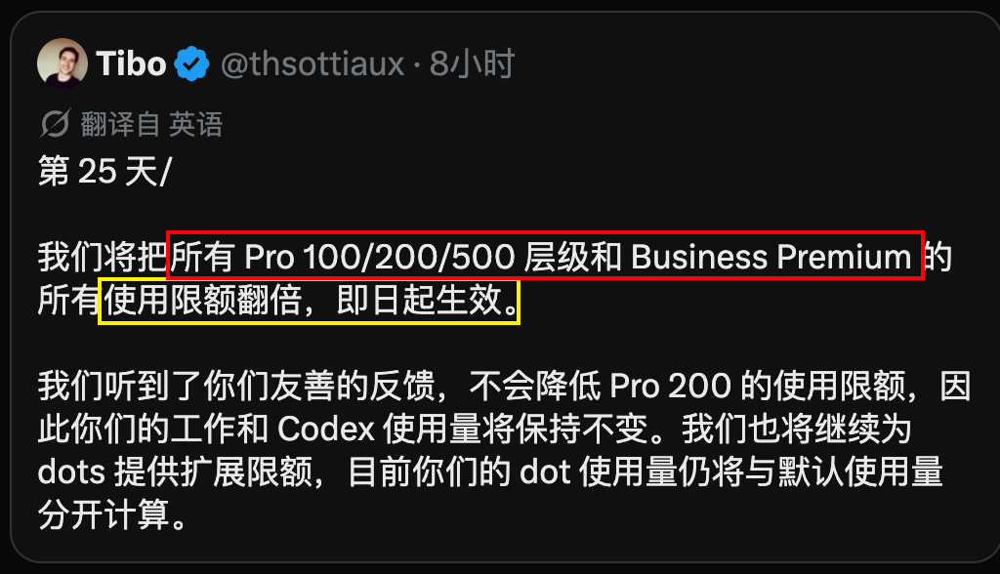

# 官宣：Pro 用户继续保留双倍 Codex 额度

2026年10月28日，Codex 在 X 上发了一条。

**Pro $100、$200、$500，以及 Business Premium，Work 和 Codex 额度翻倍，即刻生效。**

原定的降额，取消。

{#screenshot}

按照之前的倍数关系，Pro 各档相对 Plus 的额度大概是：

Plus 1x，Pro 100 是 5x，Pro 200 是 10x，Pro 500 是 25x。

但 OpenAI 之前一直在搞阶段性优惠，Pro 100 实际能到 10x 左右，Pro 200 能到 20x。

9 月底说优惠要结束，Pro 200 老用户从 20x 掉回 10x。

现在呢？

不降了，还翻倍。

调整之后，Pro 100 从 5x 变成 10x，Pro 200 从 10x 变成 20x，Pro 500 从 25x 变成 50x。

老用户本来就在 20x 的，保留。新用户本来要掉到 10x 的，直接拉到 20x。

价格没变，资源翻倍。

## 三档 Pro 怎么比较

原文以 Plus 额度为基准，整理如下：

| 套餐 | 月费（美元） | Codex 额度 | Ultrafast |
| --- | --- | --- | --- |
| Pro 100 | 100 | 10x Plus | 不含 |
| Pro 200 | 200 |   20x Plus  | 不含 |
| Pro 500 | 500 | 50x Plus | 包含 |

倍数按原文整理，实际额度以账号后台显示为准。

套餐功能可查看 [ChatGPT 官方定价页](https://chatgpt.com/pricing/)。

   ## Fast 和 Ultrafast 怎么消耗额度

相对同一模型的 Standard 模式：

- **Fast**：按 2.5 倍速率消耗套餐额度。
- **Ultrafast**：按 8 倍速率消耗套餐额度。

这里说的是额度消耗，不能理解成对应倍数的运行速度。

Ultrafast 消耗更快，选模式时要留意剩余额度。

 ::: info 说明
资格窗口和保留政策以 OpenAI 官方帮助中心为依据，额度倍数按原文整理。具体用量以账号后台实际显示为准。
:::
