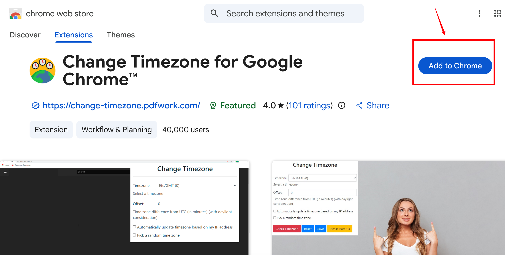
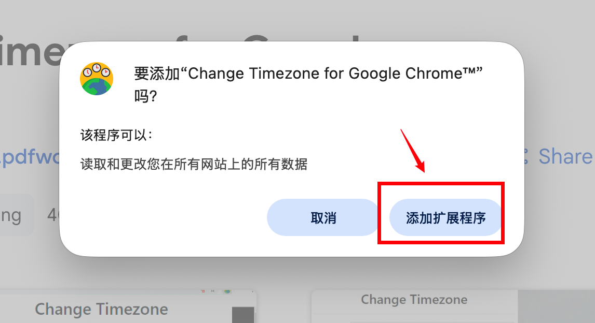
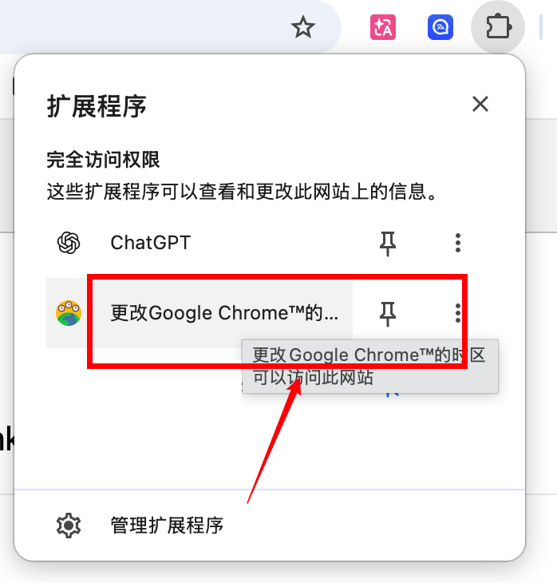
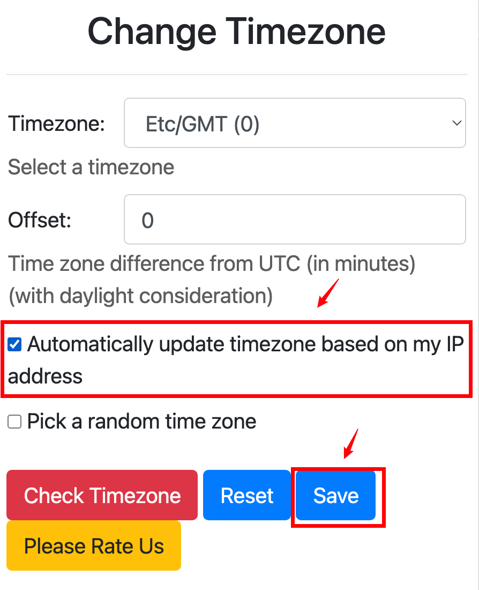

# 17 Gemini找不到模型怎么办

Codex 报 `Model not found`（找不到模型）时，可尝试检查浏览器时区。

有用户反馈：浏览器时区与代理出口 IP 所在地时区不一致时，可能遇到此报错。

可尝试用 Chrome 时区插件将两者调为一致。

## 操作步骤

### 1. 打开插件安装地址

[Change Timezone for Google Chrome™](https://chromewebstore.google.com/detail/change-timezone-for-googl/cejckpjfigehbeecbbfhangbknpidcnh?pli=1)

### 2. 点击 Add to Chrome

在插件页面点击 **Add to Chrome**。

{#screenshot}

### 3. 确认添加扩展程序

在弹出的窗口中点击 **添加扩展程序**。

{#screenshot}

### 4. 打开时区插件

点击浏览器右上角的扩展程序图标，在列表中打开 **Change Timezone**。

{#screenshot}

### 5. 开启自动更新时区

勾选 **Automatically update timezone based on my IP address**（根据 IP 地址自动更新时区），点击 **Save** 保存。

{#screenshot}

### 6. 重新登录

最后一步，退出Codex 桌面端 并重新登录 Codex，部分同学已经测试搞定！
